# ASP.NET Core and C# — Interview Preparation

Prepared for senior developers, technical leads, and .NET architect interviews.

> The TCS labels and repetition counts were supplied in the question list; this guide does not independently verify company interview reports. Examples are educational snippets, not a complete application. Modern examples use C# 12 or later and ASP.NET Core controller APIs; EF Core examples require Microsoft.EntityFrameworkCore and an application-specific DbContext. A static site must enable Mermaid to render the diagrams.

## Contents

1. [Optimize a slow Web API](#1-how-do-you-optimize-a-slow-aspnet-core-web-api)
2. [Custom middleware](#2-how-do-you-implement-custom-middleware)
3. [Singleton dependency injection](#3-explain-singleton-lifetime-with-a-real-world-example)
4. [SOLID principles](#4-explain-solid-principles-with-practical-examples)
5. [Hashtable versus Dictionary](#5-what-is-the-difference-between-hashtable-and-dictionary)
6. [First and Single methods](#6-first-firstordefault-single-and-singleordefault)
7. [Pagination](#7-how-do-you-implement-pagination-in-aspnet-core)
8. [MVC filters](#8-explain-mvc-filters-and-their-execution)
9. [Action return types](#9-iactionresult-versus-actionresult-and-actionresultt)
10. [Async and await](#10-how-do-async-and-await-work)
11. [String conversion](#11-converttostring-versus-tostring)
12. [Primary constructors](#12-explain-primary-constructors-in-modern-c)

## 1. How do you optimize a slow ASP.NET Core Web API?

### Interview answer

“I measure latency and throughput under representative load, trace the request to find the bottleneck, and optimize the most expensive operation. Typical causes are slow database queries, blocking I/O, repeated remote calls, excessive allocations, and large responses. I compare p95 and p99 latency, error rates, and resource usage before and after the change.”

### A practical investigation

1. **Define the symptom:** Which endpoint is slow? Is the problem constant, load-dependent, or limited to cold starts? Compare server latency with client latency.
2. **Establish a baseline:** Record request volume, p50/p95/p99 latency, failures, CPU, memory, GC pauses, thread-pool queueing, and connection-pool waits.
3. **Trace dependencies:** Use OpenTelemetry with a trace backend such as Application Insights. Separate database time, HTTP calls, application processing, and serialization.
4. **Fix the measured cause:** Use query plans and indexes for database problems; async I/O for blocking; bounded concurrency and timeouts for dependency pressure; caching for repeatable expensive reads.
5. **Retest:** Use realistic data sizes, concurrency, and cache hit rates. Check correctness and resource cost as well as speed.

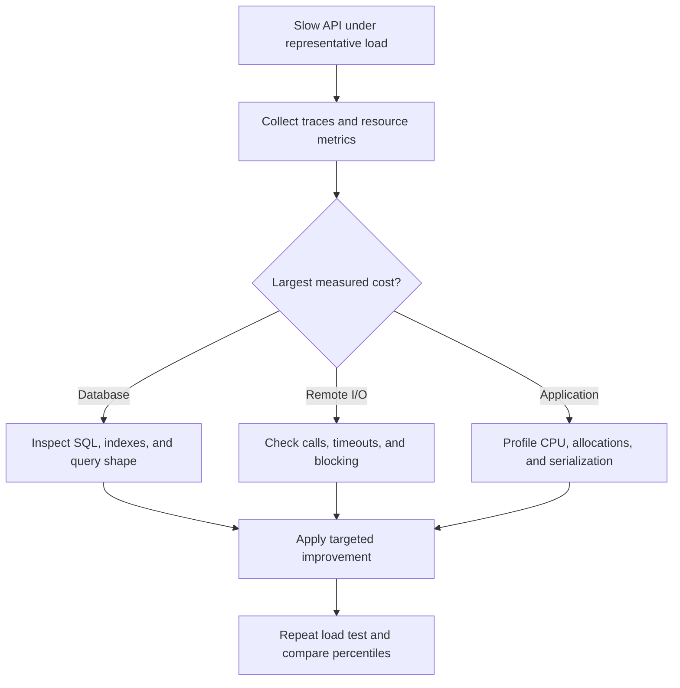

### Database improvements

Filter, project, and paginate in SQL before materializing results. Avoid loading complete entity graphs when a small response is sufficient. Inspect N+1 queries, unnecessary joins, missing indexes, and expensive counts. Use `AsNoTracking()` for read-only entity queries; a projection containing only scalar DTO values generally has no entity tracking to remove.

```csharp
public sealed record ProductDto(int Id, string Name, decimal Price);

// db is an injected application DbContext; ct is a CancellationToken.
var products = await db.Products
    .AsNoTracking()
    .Where(p => p.IsActive)
    .OrderBy(p => p.Id)
    .Select(p => new ProductDto(p.Id, p.Name, p.Price))
    .Take(50)
    .ToListAsync(ct);
```

Add indexes based on actual predicates and ordering; every extra index also increases write cost. Check generated SQL and the execution plan instead of assuming a LINQ query is efficient.

### Application and infrastructure improvements

| Finding | Possible improvement | Tradeoff to explain |
| --- | --- | --- |
| Threads blocked by `.Result` or `.Wait()` | Await real asynchronous I/O end to end | Improves concurrency; does not make the database query itself faster |
| Repeated reference-data reads | Memory or distributed cache | Requires expiration, invalidation, and tenant-aware keys |
| Large JSON response | DTO projection, pagination, selective compression | Compression consumes CPU; evaluate sensitive responses carefully |
| Repeated independent HTTP calls | Reuse connections with IHttpClientFactory; bounded concurrency | Dependencies still have rate and capacity limits |
| CPU-heavy transformation | Improve algorithm; move long jobs to workers | Queueing changes response semantics |
| Capacity saturation after optimization | Scale out or increase suitable resources | A shared database can remain the bottleneck |

Output caching must respect authentication, authorization, tenant boundaries, and variation keys. In-memory caches are local to one application instance; distributed caches can share entries between instances. Cache stampede protection prevents many requests rebuilding an expired entry simultaneously.

### Interview tips and follow-ups

- Lead with measurement, not “add Redis” or “use microservices.”
- Do not wrap synchronous database calls in `Task.Run` to claim asynchronous scalability.
- Distinguish cold-start latency, steady-state latency, and throughput.
- Explain connection pooling and query optimization before suggesting more servers.
- If using a real project example, report only measurements you actually collected. A useful answer structure is symptom → trace evidence → change → measured result.

Reference: [ASP.NET Core best practices](https://learn.microsoft.com/en-us/aspnet/core/fundamentals/best-practices).

## 2. How do you implement custom middleware?

### Interview answer

“Middleware is a component in the HTTP request pipeline. It can inspect or modify a request, call the next delegate, execute work while the response unwinds, or short-circuit the pipeline. I create a class with a RequestDelegate constructor dependency and an InvokeAsync method, then register it using UseMiddleware.”

### Example: request timing middleware

```csharp
using System.Diagnostics;

public sealed class RequestTimingMiddleware
{
    private readonly RequestDelegate _next;
    private readonly ILogger<RequestTimingMiddleware> _logger;

    public RequestTimingMiddleware(
        RequestDelegate next,
        ILogger<RequestTimingMiddleware> logger)
    {
        _next = next;
        _logger = logger;
    }

    public async Task InvokeAsync(HttpContext context)
    {
        var started = Stopwatch.GetTimestamp();
        try
        {
            await _next(context);
        }
        finally
        {
            _logger.LogInformation(
                "Request {Method} {Path} took {ElapsedMs} ms; TraceId {TraceId}",
                context.Request.Method,
                context.Request.Path,
                Stopwatch.GetElapsedTime(started).TotalMilliseconds,
                context.TraceIdentifier);
        }
    }
}
```

Registration in `Program.cs`, after registering controllers and authentication services appropriate to the application:

```csharp
var app = builder.Build();

app.UseExceptionHandler("/error"); // Requires an application error endpoint.
app.UseMiddleware<RequestTimingMiddleware>();
app.UseHttpsRedirection();
app.UseRouting();
app.UseAuthentication();
app.UseAuthorization();
app.MapControllers();
app.Run();
```

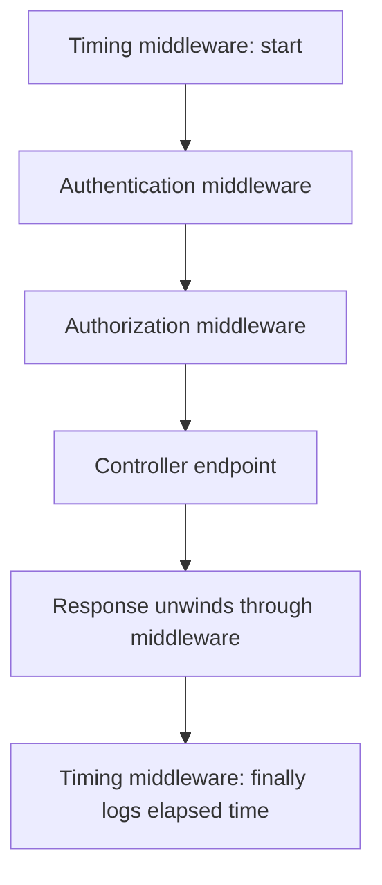

Order controls behavior. Exception handling belongs early so it can catch downstream exceptions. Authentication establishes identity before authorization evaluates access. Components requiring endpoint metadata should run after routing. A response may already have started when downstream middleware returns; use `Response.OnStarting` for headers that must be written immediately before headers are sent.

### Short-circuiting

```csharp
app.Use(async (context, next) =>
{
    if (context.Request.Path.StartsWithSegments("/maintenance"))
    {
        context.Response.StatusCode = StatusCodes.Status503ServiceUnavailable;
        await context.Response.WriteAsync("Temporarily unavailable.");
        return; // No call to next: downstream processing stops.
    }

    await next(context);
});
```

### Lifetime and dependency injection

Conventional middleware instances are created at application startup and reused. Do not store request-specific state in instance fields. Inject scoped dependencies, such as an application DbContext, into `InvokeAsync`, rather than its constructor. Alternatively, implement `IMiddleware` and register the class as scoped or transient for factory-based per-request activation.

### Interview tips

- `Use` can continue the pipeline; `Run` registers a terminal request delegate; path-based `Map` creates a branch.
- Code before `await _next(context)` executes on the request path; code afterward executes during unwinding if control returns normally. Use `finally` for cleanup when exceptions occur.
- Middleware covers HTTP requests broadly; MVC filters operate within MVC action processing.
- Avoid logging sensitive headers, tokens, or request bodies indiscriminately.

Reference: [ASP.NET Core middleware](https://learn.microsoft.com/en-us/aspnet/core/fundamentals/middleware/).

## 3. Explain Singleton lifetime with a real-world example

### Interview answer

“A singleton registration reuses one instance for resolutions from a service provider. It is useful for shared, thread-safe services such as immutable lookup catalogs or stateless helpers. Because concurrent requests access the same instance, I avoid mutable request state and scoped dependencies.”

### Lifetime comparison

| Lifetime | Instance reuse | Typical use |
| --- | --- | --- |
| Transient | New instance each time the registration is resolved | Lightweight services without shared state |
| Scoped | One instance per scope; normally one scope per HTTP request | EF Core DbContext and request-oriented business services |
| Singleton | One shared instance per service provider | Immutable catalogs and thread-safe shared infrastructure |

“Singleton” does not mean one object across every server, process, or manually created service provider. Two application instances each have their own singleton.

### Example: immutable supported-currency catalog

```csharp
using System.Collections.Frozen;

public interface ICurrencyCatalog
{
    bool IsSupported(string code);
}

public sealed class CurrencyCatalog : ICurrencyCatalog
{
    private readonly FrozenSet<string> _codes =
        new[] { "INR", "USD", "EUR" }
            .ToFrozenSet(StringComparer.OrdinalIgnoreCase);

    public bool IsSupported(string code) => _codes.Contains(code);
}

// Program.cs
builder.Services.AddSingleton<ICurrencyCatalog, CurrencyCatalog>();
```

The catalog is immutable after construction, so many requests can safely read it without locking. A singleton is normally instantiated when first resolved unless an already-created instance is registered or startup code resolves it earlier. Container-created singleton disposables are disposed when the container shuts down.

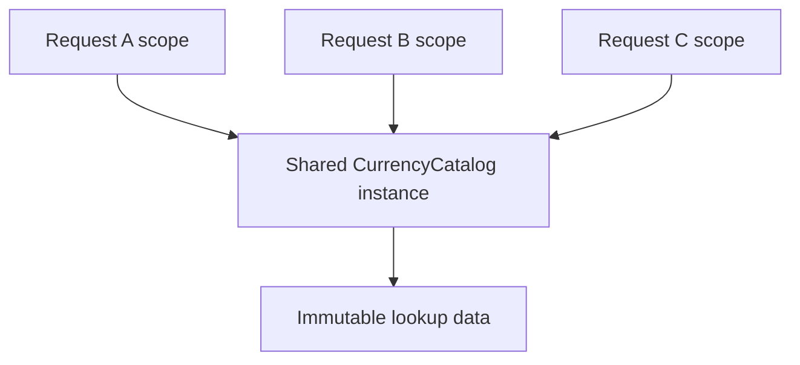

### Common production mistakes

- **Captive dependency:** A singleton constructor takes a scoped DbContext. That context is retained beyond its intended scope and is unsafe for concurrent requests.
- **User leakage:** A singleton stores the current user's ID in a field. Another request can overwrite or read it.
- **Unbounded memory:** A singleton dictionary grows forever without eviction.
- **Assumed global coordination:** An in-process singleton is used to coordinate jobs across several servers.

A background singleton may explicitly create a short-lived scope with `IServiceScopeFactory`, resolve scoped services inside it, await the work, and dispose the scope. Do not return those scoped objects for use after disposal. For request-bound work, prefer keeping the service scoped.

### Interview tips

- Thread-safe construction does not make instance methods thread-safe.
- A singleton consuming a transient effectively retains that particular transient instance; consider its lifetime, thread safety, and disposal.
- Prefer DI-managed lifetime to a global static singleton because dependencies and substitution are clearer.

Reference: [Dependency injection guidelines](https://learn.microsoft.com/en-us/dotnet/core/extensions/dependency-injection-guidelines).

## 4. Explain SOLID principles with practical examples

### Interview answer

“SOLID helps keep responsibilities focused and dependencies replaceable. I use SRP to separate reasons for change, OCP to add behavior through extension points, LSP to preserve contracts, ISP to keep interfaces relevant, and DIP to keep business policy independent of infrastructure.”

| Principle | Meaning | Practical example |
| --- | --- | --- |
| S — Single Responsibility | A module has one coherent reason to change | Separate invoice calculation, persistence, and email delivery |
| O — Open/Closed | Extend behavior without repeatedly rewriting stable policy | Add a discount strategy implementing an existing interface |
| L — Liskov Substitution | Subtypes preserve the behavioral contract expected by callers | Every payment implementation honors the documented refund contract |
| I — Interface Segregation | Clients depend only on operations they need | Separate document reading from document approval |
| D — Dependency Inversion | High-level policy and details depend on abstractions | Checkout depends on a payment contract rather than a concrete vendor SDK |

### S: separate reasons for change

An `InvoiceService` that calculates taxes, executes SQL, builds a PDF, and sends SMTP messages changes for unrelated reasons. Separate those capabilities and let a workflow service coordinate them. SRP does not mean every class must have exactly one method.

```csharp
public sealed record Invoice(decimal Subtotal, decimal Tax);

public sealed class InvoiceCalculator
{
    public Invoice Calculate(decimal subtotal, decimal taxRate)
        => new(subtotal, subtotal * taxRate);
}

public interface IInvoiceRepository
{
    Task SaveAsync(Invoice invoice, CancellationToken ct);
}

public interface IInvoiceSender
{
    Task SendAsync(Invoice invoice, CancellationToken ct);
}
```

### O: extend discount behavior

```csharp
public interface IDiscountPolicy
{
    decimal Apply(decimal subtotal);
}

public sealed class RegularDiscount : IDiscountPolicy
{
    public decimal Apply(decimal subtotal) => subtotal;
}

public sealed class PremiumDiscount : IDiscountPolicy
{
    public decimal Apply(decimal subtotal) => subtotal * 0.90m;
}

public sealed class PriceCalculator(IDiscountPolicy discount)
{
    public decimal Calculate(decimal subtotal) => discount.Apply(subtotal);
}
```

A new policy implements the contract without adding another customer-type branch inside `PriceCalculator`. Wiring or selection may still change. OCP does not prohibit modifying code; it guides where stable extension points are valuable.

### L: preserve behavioral promises

Suppose `IRefundablePayment.RefundAsync` promises to refund a valid captured payment or return a documented business failure. An implementation that always throws `NotSupportedException` violates callers' expectations. A nonrefundable provider should implement a narrower payment contract rather than claim refund capability. Substitutability includes preconditions, postconditions, invariants, and exception behavior—not merely matching method signatures.

### I: split broad interfaces

```csharp
public interface IDocumentReader
{
    Task<string> ReadAsync(Guid documentId, CancellationToken ct);
}

public interface IDocumentApprover
{
    Task ApproveAsync(Guid documentId, CancellationToken ct);
}
```

A document preview component needs only `IDocumentReader`. It should not depend on approval or deletion operations that it never uses. Split by meaningful client capability rather than mechanically creating one-method interfaces.

### D: depend on a business-facing contract

```csharp
public interface IPaymentGateway
{
    Task<string> ChargeAsync(decimal amount, CancellationToken ct);
}

public sealed class CheckoutService(IPaymentGateway gateway)
{
    public Task<string> CheckoutAsync(decimal amount, CancellationToken ct)
        => gateway.ChargeAsync(amount, ct);
}
```

Place the contract with the application policy; infrastructure implements it. DI is a technique for supplying the implementation. Dependency inversion is the architectural direction of dependency, so using a DI container alone does not prove DIP.

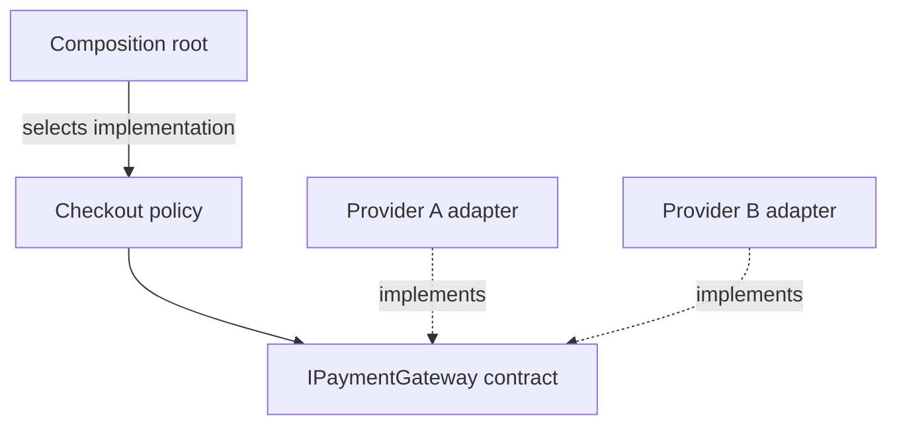

### Interview tips

- Give one concrete before-and-after example instead of only expanding the acronym.
- LSP concerns behavior; ISP concerns how interfaces fit clients.
- Avoid speculative abstractions for every class. Apply SOLID where change, coupling, or testing difficulty justifies it.
- In a protocol-authoring application, separate generation, source retrieval, persistence, and approval policy; infrastructure-specific AI and storage adapters implement application-facing contracts.

## 5. What is the difference between Hashtable and Dictionary?

### Interview answer

“Hashtable is a legacy nongeneric key/value collection using object keys and values. Dictionary<TKey,TValue> is generic, providing compile-time type checking and avoiding boxing for value-type keys and values stored as their concrete types. I normally choose Dictionary for new code.”

| Aspect | Hashtable | Dictionary<TKey,TValue> |
| --- | --- | --- |
| Namespace | System.Collections | System.Collections.Generic |
| Type contract | object keys and values | Explicit key and value types |
| Retrieval | Casting commonly required | Typed value returned |
| Value types | Boxing on storage; unboxing on typed retrieval | No boxing for concrete generic value types |
| Missing indexer key | Returns null | Throws KeyNotFoundException |
| Safe lookup | ContainsKey followed by lookup, with concurrency caveats | TryGetValue |
| Null keys | Not allowed | Not allowed |
| Null values | Allowed | Allowed for reference or nullable value types |
| Concurrent mutation | Requires appropriate synchronization | Requires synchronization; consider ConcurrentDictionary |
| Ordering contract | Do not rely on enumeration order | Do not use as an ordering contract |

Both are hash-based collections with average lookup near O(1); poor hash distribution can degrade performance. Dictionary is generally a better default, but actual performance depends on workload and comparers.

```csharp
using System.Collections;

var legacy = new Hashtable();
legacy["attempts"] = 3;             // int boxed as object
int attempts = (int)legacy["attempts"]!;
object? missing = legacy["unknown"]; // null

var modern = new Dictionary<string, int>(StringComparer.OrdinalIgnoreCase)
{
    ["attempts"] = 3
};

if (modern.TryGetValue("ATTEMPTS", out int count))
{
    Console.WriteLine(count);      // 3
}
```

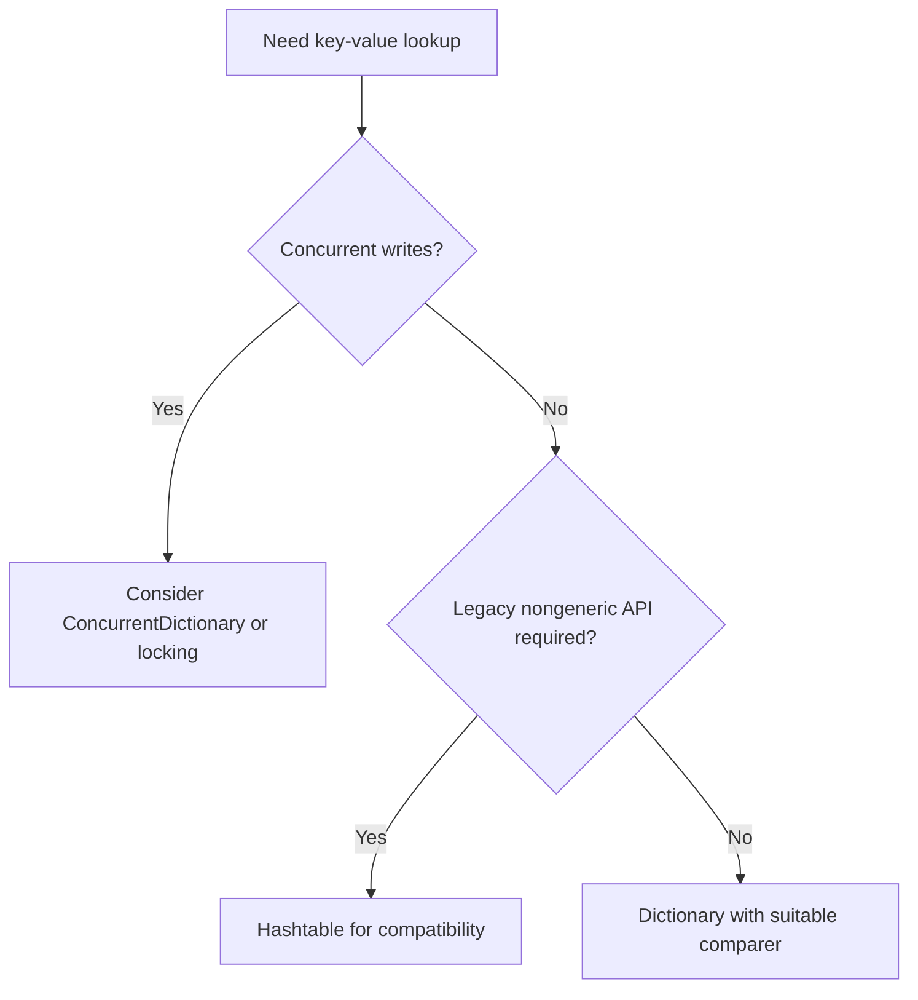

### Interview tips

- `dictionary[key] = value` inserts or replaces; `Add` throws for a duplicate key.
- Equality and hash codes must agree. Avoid mutating key data that participates in equality while the key is stored.
- Generic collections can still box if the chosen generic type is `object` and you insert a value type.
- A regular Dictionary can support concurrent readers when no writes occur; it does not provide safe concurrent mutation.

References: [Hashtable](https://learn.microsoft.com/en-us/dotnet/api/system.collections.hashtable), [Dictionary](https://learn.microsoft.com/en-us/dotnet/api/system.collections.generic.dictionary-2).

## 6. First(), FirstOrDefault(), Single(), and SingleOrDefault()

### Interview answer

“First expresses that I want the first matching item. Single expresses that at most or exactly one matching item is valid. OrDefault changes the behavior when there are no matches; it does not suppress the duplicate-match exception from SingleOrDefault.”

| Method | Zero matches | One match | Multiple matches |
| --- | --- | --- | --- |
| First | InvalidOperationException | Returns match | Returns first |
| FirstOrDefault | default(T) | Returns match | Returns first |
| Single | InvalidOperationException | Returns match | InvalidOperationException |
| SingleOrDefault | default(T) | Returns match | InvalidOperationException |

These rules apply to the whole sequence without a predicate, or only matching elements with a predicate. A null source throws `ArgumentNullException`; `OrDefault` does not make a null collection safe.

```csharp
int[] numbers = { 8, 3, 12, 7, 2, 5 };

int a = numbers.First();                      // 8
int b = numbers.First(n => n > 6);            // 8
int c = numbers.FirstOrDefault(n => n > 20);  // 0
int d = numbers.Single(n => n == 12);         // 12
int e = numbers.SingleOrDefault(n => n > 20); // 0
// numbers.Single(n => n > 6);                // Throws: 8, 12, 7
// numbers.SingleOrDefault(n => n > 6);       // Also throws

int? missing = numbers
    .Where(n => n > 20)
    .Select(n => (int?)n)
    .SingleOrDefault();                       // null, not 0
```

### Real-world choices

- **Latest order:** `OrderByDescending(o => o.CreatedAt).ThenByDescending(o => o.Id).FirstOrDefaultAsync(ct)`.
- **Optional user by unique email:** `SingleOrDefaultAsync(u => u.Email == email, ct)`, backed by a database unique constraint.
- **Exactly one mandatory configuration record:** `SingleAsync(ct)` can expose invalid cardinality.

`Single` checks the returned sequence's cardinality; it does not prevent concurrent inserts. Enforce uniqueness in the database. A first row without explicit database ordering is not a reliable “latest” or “oldest” row.

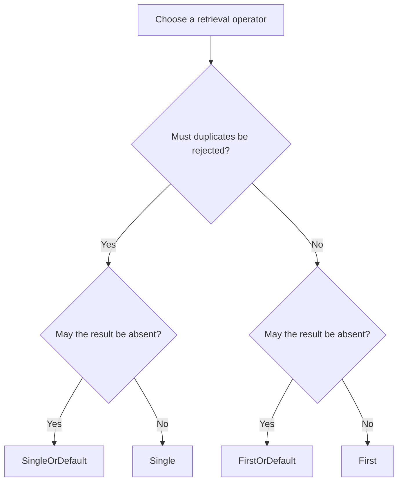

### Interview tips

- `default(int)` is 0; `default(bool)` is false; `default(string)` is null.
- LINQ-to-Objects First stops when it finds a match. Single must establish that another match does not exist; exact work depends on the source and overload.
- EF Core providers often fetch up to two rows for Single to detect duplicates; inspect generated SQL rather than assuming every provider behaves identically.
- Choose semantics before micro-optimizing. First can conceal a data-integrity problem when uniqueness is expected.

Reference: [Enumerable.Single](https://learn.microsoft.com/en-us/dotnet/api/system.linq.enumerable.single) and related Enumerable APIs.

## 7. How do you implement pagination in ASP.NET Core?

### Interview answer

“I validate the page parameters, apply authorization and filters, use deterministic ordering, and execute Skip/Take in the database. For large sequential browsing, I prefer keyset pagination with an indexed cursor because large offsets become expensive.”

### Offset pagination example

Assume a `ProductsController` has an injected application DbContext named `db`.

```csharp
public sealed record ProductDto(int Id, string Name, decimal Price);
public sealed record PageResult<T>(
    IReadOnlyList<T> Items, int Page, int PageSize, int TotalCount);

[HttpGet]
public async Task<ActionResult<PageResult<ProductDto>>> GetProducts(
    [FromQuery] int page = 1,
    [FromQuery] int pageSize = 20,
    CancellationToken ct = default)
{
    if (page < 1 || pageSize < 1 || pageSize > 100)
        return BadRequest("Page must be positive; pageSize must be 1 to 100.");

    long offset = ((long)page - 1) * pageSize;
    if (offset > int.MaxValue)
        return BadRequest("Offset too large; use cursor pagination.");

    var query = db.Products.AsNoTracking().Where(p => p.IsActive);
    // Apply tenant/authorization restrictions here, before count and paging.
    int total = await query.CountAsync(ct);

    var items = await query
        .OrderBy(p => p.Id)
        .Skip((int)offset)
        .Take(pageSize)
        .Select(p => new ProductDto(p.Id, p.Name, p.Price))
        .ToListAsync(ct);

    return Ok(new PageResult<ProductDto>(items, page, pageSize, total));
}
```

Example request: `GET /api/products?page=2&pageSize=20`.

Keep the query as `IQueryable` until execution; `ToList()` before Skip/Take loads unnecessary rows. Count and page queries are separate database operations and can observe different data during concurrent changes. If exact snapshot consistency is required, select appropriate database transaction semantics and evaluate the cost. Do not run these operations concurrently on the same DbContext.

### Keyset pagination example

```csharp
// Validated: pageSize is 1..100; lastId is the previous cursor value.
var rows = await db.Products
    .AsNoTracking()
    .Where(p => p.IsActive && p.Id > lastId)
    .OrderBy(p => p.Id)
    .Select(p => new ProductDto(p.Id, p.Name, p.Price))
    .Take(pageSize + 1)
    .ToListAsync(ct);

bool hasMore = rows.Count > pageSize;
var items = rows.Take(pageSize).ToList();
int? nextCursor = hasMore ? items[^1].Id : null;
```

For date ordering, use a unique tie-breaker: `CreatedAt > lastDate || (CreatedAt == lastDate && Id > lastId)` and `OrderBy(CreatedAt).ThenBy(Id)`. Create a suitable composite index. A production cursor can encode the ordering values and filter context; validate it and still enforce authorization independently. A cursor is not a permission token.

| Method | Strength | Limitation |
| --- | --- | --- |
| Offset | Easy numbered pages and random jumps | Large offsets cost more; inserts/deletes can shift results |
| Keyset | Efficient next/previous navigation with suitable index | Arbitrary page jumps are harder; mutable sort keys can still move rows |

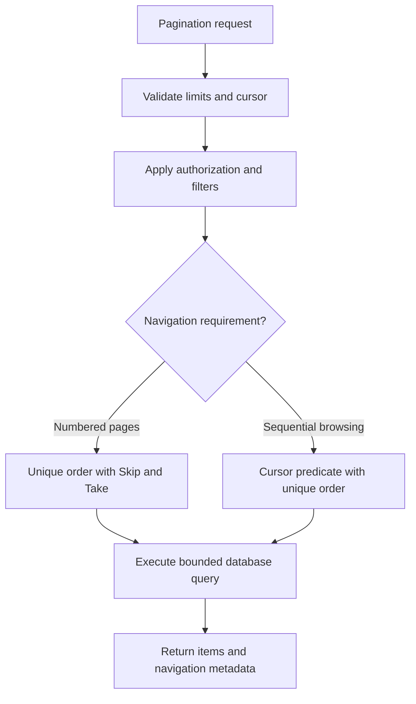

### Interview tips

- Order must be fully unique; sorting only by a nonunique date is insufficient.
- Total counts can be expensive; return `hasMore` when exact totals are unnecessary.
- Pagination reduces payload and materialization work; indexes determine whether locating rows is efficient.

Reference: [EF Core pagination](https://learn.microsoft.com/en-us/ef/core/querying/pagination).

## 8. Explain MVC filters and their execution

### Interview answer

“MVC filters run inside the selected controller action's invocation pipeline. Authorization filters run first, resource filters wrap most MVC processing, action filters wrap the action after model binding, and result filters wrap result execution. Exception filters handle eligible unhandled MVC exceptions; they are not an unconditional step in the success path.”

### Normal successful execution

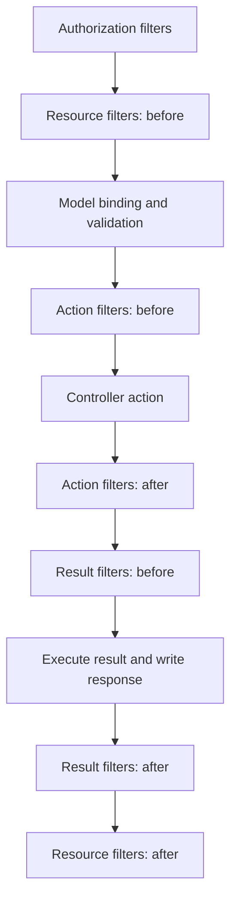

| Filter type | Main purpose | Important boundary |
| --- | --- | --- |
| Authorization | Access decisions at the start of MVC | Prefer built-in policy authorization over custom authorization filters |
| Resource | Work around most MVC execution | Before callback runs before model binding |
| Action | Inspect arguments, run logic around action, inspect returned result | After model binding; does not wrap response serialization |
| Exception | Handle eligible unhandled exceptions | Not errors in resource filters, result filters, or result execution |
| Result | Logic around action-result execution | Ordinary result filters are skipped on some short-circuit and exception paths |

Exception filters can handle unhandled exceptions from controller creation, model binding, action filters, and actions. Use exception-handling middleware for a broader HTTP boundary. Once a response is partially written, producing a clean replacement error response may be impossible.

`IAlwaysRunResultFilter` and its async equivalent cover additional result paths, such as results produced by authorization/resource short-circuiting or exception filters. They still cannot guarantee successful response completion in every failure scenario.

### Async action-filter example

```csharp
using System.Diagnostics;
using Microsoft.AspNetCore.Mvc.Filters;

public sealed class ActionTimingFilter(
    ILogger<ActionTimingFilter> logger) : IAsyncActionFilter
{
    public async Task OnActionExecutionAsync(
        ActionExecutingContext context,
        ActionExecutionDelegate next)
    {
        var started = Stopwatch.GetTimestamp();
        try
        {
            await next();
        }
        finally
        {
            logger.LogInformation("Action {Action} took {ElapsedMs} ms",
                context.ActionDescriptor.DisplayName,
                Stopwatch.GetElapsedTime(started).TotalMilliseconds);
        }
    }
}

// Program.cs: DI-backed global filter.
builder.Services.AddScoped<ActionTimingFilter>();
builder.Services.AddControllers(options =>
    options.Filters.AddService<ActionTimingFilter>());
```

This measures the inner action-filter/action region, not the entire HTTP request or result serialization. For an action-specific registration, use `[ServiceFilter(typeof(ActionTimingFilter))]` instead of global registration.

### Ordering and short-circuiting

For the same filter stage and default order, before callbacks generally nest global → controller → action; after callbacks unwind action → controller → global. `IOrderedFilter.Order` takes precedence over scope within ordering rules: lower values enter earlier and unwind later. Filter stage boundaries still matter.

Setting `ActionExecutingContext.Result` short-circuits action execution. In an async action filter, set the result and do not call `next`. With `[ApiController]`, built-in validation behavior can return HTTP 400 before the action body executes.

### Interview tips

- Do not put exception filters as a mandatory box after every successful action.
- Distinguish action completion from result execution and serialization.
- Minimal API endpoint filters are a separate feature from MVC action filters.
- Use filters when action metadata, model state, or action arguments are relevant; middleware when the concern spans general HTTP processing.

Reference: [Filters in ASP.NET Core](https://learn.microsoft.com/en-us/aspnet/core/mvc/controllers/filters).

## 9. IActionResult versus ActionResult and ActionResult<T>

### Interview answer

“IActionResult is the MVC result interface. ActionResult is an abstract base class implementing it. ActionResult<T> is a separate generic wrapper that allows an action to return either a typed success value or an ActionResult such as NotFound. For data-returning controller APIs, ActionResult<T> usually expresses the success contract most clearly.”

| Type | What it represents | Typical use |
| --- | --- | --- |
| IActionResult | Interface with result execution contract | Multiple HTTP outcomes without a typed success value in the signature |
| ActionResult | Abstract base implementing IActionResult | Base class for MVC results such as OkObjectResult and NotFoundResult |
| ActionResult<T> | Wrapper implementing IConvertToActionResult | Typed success response plus alternate ActionResult outcomes |
| T | Data-only return type | Straightforward success response when alternate outcomes are not needed |

The generic wrapper does **not** derive from non-generic `ActionResult`. It holds a value or an action result and converts to an executable action result.

```csharp
[HttpGet("untyped/{id:int}")]
public async Task<IActionResult> GetUntyped(int id, CancellationToken ct)
{
    var product = await db.Products.FindAsync(new object[] { id }, ct);
    if (product is null) return NotFound();
    return Ok(new ProductDto(product.Id, product.Name, product.Price));
}

[HttpGet("typed/{id:int}")]
[ProducesResponseType(StatusCodes.Status200OK)]
[ProducesResponseType(StatusCodes.Status404NotFound)]
public async Task<ActionResult<ProductDto>> GetTyped(
    int id, CancellationToken ct)
{
    var product = await db.Products.FindAsync(new object[] { id }, ct);
    if (product is null) return NotFound();
    return new ProductDto(product.Id, product.Name, product.Price);
}
```

`ActionResult<T>` supports API metadata inference for the successful body type. Explicitly document alternate status codes and error schemas. It does not automatically enforce that every runtime result matches the declared type; returning an arbitrary object inside `Ok(...)` can still undermine the contract.

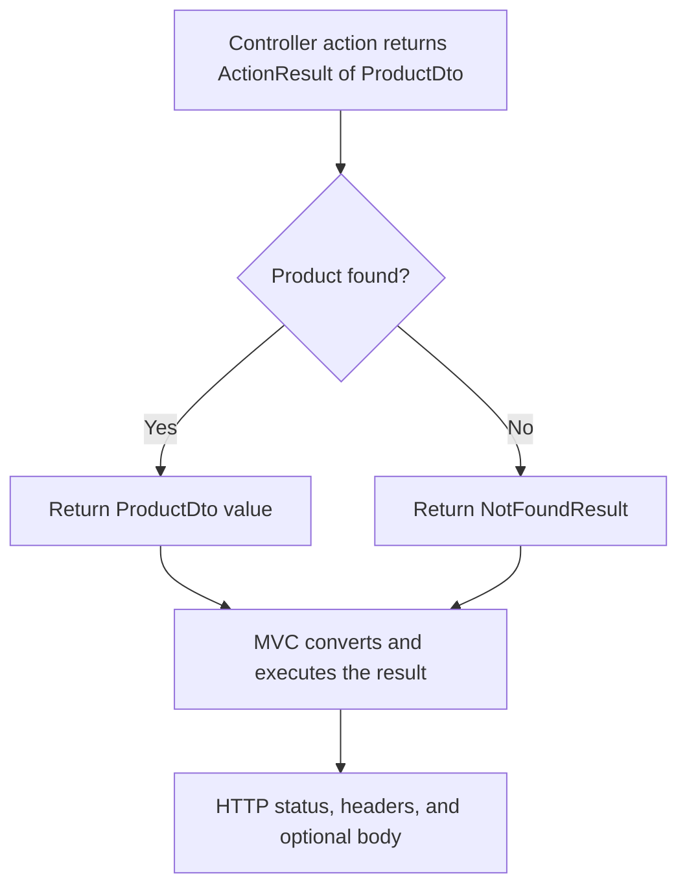

### Interview tips

- An interface can support custom implementations outside the ActionResult inheritance tree.
- Use `Task<ActionResult<T>>` for asynchronous typed controller actions.
- `IResult` and typed HTTP results are another result model, often used in Minimal APIs; do not confuse them with `IActionResult`.
- An interface-typed `T`, such as IEnumerable<ProductDto>, has implicit-conversion limitations; returning `Ok(items)` or a suitable concrete collection avoids that problem.

Reference: [Controller action return types](https://learn.microsoft.com/en-us/aspnet/core/web-api/action-return-types).

## 10. How do async and await work?

### Interview answer

“The compiler transforms an async method into a state machine. The method runs synchronously until it awaits an incomplete operation. It then yields control to its caller; after completion, a continuation resumes the method. For asynchronous I/O, a thread does not need to remain blocked while waiting, which improves server concurrency.”

`Task` represents completion, not necessarily a dedicated thread. `async` does not automatically start background work. An already-completed awaitable can continue synchronously, and execution after an await is not guaranteed to use the original thread.

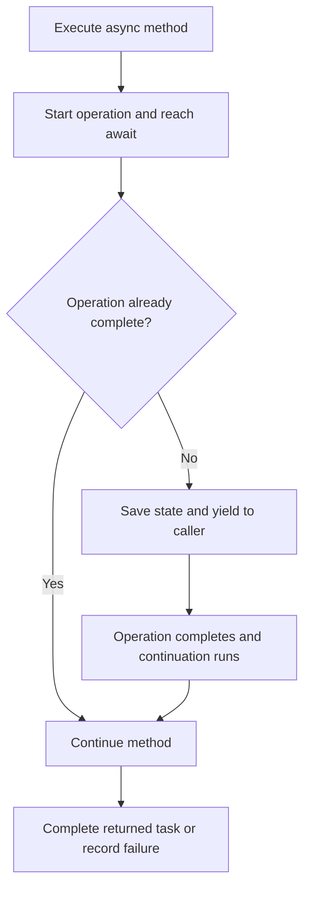

### Example: asynchronous external HTTP call

```csharp
using System.Net.Http.Json;

public sealed record PriceDto(int ProductId, decimal Amount);

public sealed class PriceClient(HttpClient client)
{
    public async Task<PriceDto?> GetAsync(int productId, CancellationToken ct)
    {
        using var response = await client.GetAsync(
            $"prices/{productId}", ct);
        response.EnsureSuccessStatusCode();
        return await response.Content.ReadFromJsonAsync<PriceDto>(
            cancellationToken: ct);
    }
}

// Configure an actual trusted base URL from application configuration.
builder.Services.AddHttpClient<PriceClient>(client =>
    client.BaseAddress = new Uri(builder.Configuration["Pricing:BaseUrl"]!));
```

### When to use it

| Workload | Approach | Why |
| --- | --- | --- |
| Database, HTTP, blob, or file I/O with async APIs | Await native asynchronous methods | Avoid blocking threads during waits |
| Independent I/O requests | Start tasks and await Task.WhenAll with bounded concurrency | Overlap waits without overwhelming dependencies |
| Short CPU computation | Execute directly | Scheduling overhead may exceed benefit |
| Long CPU-heavy server work | Optimize or move to a worker/job service | Task.Run still consumes process thread-pool capacity |
| Desktop UI CPU work | Task.Run may keep UI responsive | A different goal from server scalability |

### Concurrency example

```csharp
// These independent HTTP operations can safely overlap.
Task<string> catalogTask = httpClient.GetStringAsync("catalog", ct);
Task<string> stockTask = httpClient.GetStringAsync("stock", ct);
await Task.WhenAll(catalogTask, stockTask);
string catalog = await catalogTask;
string stock = await stockTask;
```

This small example starts two tasks; a large input needs concurrency limits. Do not overlap EF Core operations on the same DbContext—it is not thread-safe.

### Errors, cancellation, and common traps

- Awaiting a faulted task propagates an exception to the caller; use normal `try/catch` around awaited work.
- Pass cancellation tokens through the call chain. Cancellation is cooperative, not a forceful thread termination.
- Prefer `Task` or `Task<T>` over `async void`, except for event-handler signatures that require void.
- Avoid `.Result` and `.Wait()`: they block threads and can cause deadlocks in contexts with thread-affine synchronization. ASP.NET Core normally has no custom SynchronizationContext, but blocking can still cause thread-pool starvation.
- `ConfigureAwait(false)` is often useful in reusable libraries; it is not usually necessary throughout ASP.NET Core application code and does not create parallelism.
- Do not start unobserved fire-and-forget work using request-scoped services; use a queue and hosted worker with explicit scopes.

### Interview tips

Say “improves scalability during I/O waits,” not “async always makes a request faster.” Distinguish concurrency, parallel execution, and asynchronous completion. Explain that a task can represent I/O with no dedicated waiting worker thread.

Reference: [Asynchronous programming with async and await](https://learn.microsoft.com/en-us/dotnet/csharp/asynchronous-programming/).

## 11. Convert.ToString() versus ToString()

### Interview answer

“ToString is an instance method producing an object's textual representation; calling it through a null reference throws. Convert.ToString has multiple overloads. Its object overload returns an empty string for a null object, but its string overload returns the supplied string, including null. Therefore, overload resolution matters.”

### Important null distinction

```csharp
object? objectValue = null;
string? stringValue = null;

string? a = Convert.ToString(objectValue); // "": object overload
string? b = Convert.ToString(stringValue); // null: string overload
string? c = objectValue?.ToString();       // null: no instance call occurs
string d = objectValue?.ToString() ?? "";  // Explicit empty-string fallback

// objectValue!.ToString();               // NullReferenceException
// ! suppresses a nullable warning; it does not prevent a runtime exception.
```

| Expression | Null handling | Notes |
| --- | --- | --- |
| value.ToString() | Throws for a null reference receiver | Virtual method; a type can override its representation |
| Convert.ToString((object?)null) | Empty string | Object overload |
| Convert.ToString((string?)null) | Null | String overload returns the input |
| value?.ToString() | Null | Null-conditional access skips the call |
| value?.ToString() ?? "N/A" | Explicit fallback | Makes missing-value semantics visible |

For a nonnull object, Convert's object overload can use conversion/formatting interfaces and ultimately a textual representation. It does not generically serialize an object's properties to JSON. `Nullable<T>.ToString()` is also special: a nullable value type without a value returns an empty string; do not treat it as a null reference receiver.

### Culture and formatting

```csharp
using System.Globalization;

decimal amount = 1234.50m;
string machineValue = amount.ToString(CultureInfo.InvariantCulture);
string displayValue = amount.ToString("N2", CultureInfo.GetCultureInfo("en-IN"));
string? converted = Convert.ToString(amount, CultureInfo.InvariantCulture);
```

Use an explicit culture for machine-readable text and the intended user culture for display. Use typed JSON serializers for API payloads rather than manually converting every value to a string.

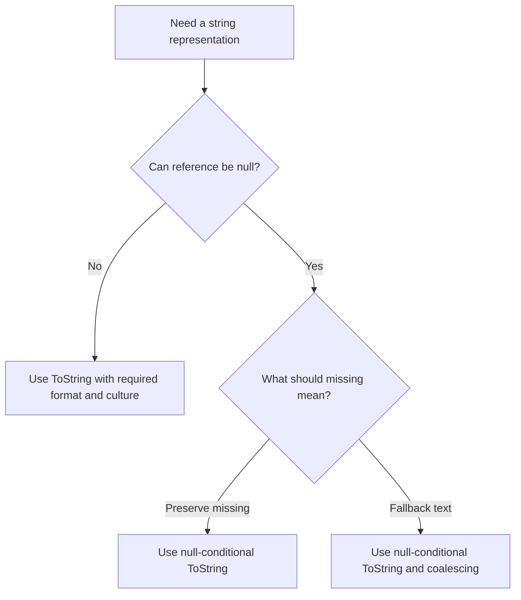

### Interview tips

- Avoid the blanket claim “Convert.ToString always returns empty for null.” Name the overload.
- Null, empty string, and database `DBNull.Value` are different concepts; check database nulls explicitly when the distinction matters.
- A custom ToString override controls how a domain object is represented; it should not casually expose sensitive data.

Reference: [Convert.ToString overloads](https://learn.microsoft.com/en-us/dotnet/api/system.convert.tostring).

## 12. Explain primary constructors in modern C#

### Interview answer

“C# 12 introduced primary constructors for ordinary classes and structs. Constructor parameters are declared on the type declaration and are available throughout the type body. They reduce constructor boilerplate, especially for dependency injection, but they do not automatically create properties or readonly fields.”

### Traditional constructor

```csharp
public sealed class ReportService
{
    private readonly ILogger<ReportService> _logger;

    public ReportService(ILogger<ReportService> logger)
    {
        _logger = logger;
    }

    public void Generate() => _logger.LogInformation("Generating report");
}
```

### Primary constructor equivalent with explicit readonly storage

```csharp
public sealed class ReportService(ILogger<ReportService> logger)
{
    private readonly ILogger<ReportService> _logger =
        logger ?? throw new ArgumentNullException(nameof(logger));

    public void Generate() => _logger.LogInformation("Generating report");
}
```

A shorter version references the parameter directly:

```csharp
public sealed class ShortReportService(ILogger<ShortReportService> logger)
{
    public void Generate() => logger.LogInformation("Generating report");
}
```

If instance members need a parameter later, the compiler captures it in storage. If a parameter is only used to initialize an explicit member, persistent storage for the parameter itself may be unnecessary. Referencing both a captured parameter and a separate field initialized from it can duplicate storage and create divergent state if reassigned.

### Rules worth remembering

1. A primary-constructor parameter is still a parameter, not a named instance member. `this.logger` does not refer to the parameter.
2. Parameters are not automatically public properties and are not implicitly readonly.
3. Other explicitly declared instance constructors must chain to the primary constructor, directly or indirectly, using `this(...)`.
4. Parameters can initialize fields/properties and be passed to a base constructor.
5. Ordinary classes do not gain record equality, deconstruction, or `with` support simply by having a primary constructor.
6. A struct still has its default zero-initialized value; primary-constructor validation does not eliminate `default(MyStruct)`.

### Validation and secondary constructor

```csharp
public sealed class RetryPolicy(int maxAttempts)
{
    public int MaxAttempts { get; } = maxAttempts > 0
        ? maxAttempts
        : throw new ArgumentOutOfRangeException(nameof(maxAttempts));

    public RetryPolicy() : this(3) { }
}
```

### Classes versus positional records

```csharp
public class CustomerClass(string name)
{
    public string Name { get; } = name; // Explicitly declared property
}

public record CustomerRecord(string Name); // Synthesized positional property
```

For a positional record class, `Name` is normally a synthesized public init-only property; record structs have different synthesized mutability rules. Positional records existed before C# 12. C# 12 generalized primary-constructor syntax to ordinary classes and structs.

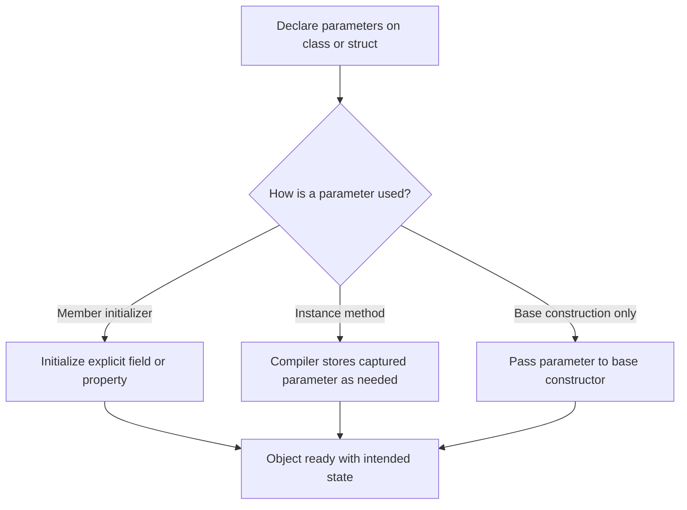

### Interview tips

- State **C# 12**, not merely “a .NET 8 constructor feature.” Language version and runtime version are related but distinct.
- Use explicit readonly fields when immutability and clear ownership matter.
- DI registration and lifetime rules remain the same; a primary constructor changes syntax, not service lifetime.
- Prefer a traditional constructor if substantial imperative initialization makes it clearer.

Reference: [Primary constructors for classes and structs](https://learn.microsoft.com/en-us/dotnet/csharp/whats-new/tutorials/primary-constructors).

## Final revision checklist

| Topic | One point to remember |
| --- | --- |
| Slow API | Measure and trace before changing architecture |
| Middleware | Order, short-circuiting, response unwinding, and dependency lifetime |
| Singleton | Shared per provider; design for concurrent access |
| SOLID | Explain behavior and tradeoffs with concrete examples |
| Collections | Generic type safety; distinguish missing-key behavior |
| LINQ | Single validates cardinality; OrDefault only changes the zero-match case |
| Pagination | Unique ordering and database-side limits |
| Filters | Action execution and result execution are different stages |
| Results | ActionResult<T> is a wrapper, not a subclass of ActionResult |
| Async | No blocked thread needed during native asynchronous I/O waits |
| Conversion | Convert.ToString null behavior depends on overload |
| Primary constructors | Parameters are not automatically properties or readonly members |

For senior interviews, structure answers as **definition → practical example → tradeoff → failure mode → verification**. Start with a concise answer, then expand when the interviewer asks for implementation detail.
