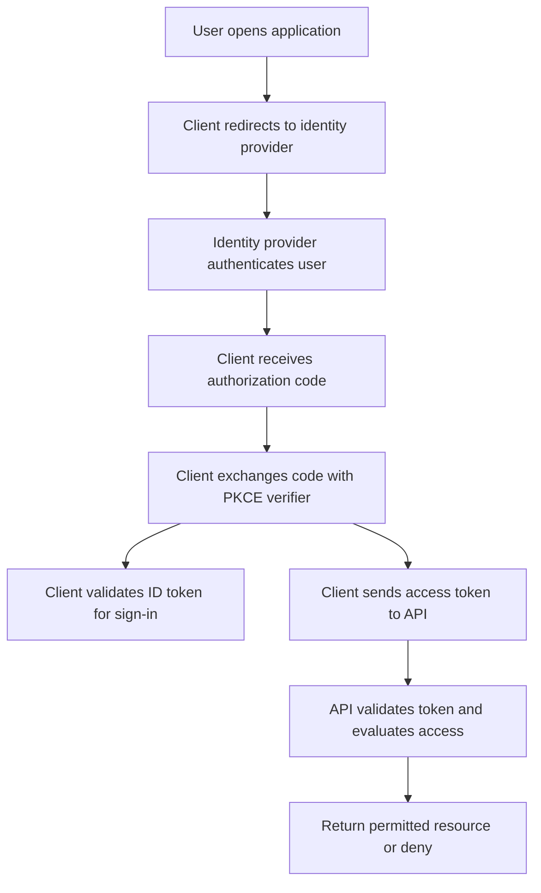
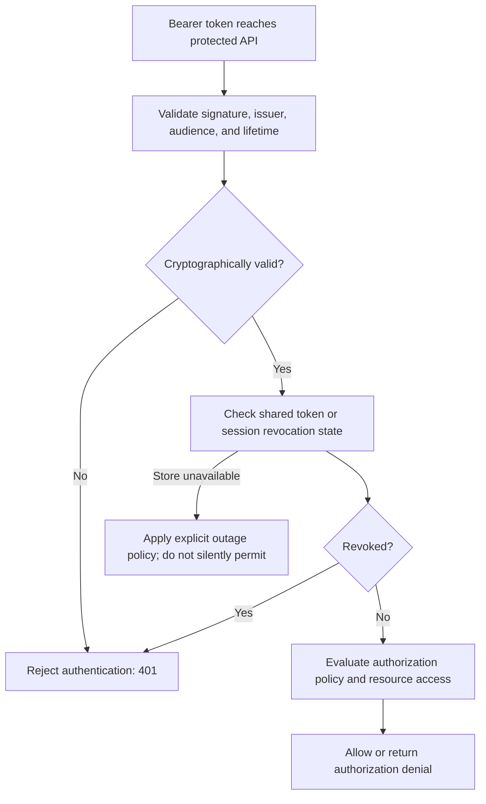
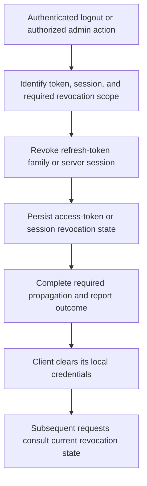
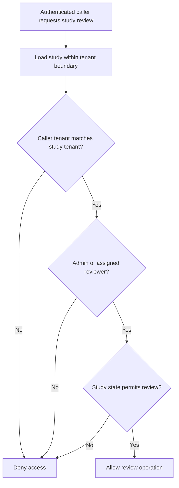

# Security and Authentication — ASP.NET Core Interview Guide

Detailed preparation for senior .NET developers, technical leads, and architects.

> Question numbering continues from the ASP.NET Core and C# guide. TCS attribution was supplied in the question list and is not independently verified here. Code examples illustrate separate implementation choices, not a complete identity platform. Use an established OAuth/OIDC provider for production token issuance. Mermaid must be enabled in your static site's Markdown renderer.

## Contents

- [13. Authentication versus OAuth](#13-what-is-the-difference-between-authentication-and-oauth)
- [14. Expire or revoke a JWT before expiry](#14-how-do-you-expire-or-revoke-a-jwt-before-its-normal-expiry)
- [15. Different access rules on an authorized API](#15-an-api-already-has-authorization-how-do-you-handle-different-access-rules)
- [Revision and practice scenarios](#revision-and-practice-scenarios)
- [Official references](#official-references)

## 13. What is the difference between authentication and OAuth?

### Short interview answer

“Authentication establishes who the caller is. OAuth 2.0 is an authorization framework for obtaining limited access to resources. OpenID Connect adds a standardized user-authentication layer on top of OAuth 2.0. JWT is a token format, not a login protocol. A typical application uses OIDC for sign-in and an OAuth access token to call an API.”

### Compare the concepts correctly

The question compares a security function with a framework, so clarify the terms before comparing implementations.

| Concept | Question it answers | Example |
| --- | --- | --- |
| Authentication | Who is this caller? | Establish a user's identity using an identity provider and MFA |
| Authorization | May this caller perform this operation? | Permit a reviewer to approve an assigned study |
| OAuth 2.0 | How can a client obtain limited access to protected resources? | An application obtains an access token for a document API |
| OpenID Connect, or OIDC | How can a client authenticate an end user using an identity provider? | Sign in with an enterprise account and validate an ID token |
| JWT | How can claims be represented in a token? | A signed access token carrying issuer, audience, and expiration claims |

OAuth can support delegated user access or application-only access. The client credentials grant has no signed-in end user. An access token can be opaque or JWT-formatted; OAuth does not require every token to be a JWT.

### Real-world example

Consider a clinical protocol application:

1. A writer signs in with an enterprise identity provider using OIDC.
2. The client obtains an access token intended for the Protocol API.
3. The API validates the token and establishes a claims principal.
4. An authorization policy checks the required permission.
5. A resource authorization check verifies that the writer belongs to the study and that its current state allows editing.

Successful authentication does not automatically grant access to every study.

### OIDC and OAuth flow



This is a simplified authorization-code flow. Use a mature OIDC library to handle correlation, `state`, OIDC `nonce` where applicable, PKCE, issuer validation, and callback processing. PKCE binds the authorization code to the initiating client's verifier. For public clients, it does not replace a client secret with another secret embedded in the app; public clients cannot safely keep such secrets. Confidential clients also authenticate as required by the provider.

### ID token, access token, and refresh token

| Token | Intended recipient/use | Important boundary |
| --- | --- | --- |
| ID token | OIDC client; describes the authentication event and user | Do not use it as the API's bearer access token |
| Access token | Resource server/API; authorizes resource access | Validate its intended audience and granted privileges |
| Refresh token | Authorization server's token endpoint | Do not send it to business API endpoints |

Scopes represent granted access, but scope validation alone is often insufficient. An API must also enforce tenant membership, ownership, record state, or other business restrictions. Claim names and representations vary between providers.

### ASP.NET Core JWT bearer validation

For an API consuming access tokens from an established issuer:

```csharp
using Microsoft.AspNetCore.Authentication.JwtBearer;

var builder = WebApplication.CreateBuilder(args);

builder.Services.AddControllers();
builder.Services
    .AddAuthentication(JwtBearerDefaults.AuthenticationScheme)
    .AddJwtBearer(options =>
    {
        options.Authority = builder.Configuration["Identity:Authority"];
        options.Audience = builder.Configuration["Identity:Audience"];
        options.RequireHttpsMetadata = true;
        options.MapInboundClaims = false;
        options.TokenValidationParameters.NameClaimType = "name";
        options.TokenValidationParameters.RoleClaimType = "roles";
    });

builder.Services.AddAuthorization();

var app = builder.Build();
app.UseHttpsRedirection();
app.UseAuthentication();
app.UseAuthorization();
app.MapControllers();
app.Run();
```

Use the JWT bearer package compatible with the application's target framework. Configure a trusted HTTPS issuer and the API's actual audience. Confirm the provider's role claim name; some use `role`, some `roles`, and some use another representation. With inbound mapping disabled, the examples below read raw claim names such as `sub` and `jti`.

The API must validate signature, trusted issuer, intended audience, and token lifetime. Decoding a JWT payload does not validate it. Signed tokens provide integrity; their payload is normally readable and should not contain secrets.

### Common follow-up: why is this called authentication middleware?

OAuth describes how access is granted and tokens are obtained. At the resource server, ASP.NET Core's JWT bearer authentication handler validates a presented token and constructs the caller's identity. Authorization then decides what that identity can do. These are different layers of the same request flow.

### Interview tips

- Say **OAuth authorizes; OIDC standardizes user authentication on top of OAuth**.
- Distinguish client, resource server, authorization server, and end user.
- Do not say OAuth requires JWT or that a JWT proves a person entered a password.
- Use authorization code with PKCE for modern interactive clients; do not propose the resource-owner-password grant for a new application.
- Prefer client credentials with appropriate application permissions for service-to-service calls that do not act for a user.
- API requests with missing/invalid bearer credentials normally receive **401**. A valid authenticated caller who lacks required access normally receives **403**.

Sources: [OpenID Foundation](https://openid.net/developers/how-connect-works/), [OAuth security best current practice](https://www.rfc-editor.org/rfc/rfc9700.html), [JWT bearer authentication](https://learn.microsoft.com/en-us/aspnet/core/security/authentication/configure-jwt-bearer-authentication).

## 14. How do you expire or revoke a JWT before its normal expiry?

### Short interview answer

“I cannot modify an already-issued signed JWT's expiry without invalidating its signature. To reject it early, the API needs a revocation signal, such as a shared denylist, revoked session, or current token-version check. An alternative is reference tokens with introspection. I also revoke refresh tokens and keep access tokens short-lived to limit exposure.”

### Why this is a design tradeoff

A self-contained JWT can be validated locally using trusted signing keys and claims. If an API checks only signature and lifetime, it cannot know that a user clicked logout, an administrator disabled an account, or a token was reported stolen.

Changing the issuer's default lifetime affects future tokens. Deleting a browser's token copy does not invalidate a stolen copy. Revoking a refresh token stops future refreshes but does not automatically make every already-issued JWT access token fail local validation.

### Revocation strategies

| Strategy | Scope | Benefit | Tradeoff |
| --- | --- | --- | --- |
| Short-lived access tokens | All tokens age out quickly | Simple local validation | Residual access lasts until expiry; not immediate revocation |
| JWT identifier denylist | A particular token | Precise early rejection | Shared lookup, retention, availability, and propagation costs |
| Session revocation | All tokens associated with a session | Useful for logout of one device/session | Needs a server-issued session identifier and session checks |
| User token version/security version | All participating tokens for a user | Useful for logout everywhere or account compromise | API must compare with current shared state |
| Reference token plus introspection | Tokens managed by authorization server | Central active-state decisions | Introspection availability, latency, and cache staleness |
| Emergency signing-key invalidation | Many tokens signed by that key | Broad containment during compromise | Large blast radius; distributed key caches complicate timing |

Routine key rotation is not a per-user logout mechanism. Validators may retain old keys to allow existing tokens to expire normally. Emergency invalidation requires coordinated removal of trust and cache behavior across resource servers.

### Flow: validate a JWT and consult revocation state



### ASP.NET Core example: shared JWT denylist

This example assumes an issuer contract that includes a unique `jti` and an expiration for every access token. Not every provider issues these claims with the same semantics. If the issuer does not support this contract, use a provider-supported session or token revocation design.

#### Step 1: define a revocation store

```csharp
public interface ITokenRevocationStore
{
    Task<bool> IsRevokedAsync(
        string issuer, string jti, CancellationToken ct);

    Task RevokeAsync(
        string issuer, string jti,
        DateTimeOffset retainUntilUtc, CancellationToken ct);
}
```

The issuer namespaces the identifier. Include additional namespace boundaries if your token-ID contract requires them. Do not store the raw bearer token in logs or cache keys.

#### Step 2: implement the lookup with a shared cache abstraction

```csharp
using System.Security.Cryptography;
using System.Text;
using Microsoft.Extensions.Caching.Distributed;

public sealed class TokenRevocationStore(
    IDistributedCache cache) : ITokenRevocationStore
{
    private static string Key(string issuer, string jti)
    {
        // Length-prefix issuer to make the input pair unambiguous.
        string input = $"{issuer.Length}:{issuer}{jti}";
        byte[] hash = SHA256.HashData(Encoding.UTF8.GetBytes(input));
        return $"revoked-access:{Convert.ToHexString(hash)}";
    }

    public async Task<bool> IsRevokedAsync(
        string issuer, string jti, CancellationToken ct)
        => await cache.GetAsync(Key(issuer, jti), ct) is not null;

    public Task RevokeAsync(
        string issuer, string jti,
        DateTimeOffset retainUntilUtc, CancellationToken ct)
    {
        if (retainUntilUtc <= DateTimeOffset.UtcNow)
            return Task.CompletedTask;

        return cache.SetAsync(
            Key(issuer, jti),
            new byte[] { 1 },
            new DistributedCacheEntryOptions
            {
                AbsoluteExpiration = retainUntilUtc
            },
            ct);
    }
}
```

A cache is only a suitable enforcement store if its operational guarantees match the security requirement. Unexpected eviction, restart data loss, or restoration of an old snapshot can erase revocation evidence. Use suitable persistence and no-eviction/capacity controls, or a durable authoritative session/revocation store. Define how replicas, regions, and failures affect the revocation guarantee.

#### Step 3: check revocation after normal token validation

Integrate this into the existing bearer registration from question 13; do not accidentally replace other configured event behavior.

```csharp
using Microsoft.AspNetCore.Authentication.JwtBearer;

// Requires Microsoft.Extensions.Caching.StackExchangeRedis.
builder.Services.AddStackExchangeRedisCache(options =>
{
    options.Configuration = builder.Configuration.GetConnectionString("Redis");
    options.InstanceName = "protocol-api:";
});
builder.Services.AddScoped<ITokenRevocationStore, TokenRevocationStore>();

builder.Services.PostConfigure<JwtBearerOptions>(
    JwtBearerDefaults.AuthenticationScheme, options =>
    {
        options.TokenValidationParameters.ClockSkew = TimeSpan.FromSeconds(30);
        options.Events ??= new JwtBearerEvents();
        var previous = options.Events.OnTokenValidated;

        options.Events.OnTokenValidated = async context =>
        {
            if (previous is not null)
                await previous(context);
            if (context.Result is not null)
                return;

            string? jti = context.Principal?.FindFirst("jti")?.Value;
            string issuer = context.SecurityToken.Issuer;

            if (string.IsNullOrWhiteSpace(jti) ||
                string.IsNullOrWhiteSpace(issuer))
            {
                context.Fail("Required token identifier is missing.");
                return;
            }

            var store = context.HttpContext.RequestServices
                .GetRequiredService<ITokenRevocationStore>();

            if (await store.IsRevokedAsync(
                issuer, jti, context.HttpContext.RequestAborted))
            {
                context.Fail("Token is revoked.");
            }
        };
    });
```

This illustrates delegate-based events on a single bearer scheme. An application using `EventsType`, several schemes, or specialized identity-provider integrations should attach the check using that integration's supported event mechanism.

Store failures are not caught and converted to “not revoked.” An exception prevents successful protected processing; configure an outer exception handler to return an appropriate generic service error, such as 503 for the identified infrastructure outage. Do not present an outage as a valid token or disclose internal details. Select and document outage behavior explicitly.

#### Step 4: write revocation state on logout or an administrator action

From a **validated** current token, obtain its issuer, `jti`, and expiration. Call:

```csharp
// Values must come from validated token/session context, not an arbitrary body.
await revocationStore.RevokeAsync(
    validatedIssuer,
    validatedJti,
    validatedExpiresAtUtc + configuredClockSkew + retentionSafetyMargin,
    ct);
```

Retain the entry through the last time any participating validator could accept the token, including allowed clock skew and a chosen safety margin. Deleting the entry at the raw `exp` instant is insufficient if a validator accepts a post-expiration skew window. Keep time synchronization and validation settings consistent across services.

The logout operation must also revoke the relevant refresh-token family or session at its authoritative store/provider. A single `jti` denylist entry blocks only that access token. If several active access tokens exist for the same session, a session-level revocation check is the clearer mechanism.

### Logout flow



If the two server-side writes cannot be atomic, make them idempotent, record partial failures, and retry/reconcile. Do not claim global immediate revocation if some resource servers cache results or are disconnected. Already-authorized in-flight operations and established WebSocket connections may need separate handling.

### Refresh-token rotation

The authorization server can rotate refresh tokens after use and detect reuse of an invalidated predecessor. Public clients' refresh tokens need sender constraint or rotation under current OAuth security guidance. If a reused token indicates compromise, revoke the affected grant/family according to the provider's design. Rotation needs atomic consume-and-replace behavior and a deliberate policy for concurrent refreshes and retries.

For a custom opaque refresh-token store, use cryptographically random secrets and store a one-way verification hash rather than raw reusable token values where feasible. Use an established identity product instead of inventing the entire protocol.

### Token-version alternative

Issue a custom version claim, such as `auth_version=7`, and compare it against the current shared user version. Incrementing the current version invalidates older participating tokens. Merely changing a database value does nothing unless APIs consult it. Cached versions introduce a bounded stale-acceptance window. ASP.NET Core Identity security-stamp behavior for cookies does not automatically revoke arbitrary JWTs validated by `AddJwtBearer`.

### Introspection alternative

With provider-supported introspection, the API asks the authorization server whether a token is active. RFC 7662 defines this mechanism. Cache introspection responses only within the acceptable stale-access window. Not every issuer supports introspection for every JWT; verify provider capabilities.

### Interview tips

- Start with the tradeoff: **fully local token validation cannot observe a later revocation event**.
- Separate single-token, single-session, user-wide, and signing-key-wide invalidation.
- “Short-lived access tokens plus revoked refresh tokens” limits exposure but does not guarantee instant access-token rejection.
- Redis is an implementation choice, not a security guarantee; discuss durability, eviction, outage behavior, and propagation.
- A JWT's `jti` is an identifier, not proof that it is active.
- Test expired, revoked, duplicate logout, missing identifier, clock-skew, outage, multi-instance, and refresh-reuse scenarios.

Sources: [RFC 7009: revocation](https://www.rfc-editor.org/rfc/rfc7009.html), [RFC 7662: introspection](https://www.rfc-editor.org/rfc/rfc7662.html), [RFC 9700: OAuth security](https://www.rfc-editor.org/rfc/rfc9700.html), [JWT bearer configuration](https://learn.microsoft.com/en-us/aspnet/core/security/authentication/configure-jwt-bearer-authentication).

## 15. An API already has authorization. How do you handle different access rules?

### Short interview answer

“I first clarify whether the new condition adds a restriction, provides an alternative authorized path, or depends on the requested resource. I express static permission rules as named policies and use resource-based authorization for ownership, tenant, assignment, or workflow conditions. Adding another Authorize attribute normally combines restrictions; it does not replace an existing controller policy.”

### Select the mechanism

| Requirement | Suitable approach |
| --- | --- |
| Require an extra permission on one action | Add an action policy while preserving compatible controller restrictions |
| Allow either of two roles | One RequireRole call with both roles, or one explicit OR requirement |
| Require two independent conditions | Multiple requirements in one policy; all must succeed |
| Allow a nonadmin exception to an admin-only controller rule | Refactor the controller/endpoint policies to express the intended alternatives |
| Check document owner, assigned reviewer, tenant, or current status | Resource-based authorization using IAuthorizationService |
| Many runtime-generated permission policy names | Custom IAuthorizationPolicyProvider plus correct handlers and caching |
| Public health or sign-in endpoint | Intentionally anonymous endpoint only if public access is actually required |

### Understand AND and OR behavior

```csharp
[Authorize(Policy = "Employee")]
public class ReportsController : ControllerBase
{
    [Authorize(Policy = "CanExport")]
    public IActionResult Export() => Ok();
}
```

The caller must satisfy **Employee AND CanExport**.

```csharp
[Authorize(Roles = "Admin,Reviewer")]
```

Within this role list, **Admin OR Reviewer** is sufficient. Separate role attributes combine as additional requirements.

`[Authorize(Policy = "PolicyA,PolicyB")]` does not mean OR: it names one policy literally unless custom policy resolution implements that convention. Multiple requirements in a policy are AND. Multiple handlers may provide alternative ways to satisfy the **same** requirement; an explicit `context.Fail()` can prevent success even if another handler succeeds. Do not use it casually when modeling alternatives.

### Example A: add a permission to an authenticated controller

```csharp
using Microsoft.AspNetCore.Authorization;
using Microsoft.AspNetCore.Mvc;

builder.Services.AddAuthorization(options =>
{
    options.AddPolicy("CanExportStudy", policy =>
    {
        policy.RequireAuthenticatedUser();
        policy.RequireClaim("permission", "study.export");
    });
});

[ApiController]
[Route("api/studies")]
[Authorize]
public sealed class StudyExportsController : ControllerBase
{
    [HttpPost("{id:guid}/export")]
    [Authorize(Policy = "CanExportStudy")]
    public IActionResult Export(Guid id)
    {
        // Also enforce resource-level access before exporting this study.
        return Accepted(new { StudyId = id });
    }
}
```

The `permission` claim is an example issuer contract. Configure the real claim format. Many providers encode scopes in one space-delimited `scope` or `scp` claim; `RequireClaim("scope", "study.export")` does not split such strings automatically.

### Example B: alternatives without accidentally removing a tenant boundary

Suppose access means “same tenant AND either administrator or assigned reviewer.” Keep the tenant condition outside the OR expression. `isAdmin || sameTenant && isReviewer` can accidentally allow cross-tenant administration because of operator precedence and the chosen policy semantics.



### Example C: resource-based authorization with a custom requirement

The following example deliberately requires the study to be in review even for an administrator. If administrators need a controlled override, model that as a separate explicit operation with its own audit rules.

#### Define the resource and requirement

```csharp
using Microsoft.AspNetCore.Authorization;

public sealed record StudyAccessResource(
    Guid Id,
    string TenantId,
    string AssignedReviewerSubject,
    string Status);

public sealed class ReviewStudyRequirement : IAuthorizationRequirement
{
}
```

#### Implement the handler

```csharp
public sealed class ReviewStudyHandler
    : AuthorizationHandler<ReviewStudyRequirement, StudyAccessResource>
{
    protected override Task HandleRequirementAsync(
        AuthorizationHandlerContext context,
        ReviewStudyRequirement requirement,
        StudyAccessResource study)
    {
        if (context.User.Identity?.IsAuthenticated != true)
            return Task.CompletedTask;

        string? tenantId = context.User.FindFirst("tenant_id")?.Value;
        string? subject = context.User.FindFirst("sub")?.Value;

        if (string.IsNullOrWhiteSpace(tenantId) ||
            string.IsNullOrWhiteSpace(subject))
            return Task.CompletedTask;

        bool sameTenant = string.Equals(
            tenantId, study.TenantId, StringComparison.Ordinal);
        bool assignedReviewer = string.Equals(
            subject, study.AssignedReviewerSubject, StringComparison.Ordinal);
        bool admin = context.User.IsInRole("Admin");
        bool reviewable = study.Status == "InReview";

        if (sameTenant && reviewable && (admin || assignedReviewer))
            context.Succeed(requirement);

        return Task.CompletedTask;
    }
}
```

The raw claim names must match the issuer contract and claim-mapping configuration. Subject identifiers are scoped to an issuer; in a system trusting several issuers, store and compare an issuer-and-subject identity, or map to an internal stable user ID. For several reviewers, consult trusted assignment data rather than relying on one subject string.

#### Register the policy and handler

```csharp
builder.Services.AddAuthorization(options =>
{
    options.AddPolicy("CanReviewStudy", policy =>
    {
        policy.RequireAuthenticatedUser();
        policy.AddRequirements(new ReviewStudyRequirement());
    });
});
builder.Services.AddScoped<IAuthorizationHandler, ReviewStudyHandler>();
```

#### Load the resource, then authorize it

```csharp
public interface IStudyAccessReader
{
    Task<StudyAccessResource?> FindInTenantAsync(
        Guid studyId, string tenantId, CancellationToken ct);
}

[ApiController]
[Route("api/study-reviews")]
[Authorize]
public sealed class StudyReviewsController(
    IStudyAccessReader reader,
    IAuthorizationService authorization) : ControllerBase
{
    [HttpGet("{id:guid}")]
    public async Task<IActionResult> GetReviewContext(
        Guid id, CancellationToken ct)
    {
        string? tenantId = User.FindFirst("tenant_id")?.Value;
        if (string.IsNullOrWhiteSpace(tenantId))
            return Forbid();

        var study = await reader.FindInTenantAsync(id, tenantId, ct);
        if (study is null)
            return NotFound();

        var decision = await authorization.AuthorizeAsync(
            User, study, "CanReviewStudy");

        if (!decision.Succeeded)
            return Forbid();

        return Ok(new { study.Id, study.Status });
    }
}
```

`IStudyAccessReader` needs a scoped implementation that queries authoritative data and enforces the tenant predicate in the database. The example returns only review context. A review mutation must additionally enforce current state and assignment at commit time, using a suitable transaction or concurrency token. A record can change between authorization and persistence; do not assume a successful earlier check protects a later write indefinitely.

Do not apply the resource-specific policy only as an attribute and expect MVC to supply your loaded `StudyAccessResource`. Endpoint authorization has HTTP context metadata, not the domain object retrieved later. The explicit `AuthorizeAsync(User, study, policy)` call supplies the required resource.

### Handling a replacement rule on an already restricted controller

Consider an admin-only controller with a new endpoint that should also allow an owner:

```csharp
// Adding an owner policy here does not replace the Admin requirement.
[Authorize(Roles = "Admin")]
public class DocumentsController : ControllerBase
{
    [Authorize(Policy = "OwnerOrAdmin")]
    public IActionResult Edit() => Ok();
}
```

The controller still requires Admin, so the owner-only path cannot succeed. Refactor by moving the endpoint to a controller with an authenticated baseline, or replace the broad controller restriction with explicit action policies that accurately express each operation. Preserve restrictions for every other action during the refactor.

Do not add `[AllowAnonymous]` as a way to substitute a different protected policy. It bypasses normal authorization enforcement for that endpoint, including other authorization metadata. Use it only for an intentionally public endpoint.

### Default and fallback policies

- **DefaultPolicy:** Used for a bare `[Authorize]` or equivalent authorization requirement without a named policy.
- **Named policy:** Explicit permission/rule selection. Include any required authenticated-user baseline in its design; do not assume a custom DefaultPolicy is automatically added to all named policies.
- **FallbackPolicy:** Used when an endpoint has no explicit authorization metadata. It can establish an authenticated baseline for otherwise unannotated endpoints.
- **AllowAnonymous:** Explicitly permits anonymous access through normal authorization middleware; it is not a policy override mechanism for another protected rule.

### Choosing status codes

| Situation | Typical API behavior |
| --- | --- |
| Missing, invalid, expired, or revoked bearer token | 401 authentication challenge |
| Authenticated caller fails policy | 403 forbidden |
| Resource does not exist within permitted tenant scope | 404 not found |
| Existing resource must be concealed from unauthorized callers | Consistent 404 strategy where deliberately designed |
| Resource changed since authorization | Re-evaluate access; return a suitable denial or concurrency response |

Use a consistent disclosure strategy so existence cannot be inferred from inconsistent error messages or response differences. Hiding buttons in the frontend improves usability but does not enforce API authorization.

### Interview tips

- Clarify **additional rule, alternative rule, or resource-dependent rule** first.
- State explicitly that controller and action authorization generally combine; the action does not simply override the controller.
- Use reusable policy/handler logic instead of repeating role checks across controllers.
- Keep tenant boundaries and sensitive workflow invariants mandatory across all alternative access paths.
- Recheck dynamic permissions if stale token claims cannot meet the required revocation window.
- Audit actor, operation, resource, outcome, and a safe reason code; never log bearer tokens.

Sources: [Policy-based authorization](https://learn.microsoft.com/en-us/aspnet/core/security/authorization/policies), [MVC policy composition](https://learn.microsoft.com/en-us/aspnet/core/mvc/security/authorization/policies), [Resource-based authorization](https://learn.microsoft.com/en-us/aspnet/core/security/authorization/resourcebased).

## Revision and practice scenarios

| Interview prompt | Core answer |
| --- | --- |
| Is OAuth the same as authentication? | OAuth is an authorization framework; OIDC adds user authentication |
| Is every access token a JWT? | No; opaque tokens are also possible |
| Can I edit exp on an issued JWT? | That invalidates its signature; use a new token or server-side rejection state |
| Does logout invalidate stolen JWT copies? | Only if participating APIs observe revocation or the copies expire |
| Is refresh-token revocation sufficient for instant API rejection? | No; existing JWT access tokens need a rejection mechanism |
| Does deleting Redis data improve security? | It can remove revocation evidence; design retention and durability deliberately |
| Do two Authorize policies mean OR? | Normally they combine as AND; express alternatives explicitly |
| Can action-level authorization remove a controller restriction? | No; refactor policy placement and composition |
| Where do ownership checks belong? | Resource authorization using trusted resource/assignment data |
| Can frontend role checks secure an API? | No; the server must enforce all relevant rules |

### Practice scenarios to discuss aloud

1. **Stolen token on one device:** Revoke that session and refresh-token family; ensure the API checks session state, then explain propagation and in-flight limitations.
2. **Reviewer removed during an active session:** A still-valid JWT may contain stale claims. Read current assignment/permission data where immediate removal is required.
3. **Admin accesses another tenant:** Confirm whether cross-tenant access is explicitly allowed. Do not accidentally bypass the tenant condition through an OR branch.
4. **Revocation store outage:** Keep the protected operation from silently succeeding; return a controlled service error under the chosen fail-closed design and alert operators.
5. **Two concurrent approval requests:** Authorize both appropriately, then use transactional/concurrency enforcement so only the valid state transition commits.

Answer senior-level questions using **security goal → mechanism → enforcement location → tradeoff → failure handling → verification**.

## Official references

- [OpenID Connect: how it works — OpenID Foundation](https://openid.net/developers/how-connect-works/)
- [RFC 6749 — OAuth 2.0 authorization framework](https://www.rfc-editor.org/rfc/rfc6749.html)
- [RFC 9700 — OAuth 2.0 security best current practice](https://www.rfc-editor.org/rfc/rfc9700.html)
- [RFC 7009 — OAuth 2.0 token revocation](https://www.rfc-editor.org/rfc/rfc7009.html)
- [RFC 7662 — OAuth 2.0 token introspection](https://www.rfc-editor.org/rfc/rfc7662.html)
- [Configure JWT bearer authentication — Microsoft Learn](https://learn.microsoft.com/en-us/aspnet/core/security/authentication/configure-jwt-bearer-authentication)
- [Policy-based authorization — Microsoft Learn](https://learn.microsoft.com/en-us/aspnet/core/security/authorization/policies)
- [Policy-based authorization in MVC — Microsoft Learn](https://learn.microsoft.com/en-us/aspnet/core/mvc/security/authorization/policies)
- [Resource-based authorization — Microsoft Learn](https://learn.microsoft.com/en-us/aspnet/core/security/authorization/resourcebased)
