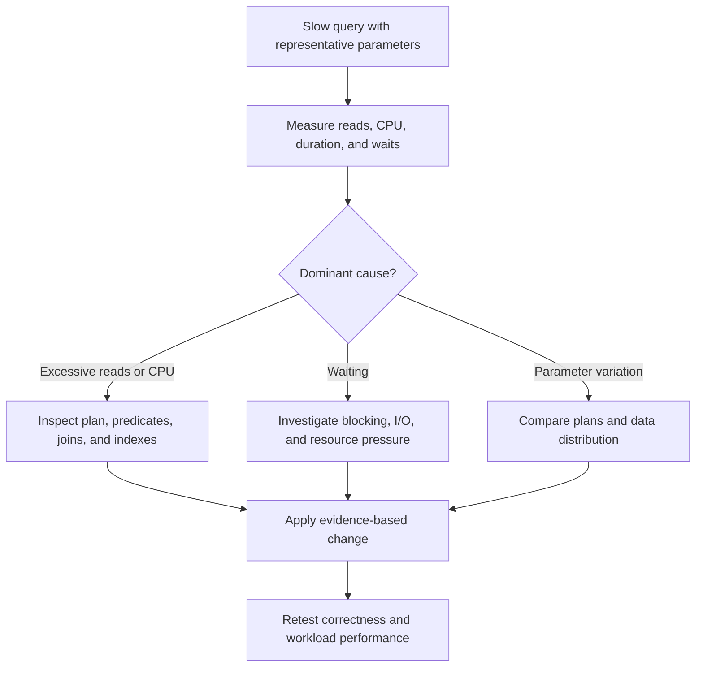
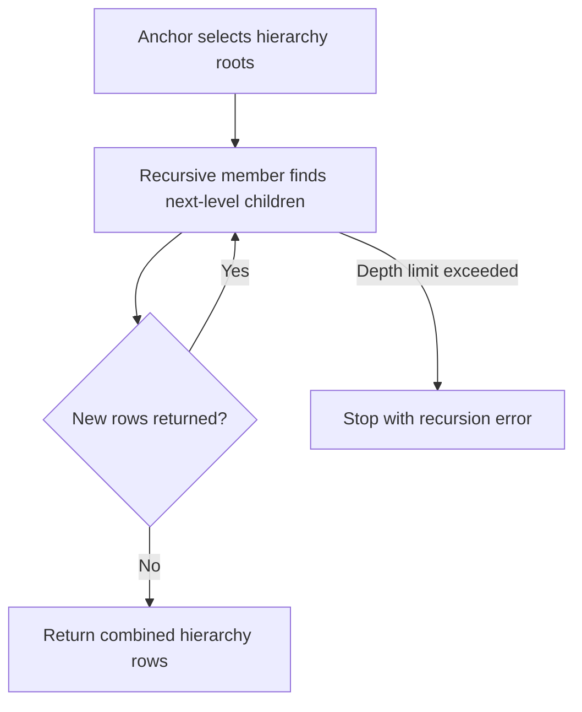
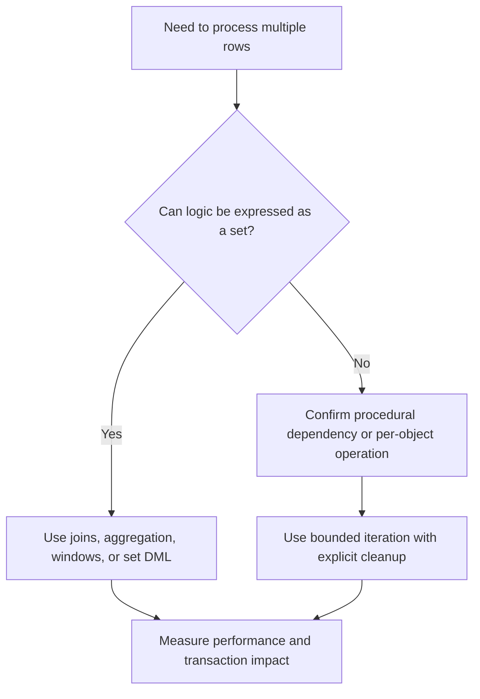
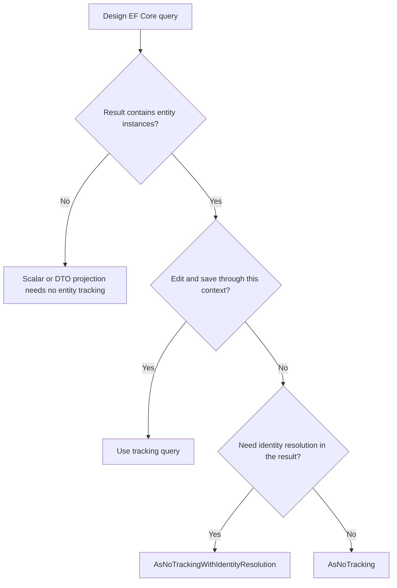
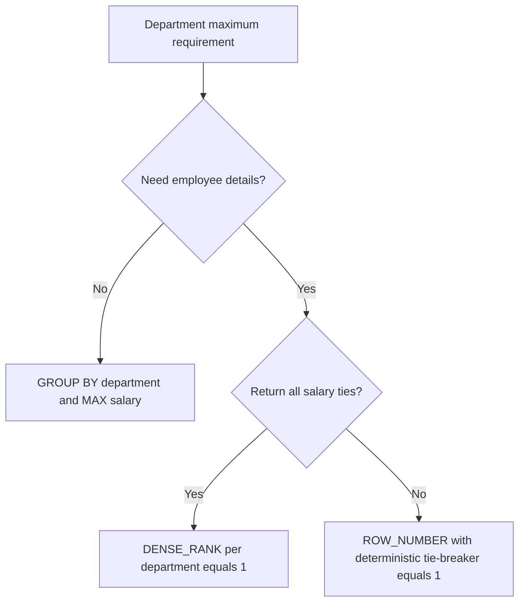
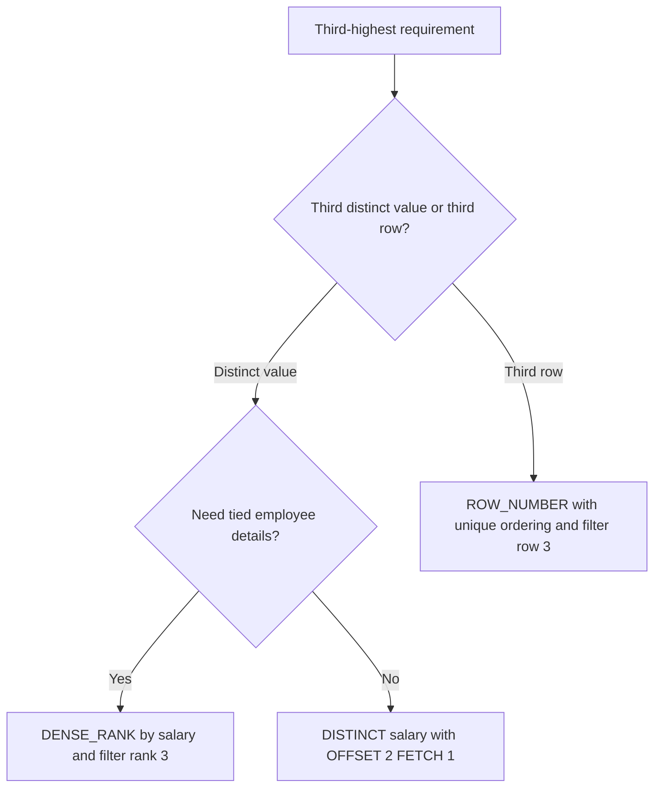
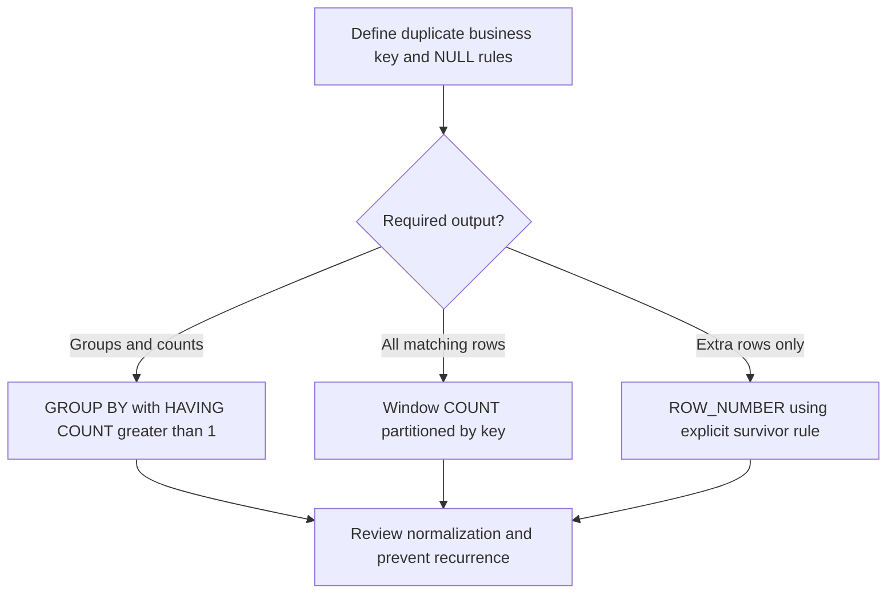
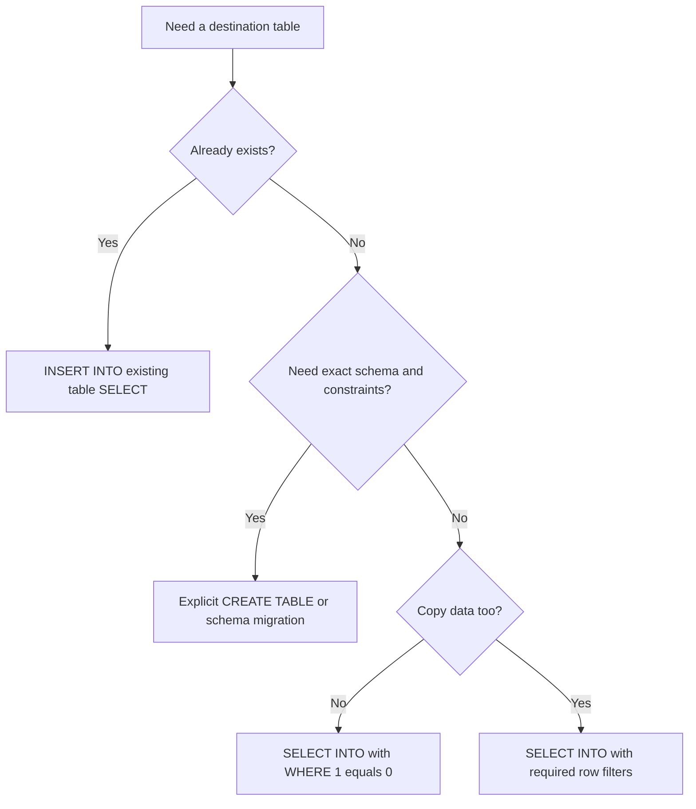

# SQL Server and Entity Framework Core — Interview Preparation

Questions 16–22 for experienced developers, .NET technical leads, and architects.

> TCS attribution comes from the supplied question list and has not been independently verified. SQL examples target Microsoft SQL Server. C# snippets assume an application-specific EF Core DbContext. Enable Mermaid in your static site's Markdown renderer. Run the sample setup only in a disposable practice database.

## Contents

- [Sample database](#sample-database)
- [16. Optimize a slow SQL query](#16-how-do-you-optimize-a-slow-sql-query)
- [17. Common table expressions](#17-what-is-a-cte-and-when-would-you-use-it)
- [18. Disadvantages of cursors](#18-what-are-the-disadvantages-of-sql-cursors)
- [19. AsNoTracking in EF Core](#19-when-should-you-use-asnotracking-in-ef-core)
- [20. Department-wise maximum salary](#20-find-the-department-wise-maximum-salary)
- [21. Third-highest value and duplicates](#21-find-the-third-highest-value-and-identify-duplicate-records)
- [22. SELECT INTO with constant predicates](#22-select-into-with-where-10-versus-where-11)
- [Revision checklist](#revision-checklist)

## Sample database

Use these tables for the SQL examples. Salary is nullable to make NULL behavior explicit. Duplicate emails are intentionally permitted in this training data.

```sql
CREATE TABLE dbo.Departments
(
    DepartmentId int NOT NULL PRIMARY KEY,
    DepartmentName nvarchar(100) NOT NULL
);

CREATE TABLE dbo.Employees
(
    EmployeeId int NOT NULL PRIMARY KEY,
    EmployeeName nvarchar(100) NOT NULL,
    DepartmentId int NOT NULL,
    Salary decimal(12, 2) NULL,
    Email nvarchar(200) NULL,
    ManagerId int NULL,
    JoiningDate date NOT NULL,
    CONSTRAINT FK_Employees_Departments FOREIGN KEY (DepartmentId)
        REFERENCES dbo.Departments(DepartmentId)
);

INSERT INTO dbo.Departments (DepartmentId, DepartmentName)
VALUES (1, N'IT'), (2, N'HR'), (3, N'Finance'), (4, N'Legal');

INSERT INTO dbo.Employees
    (EmployeeId, EmployeeName, DepartmentId, Salary, Email, ManagerId, JoiningDate)
VALUES
    (1, N'Arun',  1, 90000, N'arun@example.test',  NULL, '20240110'),
    (2, N'Bala',  1, 80000, N'bala@example.test',  1,    '20240215'),
    (3, N'Chitra',1, 90000, N'chitra@example.test',1,    '20240301'),
    (4, N'Divya', 2, 70000, N'divya@example.test', NULL, '20240401'),
    (5, N'Eshan', 2, 65000, N'divya@example.test', 4,    '20240501'),
    (6, N'Farah', 3, 80000, N'farah@example.test', NULL, '20240601'),
    (7, N'Gopal', 3, NULL,  NULL,                  6,    '20240701');
```

Distinct non-NULL salaries in descending order are **90000, 80000, 70000, 65000**. The third distinct salary is **70000**. Legal has no employees; IT has two employees tied for its highest salary.

## 16. How do you optimize a slow SQL query?

### Short interview answer

“I reproduce the query with representative parameters, capture its actual execution plan and logical reads, and distinguish CPU work from blocking or other waits. I then improve the query shape, indexes, statistics, or parameter-sensitive plan as indicated by evidence, and retest correctness, elapsed time, reads, and write overhead.”

### Investigation sequence

1. **Capture the real statement and parameters.** A query can be fast for a small department and slow for a large one. Compare the application's parameter types and session settings with your test.
2. **Measure a baseline.** Record duration, CPU, logical reads, rows returned, execution frequency, and concurrency. Query Store can help locate regressions and compare historical plans when enabled.
3. **Inspect actual execution evidence.** Check estimated versus actual row counts, scans/seeks, key lookups, sorts, spills, join choices, memory grants, and implicit conversions.
4. **Investigate waits.** A long elapsed time may reflect blocking, storage latency, memory pressure, or client consumption rather than an inefficient CPU-intensive plan.
5. **Make the smallest justified change.** Rewrite a predicate, add an appropriate index, correct statistics, reduce rows/columns, or address a demonstrated parameter-sensitive plan.
6. **Validate under realistic load.** An index that speeds one report can slow a busy write path. Compare both workloads.

```sql
SET STATISTICS IO ON;
SET STATISTICS TIME ON;

-- Also enable Include Actual Execution Plan in SSMS.
SELECT EmployeeId, EmployeeName, Salary
FROM dbo.Employees
WHERE DepartmentId = 1
ORDER BY Salary DESC, EmployeeId;

SET STATISTICS TIME OFF;
SET STATISTICS IO OFF;
```



### Make predicates searchable

A SARGable predicate can enable an index search. Avoid unnecessary transformations on indexed columns.

```sql
-- Often prevents a direct seek on an ordinary JoiningDate index.
SELECT EmployeeId, EmployeeName
FROM dbo.Employees
WHERE YEAR(JoiningDate) = 2024;

-- Range predicate can use the original column's index.
SELECT EmployeeId, EmployeeName
FROM dbo.Employees
WHERE JoiningDate >= '20240101'
  AND JoiningDate <  '20250101';
```

This range also works when a corresponding column is a datetime type with time components. Match parameter types to column types to avoid harmful implicit conversions. SARGability enables useful access paths; the optimizer can still choose a scan if it estimates that is cheaper.

### Design an index for an actual access pattern

```sql
CREATE INDEX IX_Employees_Department_Salary
ON dbo.Employees (DepartmentId, Salary DESC, EmployeeId)
INCLUDE (EmployeeName);
```

For a department-filtered salary list, this key order can support the equality predicate and requested ordering. The included name can avoid a lookup for that query. Do not add every selected column indiscriminately: wider indexes use more space and increase update cost. A tiny practice table may still be scanned; assess real data and plans.

### Common findings and remedies

| Finding | Possible remedy | What to verify |
| --- | --- | --- |
| Many reads for a selective predicate | Suitable index or SARGable rewrite | Predicate selectivity and actual plan |
| Repeated key lookups | Narrower projection or covering index | Whether lookup volume justifies index width |
| Large estimation error | Statistics and data-distribution investigation | Parameter values, correlation, and stale stats |
| Sort/hash spill | Reduce input or investigate estimates and grant | Tempdb usage and concurrency impact |
| Blocking | Shorter transactions and better access paths | Blocking chain and isolation requirements |
| Excessive rows returned | Filter, aggregate, or paginate in SQL | Consumer's actual data needs |
| Parameter-sensitive plan | Appropriate version-specific optimization or targeted recompilation | Compile cost, skew, and execution frequency |

### Mistakes to avoid

- An index scan is not automatically bad; reading most of a table may make scanning optimal.
- Avoid `SELECT *` when you need only a few columns.
- `NOLOCK` permits inconsistent reads and is not a general performance fix. It also does not eliminate every kind of blocking.
- Do not apply hints, force plans, update all statistics with full scans, or rebuild all indexes without evidence.
- Do not clear production caches to manufacture benchmark results.
- A CTE or stored procedure is not inherently faster than an equivalent query.

### Interview tips

Explain a measurable scenario: “The department report performed many lookups; I verified the plan, selected fewer columns, evaluated a covering index, and compared logical reads and latency.” Use real measured numbers only when you have them. Discuss Query Store, blocking, and parameter sensitivity for senior-level depth.

References: [Troubleshoot slow queries](https://learn.microsoft.com/en-us/troubleshoot/sql/database-engine/performance/troubleshoot-slow-running-queries), [Query Store](https://learn.microsoft.com/en-us/sql/relational-databases/performance/monitoring-performance-by-using-the-query-store).

## 17. What is a CTE and when would you use it?

### Short interview answer

“A common table expression is a named query expression scoped to one following statement. I use it to organize complex queries, filter window-function results, and traverse hierarchies recursively. It is not automatically a materialized temporary table and does not guarantee a performance improvement.”

### Nonrecursive example

```sql
;WITH DepartmentAverage AS
(
    SELECT DepartmentId, AVG(Salary) AS AverageSalary
    FROM dbo.Employees
    GROUP BY DepartmentId
)
SELECT e.EmployeeId, e.EmployeeName, e.Salary, a.AverageSalary
FROM dbo.Employees AS e
JOIN DepartmentAverage AS a
    ON a.DepartmentId = e.DepartmentId
WHERE e.Salary > a.AverageSalary;
```

`AVG` ignores NULL salaries. The leading semicolon safely terminates a preceding statement before `WITH`. The CTE is available only to the immediately following statement. A second SELECT cannot reuse it without redeclaring it.

### Multiple CTEs in one statement

```sql
;WITH PaidEmployees AS
(
    SELECT EmployeeId, DepartmentId, Salary
    FROM dbo.Employees
    WHERE Salary IS NOT NULL
), DepartmentTotals AS
(
    SELECT DepartmentId, SUM(Salary) AS TotalSalary
    FROM PaidEmployees
    GROUP BY DepartmentId
)
SELECT DepartmentId, TotalSalary
FROM DepartmentTotals
ORDER BY DepartmentId;
```

Multiple definitions are separated by commas under one `WITH`. In SQL Server a CTE can refer to an earlier CTE in the same clause; forward references are not allowed.

### Recursive CTE example: employee hierarchy

```sql
;WITH EmployeeHierarchy AS
(
    -- Anchor: root employees.
    SELECT EmployeeId, EmployeeName, ManagerId, 0 AS HierarchyLevel
    FROM dbo.Employees
    WHERE ManagerId IS NULL

    UNION ALL

    -- Recursive member: employees managed by the preceding level.
    SELECT e.EmployeeId, e.EmployeeName, e.ManagerId,
           h.HierarchyLevel + 1
    FROM dbo.Employees AS e
    JOIN EmployeeHierarchy AS h
        ON e.ManagerId = h.EmployeeId
)
SELECT EmployeeId, EmployeeName, ManagerId, HierarchyLevel
FROM EmployeeHierarchy
ORDER BY HierarchyLevel, EmployeeId
OPTION (MAXRECURSION 100);
```

The anchor starts the traversal. Each recursive iteration finds another level. Recursion stops when an iteration returns no rows. Cycles and unexpected depth require data validation or explicit cycle detection; `MAXRECURSION` is a safeguard, not proof of an acyclic hierarchy. The default SQL Server limit is 100 recursion levels; `0` removes the limit and must be used deliberately.



### CTE versus temporary table

| Aspect | CTE | Local temporary table |
| --- | --- | --- |
| Lifetime | One following statement | Session/scope rules for the created temp table |
| Storage | No guaranteed materialization | Explicitly stored in tempdb |
| Reuse | References within the statement | Across statements while available |
| Indexing | Cannot directly create an index on the CTE | Can create indexes on the temp table |
| Best fit | Readability, window queries, recursion | Staging reused results and breaking complex processing into steps |

The optimizer may introduce a spool, but that is a plan choice, not a promise that a CTE result is cached. Repeated CTE references can mean repeated work. Consider a temp table when reuse, intermediate statistics, or indexing warrants its creation and write overhead.

### Interview tips

- A CTE is not a view stored in the database and is not a table variable.
- It can precede supported SELECT/INSERT/UPDATE/DELETE/MERGE statements; whether a modification is valid depends on the underlying query's updateability and statement rules.
- Use final `ORDER BY` for presentation. CTE definitions have restrictions on ORDER BY and do not establish output order.
- For “top salary per department,” a CTE with a ranking function is a readable solution, not automatically the fastest one.

Reference: [WITH common_table_expression](https://learn.microsoft.com/en-us/sql/t-sql/queries/with-common-table-expression-transact-sql).

## 18. What are the disadvantages of SQL cursors?

### Short interview answer

“A cursor processes rows incrementally, which often adds fetch and per-row statement overhead compared with a set-based operation. Depending on cursor type and transaction behavior, it can also increase tempdb usage, locking, and code complexity. I first look for joins, aggregation, window functions, or set-based updates, while recognizing that some genuinely procedural tasks justify a cursor.”

### Typical drawbacks

| Drawback | Practical effect |
| --- | --- |
| Per-row execution overhead | Repeated fetches and updates can scale poorly |
| Reduced optimization across the operation | The optimizer cannot necessarily combine many procedural statements into one relational plan |
| Additional state/worktables | Some cursor types consume tempdb and memory |
| Long-running processing | Transactions can retain locks and increase blocking/log pressure |
| More cleanup paths | OPEN/FETCH/CLOSE/DEALLOCATE and error handling add complexity |
| Harder restart behavior | Partial completion needs a deliberate transaction/idempotency design |

Effects depend on cursor type, result size, access pattern, and isolation level. A cursor does not automatically lock an entire table, and a set-based rewrite does not automatically eliminate blocking.

### Prefer a set-based update for a uniform calculation

Instead of fetching every IT employee and issuing one UPDATE per employee:

```sql
-- Mutates training data; run separately from the expected-results exercises.
UPDATE dbo.Employees
SET Salary = ROUND(Salary * 1.10, 2)
WHERE DepartmentId = 1
  AND Salary IS NOT NULL;
```

SQL Server can optimize the operation as a set. For a very large update, controlled batches may be appropriate to limit transaction duration and log pressure; batching and cursor iteration are different design choices.

### Use window functions for ordered calculations

```sql
SELECT EmployeeId, DepartmentId, Salary,
       SUM(COALESCE(Salary, 0)) OVER
       (
           PARTITION BY DepartmentId
           ORDER BY EmployeeId
           ROWS BETWEEN UNBOUNDED PRECEDING AND CURRENT ROW
       ) AS RunningSalary
FROM dbo.Employees
ORDER BY DepartmentId, EmployeeId;
```

This replaces a common “fetch next row and update running total” pattern. The explicit `ROWS` frame makes the intended row-by-row accumulation clear. The business ordering must be defined; a running total without meaningful order is ambiguous.



### When a cursor can be reasonable

Administrative tasks that issue different commands per database/object, a small sequence of inherently procedural operations, or an algorithm whose state cannot reasonably be expressed using available set features may justify one.

For a forward-only read-only pass, `LOCAL FAST_FORWARD` is a useful starting point:

```sql
DECLARE @EmployeeId int;

DECLARE EmployeeCursor CURSOR LOCAL FAST_FORWARD FOR
    SELECT EmployeeId
    FROM dbo.Employees
    ORDER BY EmployeeId;

OPEN EmployeeCursor;
FETCH NEXT FROM EmployeeCursor INTO @EmployeeId;

WHILE @@FETCH_STATUS = 0
BEGIN
    -- Placeholder for genuinely procedural work.
    PRINT @EmployeeId;
    FETCH NEXT FROM EmployeeCursor INTO @EmployeeId;
END;

CLOSE EmployeeCursor;
DEALLOCATE EmployeeCursor;
```

This educational PRINT loop has no production advantage over a SELECT. Production cursor code also needs error-path cleanup and a deliberate transaction policy. A `WHILE` loop performing the same repeated statements remains row-by-row processing; changing syntax alone is not a set-based optimization.

### Interview tips

Say “prefer set-based operations for relational work,” not “cursors are always wrong.” Mention window functions, transaction boundaries, and tempdb. Explain a case where a cursor is justified and how you would measure it.

Reference: [SQL Server cursors](https://learn.microsoft.com/en-us/sql/relational-databases/cursors).

## 19. When should you use AsNoTracking() in EF Core?

### Short interview answer

“I use AsNoTracking for entity queries whose results are read-only and will not be edited through that DbContext. It avoids context change-tracking overhead. For an update workflow, I normally use a tracking query. If a read-only graph needs repeated references to the same entity instance, AsNoTrackingWithIdentityResolution is another option.”

### Tracking versus no tracking

| Mode | Tracked by application DbContext? | Identity resolution | Typical use |
| --- | --- | --- | --- |
| Default tracking query | Yes | Uses context tracker | Load, modify, SaveChanges |
| AsNoTracking | No | No identity resolution by default | Read-only lists and reports |
| AsNoTrackingWithIdentityResolution | No | Uses a temporary independent tracker | Read-only graphs with repeated entity identities |

Identity resolution means that multiple occurrences of the same entity key reuse an object instance. Plain no-tracking queries can create separate instances for repeated occurrences. Tracking can therefore be competitive or better for some repeated-entity graphs; no-tracking is not universally faster.

### Read-only endpoint example

```csharp
using Microsoft.EntityFrameworkCore;

var employees = await db.Employees
    .AsNoTracking()
    .Where(e => e.DepartmentId == departmentId)
    .OrderBy(e => e.EmployeeId)
    .Take(100)
    .ToListAsync(ct);
```

The returned entities are not registered for change detection in this DbContext. Modifying one and calling `SaveChangesAsync` does not persist that modification unless you explicitly attach/update it or otherwise issue an update.

### Tracking update example

```csharp
var employee = await db.Employees
    .SingleAsync(e => e.EmployeeId == employeeId, ct);

employee.Salary = newSalary;
await db.SaveChangesAsync(ct);
```

The context tracks the loaded entity and detects changes. If the application has globally disabled tracking, use `AsTracking()` for this workflow.

### Prefer DTO projections for API read models

```csharp
var employees = await db.Employees
    .Where(e => e.DepartmentId == departmentId)
    .OrderBy(e => e.EmployeeId)
    .Select(e => new
    {
        e.EmployeeId,
        e.EmployeeName,
        e.Salary
    })
    .Take(100)
    .ToListAsync(ct);
```

This projection contains scalar values and no entity instances, so there is no entity to track. Adding `AsNoTracking()` here is normally redundant. A projection like `new { Employee = e, DepartmentName = e.Department.DepartmentName }` still contains an entity instance and is tracked by default.

### Read-only graph with identity resolution

```csharp
var departments = await db.Departments
    .AsNoTrackingWithIdentityResolution()
    .Include(d => d.Employees)
    .ToListAsync(ct);
```

Use this mode when identity resolution is useful for the actual result shape; it is not necessary merely because Include exists. Measure the graph and memory behavior.



### Common misconceptions

- No tracking does not mean no SQL locks. It changes EF behavior, not the database transaction isolation level.
- It does not fix missing indexes, N+1 queries, or excessive result sizes.
- A tracking query may return an already-tracked instance without overwriting its current property values; no-tracking results are based on the executed query, subject to database isolation and any external caching layer.
- Attaching a detached entity is possible, but requires deliberate state/property handling, concurrency tokens, and overposting protection. `Update(entity)` can mark more properties modified than intended.
- A DbContext is still not thread-safe when queries use AsNoTracking.
- `ExecuteUpdateAsync` can perform a set-based update without loading tracked entities; that is a separate API with its own concurrency and tracker-consistency considerations.

### Interview tips

A good real-world example is a reporting endpoint returning employee lists or clinical-study summaries. Explain that projection and pagination may save more work than changing tracking mode. For a command endpoint, load tracked state or use a deliberate explicit update design.

References: [Tracking versus no-tracking](https://learn.microsoft.com/en-us/ef/core/querying/tracking), [Efficient querying](https://learn.microsoft.com/en-us/ef/core/performance/efficient-querying).

## 20. Find the department-wise maximum salary

### Short interview answer

“If only the maximum salary value is required, I group by department and use MAX. If the interviewer wants employee details, I use DENSE_RANK or join the employees back to the department maxima, preserving ties.”

### A. Maximum value for departments with employees

```sql
SELECT DepartmentId, MAX(Salary) AS MaximumSalary
FROM dbo.Employees
GROUP BY DepartmentId
ORDER BY DepartmentId;
```

### B. Include department names and departments with no employees

```sql
SELECT d.DepartmentId, d.DepartmentName,
       MAX(e.Salary) AS MaximumSalary
FROM dbo.Departments AS d
LEFT JOIN dbo.Employees AS e
    ON e.DepartmentId = d.DepartmentId
GROUP BY d.DepartmentId, d.DepartmentName
ORDER BY d.DepartmentId;
```

Expected output from the original sample:

| DepartmentId | DepartmentName | MaximumSalary |
| --- | --- | --- |
| 1 | IT | 90000.00 |
| 2 | HR | 70000.00 |
| 3 | Finance | 80000.00 |
| 4 | Legal | NULL |

`MAX` ignores NULLs. It returns NULL for a group with no non-NULL salary. A department containing only NULL salaries and a department with no employees both have NULL maximums in this query; include employee/non-NULL counts if you need to distinguish them.

### C. Employee details for every tied maximum

```sql
;WITH RankedEmployees AS
(
    SELECT EmployeeId, EmployeeName, DepartmentId, Salary,
           DENSE_RANK() OVER
           (
               PARTITION BY DepartmentId
               ORDER BY Salary DESC
           ) AS SalaryRank
    FROM dbo.Employees
    WHERE Salary IS NOT NULL
)
SELECT r.DepartmentId, d.DepartmentName,
       r.EmployeeId, r.EmployeeName, r.Salary
FROM RankedEmployees AS r
JOIN dbo.Departments AS d
    ON d.DepartmentId = r.DepartmentId
WHERE r.SalaryRank = 1
ORDER BY r.DepartmentId, r.EmployeeId;
```

This returns Arun and Chitra for IT, Divya for HR, and Farah for Finance. Legal has no maximum-paid employee to return.

### D. Exactly one highest-paid employee per department

Use `ROW_NUMBER()` with a deterministic tie-breaker:

```sql
;WITH RankedEmployees AS
(
    SELECT EmployeeId, EmployeeName, DepartmentId, Salary,
           ROW_NUMBER() OVER
           (
               PARTITION BY DepartmentId
               ORDER BY Salary DESC, EmployeeId ASC
           ) AS RowNum
    FROM dbo.Employees
    WHERE Salary IS NOT NULL
)
SELECT DepartmentId, EmployeeId, EmployeeName, Salary
FROM RankedEmployees
WHERE RowNum = 1
ORDER BY DepartmentId;
```

Selecting the lowest EmployeeId among ties is a policy choice, not an intrinsic definition of “highest paid.” Ask which employee should win a tie.



### Interview tips

- Group by DepartmentId, not only a potentially repeated department name.
- `SELECT DepartmentId, EmployeeName, MAX(Salary) ... GROUP BY DepartmentId` is invalid SQL Server syntax; the name is neither grouped nor aggregated.
- Adding EmployeeName to GROUP BY changes the groups and usually gives the wrong business result.
- Do not use `MAX(EmployeeName)` to infer whose salary was highest; independent aggregates do not preserve row association.

## 21. Find the third-highest value and identify duplicate records

### Clarify the question first

“Third-highest” might mean the third **distinct salary**, the third **employee row** in a deterministic order, or employees with ranking position three. “Duplicate” might mean a repeated business key, a repeated combination of columns, or identical non-key data. Confirm the intended semantics before writing SQL.

### A. Third-highest distinct salary value

```sql
SELECT DISTINCT Salary
FROM dbo.Employees
WHERE Salary IS NOT NULL
ORDER BY Salary DESC
OFFSET 2 ROWS FETCH NEXT 1 ROW ONLY;
```

SQL Server 2012 or later supports this OFFSET/FETCH syntax. On the original sample it returns **70000.00**. If fewer than three distinct non-NULL values exist, it returns no row.

### B. All employees with the third-highest distinct salary

```sql
;WITH SalaryRanks AS
(
    SELECT EmployeeId, EmployeeName, DepartmentId, Salary,
           DENSE_RANK() OVER (ORDER BY Salary DESC) AS SalaryRank
    FROM dbo.Employees
    WHERE Salary IS NOT NULL
)
SELECT EmployeeId, EmployeeName, DepartmentId, Salary
FROM SalaryRanks
WHERE SalaryRank = 3
ORDER BY EmployeeId;
```

This returns Divya in the original sample. Do not add EmployeeId inside this DENSE_RANK ordering: doing so breaks salary ties into different ranks. Use a final ORDER BY for display instead.

### C. Third employee row after sorting

```sql
;WITH OrderedEmployees AS
(
    SELECT EmployeeId, EmployeeName, Salary,
           ROW_NUMBER() OVER
               (ORDER BY Salary DESC, EmployeeId ASC) AS RowNum
    FROM dbo.Employees
    WHERE Salary IS NOT NULL
)
SELECT EmployeeId, EmployeeName, Salary
FROM OrderedEmployees
WHERE RowNum = 3;
```

The first two rows are Arun and Chitra at 90000; the third row is Bala at 80000. This is different from the third distinct salary.

### RANK versus DENSE_RANK versus ROW_NUMBER

| Salary, descending | RANK | DENSE_RANK | ROW_NUMBER with EmployeeId tie-breaker |
| --- | --- | --- | --- |
| 90000 — Arun | 1 | 1 | 1 |
| 90000 — Chitra | 1 | 1 | 2 |
| 80000 — Bala | 3 | 2 | 3 |
| 80000 — Farah | 3 | 2 | 4 |
| 70000 — Divya | 5 | 3 | 5 |
| 65000 — Eshan | 6 | 4 | 6 |

`RANK` leaves gaps after ties. `DENSE_RANK` does not. `ROW_NUMBER` assigns one sequential number per row. A deterministic row selection needs a unique ordering; salary alone is insufficient for ROW_NUMBER tie-breaking.

For third-highest distinct salary **within each department**, add `PARTITION BY DepartmentId` to DENSE_RANK. No department in the sample has three distinct non-NULL salaries, so that query would return no rows.



### D. Find duplicate email groups

```sql
SELECT Email, COUNT(*) AS Occurrences
FROM dbo.Employees
WHERE Email IS NOT NULL
GROUP BY Email
HAVING COUNT(*) > 1
ORDER BY Email;
```

Expected output:

| Email | Occurrences |
| --- | --- |
| divya@example.test | 2 |

`WHERE` filters input rows; `HAVING` filters aggregated groups. Equality uses the column's SQL Server collation, so case/accent sensitivity may affect what counts as a duplicate. Define business normalization rules before relying on a raw text comparison.

### E. Return every row belonging to a duplicate group

```sql
;WITH EmailCounts AS
(
    SELECT EmployeeId, EmployeeName, Email,
           COUNT(*) OVER (PARTITION BY Email) AS Occurrences
    FROM dbo.Employees
    WHERE Email IS NOT NULL
)
SELECT EmployeeId, EmployeeName, Email, Occurrences
FROM EmailCounts
WHERE Occurrences > 1
ORDER BY Email, EmployeeId;
```

This returns Divya and Eshan. The windowed count preserves individual rows, unlike GROUP BY's one-row-per-group output.

### F. Identify only extra rows while choosing one survivor

```sql
;WITH DuplicateCandidates AS
(
    SELECT EmployeeId, EmployeeName, Email,
           ROW_NUMBER() OVER
               (PARTITION BY Email ORDER BY EmployeeId ASC) AS DuplicateRowNum
    FROM dbo.Employees
    WHERE Email IS NOT NULL
)
SELECT EmployeeId, EmployeeName, Email
FROM DuplicateCandidates
WHERE DuplicateRowNum > 1
ORDER BY Email, EmployeeId;
```

This identifies Eshan as the extra row under the explicit “keep lowest EmployeeId” rule. It **does not delete anything**. Actual cleanup needs business review, dependent-record handling, concurrency control, and a retention rule; the lowest ID is not automatically the correct survivor.

For duplicate combinations, partition or group by every relevant business column, such as `(DepartmentId, EmployeeName, Salary)`. Do not include a unique primary key when looking for duplicates of non-key content; it would make each group unique.



### Prevent duplicates after defining the rule

If the business rule is “email must be unique when supplied,” a filtered unique index can enforce it:

```sql
-- Illustrative DDL: fails on the original sample because duplicates exist.
-- First resolve duplicates and confirm collation/normalization requirements.
CREATE UNIQUE INDEX UX_Employees_Email_NotNull
ON dbo.Employees (Email)
WHERE Email IS NOT NULL;
```

An application-only “check then insert” can race under concurrency. A database uniqueness constraint/index enforces the rule at write time. If NULL values are excluded from a duplicate query, state that choice; SQL grouping otherwise groups NULLs together.

### Interview tips

- Ask about ties, NULLs, insufficient distinct values, and whether the result is global or department-specific.
- Explain why RANK = 3 is not generally the third distinct value.
- Distinguish duplicate **groups**, **all member rows**, and **extra rows**.
- Prefer a SELECT preview for an identification question; deletion is a separate operation.

References: [Ranking functions](https://learn.microsoft.com/en-us/sql/t-sql/functions/ranking-functions-transact-sql), [ROW_NUMBER](https://learn.microsoft.com/en-us/sql/t-sql/functions/row-number-transact-sql), [GROUP BY](https://learn.microsoft.com/en-us/sql/t-sql/queries/select-group-by-transact-sql).

## 22. SELECT INTO with WHERE 1=0 versus WHERE 1=1

### Short interview answer

“SELECT INTO creates a new table using the SELECT output definition. WHERE 1=0 is always false, so it creates an empty table. WHERE 1=1 is always true, so it copies every row satisfying the rest of the query. Neither expression makes SELECT INTO a complete schema-cloning or backup mechanism.”

### A. Create an empty table from the query's column definitions

```sql
SELECT EmployeeId, EmployeeName, DepartmentId, Salary
INTO dbo.EmployeeStructureOnly
FROM dbo.Employees
WHERE 1 = 0;
```

The new table exists, but contains zero rows. Column definitions are inferred from the SELECT expressions; the result need not be an exact copy of all source-table metadata.

### B. Create a table and copy rows

```sql
SELECT EmployeeId, EmployeeName, DepartmentId, Salary
INTO dbo.EmployeeDataCopy
FROM dbo.Employees
WHERE 1 = 1;
```

The sample copies seven rows. In this simple query, `WHERE 1=1` is equivalent to omitting WHERE. If other filters or joins exist, only their resulting rows are copied.

```sql
SELECT EmployeeId, EmployeeName, DepartmentId, Salary
INTO dbo.ITEmployeeCopy
FROM dbo.Employees
WHERE 1 = 1
  AND DepartmentId = 1;
```

This copies only IT employees, not the whole source table.

### Compare the results

| Aspect | WHERE 1=0 | WHERE 1=1 |
| --- | --- | --- |
| Constant predicate | Always false | Always true |
| New table created | Yes | Yes |
| Rows copied | None | Every row allowed by the remaining query |
| Typical use | Quick empty staging structure | Data copy or a convenient dynamic-filter starting point |
| Target already exists | SELECT INTO fails | SELECT INTO fails |

### Important SELECT INTO limitations

- Source indexes, primary/foreign keys, other constraints, and triggers are not cloned.
- Columns are derived from the select list, including its expressions and inferred types/nullability. A computed source column becomes a stored value rather than a copied computation definition.
- Identity inheritance is conditional. Simple direct selection can preserve it; joins, unions, expressions, duplicate selection of the identity column, and remote sources can prevent inheritance.
- The source's partition scheme and several special column properties are not reproduced by this shortcut.
- Table creation and row insertion are distinct phases. If insertion fails, an empty created table can remain unless an encompassing explicit transaction handles the operation as a whole.
- Logging behavior depends on the recovery model and operation details; “SELECT INTO is always unlogged” is false.

Use explicit CREATE TABLE and migration/schema scripts when the exact schema is a contract. Use `INSERT INTO ... SELECT ...` when the destination already exists.

### Existing target example

```sql
INSERT INTO dbo.EmployeeStructureOnly
    (EmployeeId, EmployeeName, DepartmentId, Salary)
SELECT EmployeeId, EmployeeName, DepartmentId, Salary
FROM dbo.Employees
WHERE DepartmentId = 2;
```

Run this only after the empty-table example. If identity properties are inherited in a different source design, explicitly supplying identity values may need different handling; the sample source EmployeeId is not an identity column.

### Dynamic filtering and WHERE 1=1

`WHERE 1=1` is sometimes used so optional clauses can all begin with AND. It is a convenience, not a speed optimization or protection from SQL injection.

```sql
DECLARE @DepartmentId int = 1;
DECLARE @sql nvarchar(max) = N'
SELECT EmployeeId, EmployeeName, Salary
FROM dbo.Employees
WHERE 1 = 1';

IF @DepartmentId IS NOT NULL
    SET @sql += N' AND DepartmentId = @pDepartmentId';

EXEC sys.sp_executesql
    @sql,
    N'@pDepartmentId int',
    @pDepartmentId = @DepartmentId;
```

Only a fixed trusted SQL fragment is appended; the data value is parameterized. User-provided identifiers such as sort column names require a strict allowlist and appropriate quoting, not value parameters alone. For simple static filters, a dynamic query may be unnecessary.



### Interview tips

- “WHERE 1=0 copies the complete table structure” is too broad; explain the metadata limitations.
- `SELECT TOP (0) ... INTO ...` is another empty-table construction technique, with the same SELECT INTO schema-copy limitations.
- Constant predicates do not bypass permissions, row-level security, or remaining conditions.
- A table data copy is not a full database backup and does not copy security or database-wide dependencies.

Reference: [SELECT INTO clause](https://learn.microsoft.com/en-us/sql/t-sql/queries/select-into-clause-transact-sql).

## Revision checklist

| Question | Key interview point |
| --- | --- |
| 16. Slow query | Measure reads, plan, CPU, and waits before tuning |
| 17. CTE | Statement-scoped named expression; not guaranteed materialization |
| 18. Cursor | Per-row overhead; prefer sets where the logic is relational |
| 19. AsNoTracking | Read-only entity materialization; not a database locking setting |
| 20. Department maximum | MAX for values; ranking/join-back for employee rows and ties |
| 21. Third-highest and duplicates | Define distinctness, ties, business keys, and required output |
| 22. SELECT INTO | False predicate creates zero rows; true predicate preserves remaining filters |

For senior interviews, explain **requirement → query semantics → implementation → edge cases → measured tradeoffs**. Test NULL salaries, tied values, empty departments, fewer than three salary levels, duplicate business keys, and concurrent writes.
