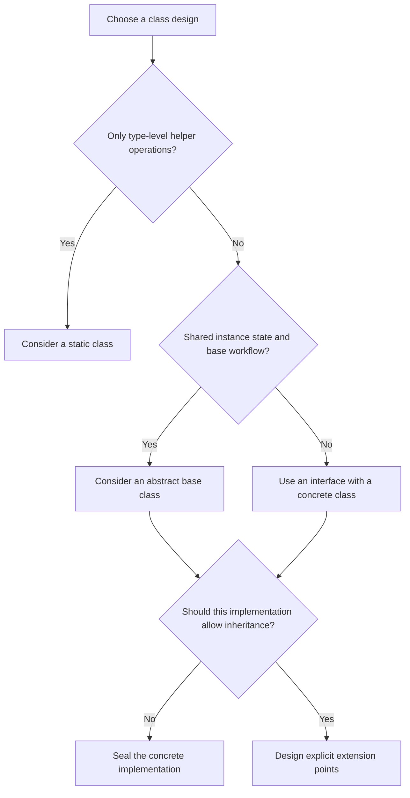

# C# Interview Guide: Static Classes, Static Constructors, Sealed Classes, and Abstract Classes

Audience: experienced .NET developers, technical leads, and full-stack developers.

Code snippets are independent unless explicitly grouped. Add the relevant `System` namespaces when using snippets in a project. Invalid examples are deliberately marked.

## Contents

1. [Quick comparison](#1-quick-comparison)
2. [Static classes](#2-static-classes)
3. [Static constructors](#3-static-constructors)
4. [Sealed classes and members](#4-sealed-classes-and-members)
5. [Abstract classes](#5-abstract-classes)
6. [Scenario questions](#6-scenario-questions)
7. [Predict the output](#7-predict-the-output)
8. [Decision flowchart](#8-decision-flowchart)
9. [Interview tips and revision](#9-interview-tips-and-revision)
10. [References](#10-references)

## 1. Quick comparison

A **static class** groups type-level operations. A **static constructor** initializes a type. A **sealed class** prevents inheritance. An **abstract class** defines a base abstraction that cannot be instantiated directly.

| Feature | Static class | Sealed class | Abstract class |
|---|---|---|---|
| Direct instantiation | No | Yes, if an accessible constructor exists | No |
| Other classes can derive from it | No | No | Yes |
| Can derive from a custom base class | No | Yes | Yes |
| Can implement interfaces | No | Yes | Yes; implementation may be deferred |
| Instance members | No | Yes | Yes |
| Static members | Yes | Yes | Yes |
| Instance constructor | No | Yes | Yes, usually protected |
| Static constructor | Yes | Yes | Yes |
| Abstract instance members | No | No | Yes |
| Typical use | Stateless helper | Final implementation | Shared state and controlled extension points |

A static constructor is a member, not a fourth category of class. A normal, sealed, abstract, or static class can declare one.

## 2. Static classes

### Q1. What is a static class?

A class declared with `static` cannot have instances. Its operations are accessed through the type name, so it suits calculations and other operations that do not require per-object state.

```csharp
public static class PriceCalculator
{
    public static decimal AddTax(decimal amount, decimal rate)
    {
        if (amount < 0 || rate < 0)
            throw new ArgumentOutOfRangeException();

        return amount + amount * rate;
    }
}

// Usage inside a method:
// decimal total = PriceCalculator.AddTax(100m, 0.18m); // 118
```

**Interview answer:** “A static class is a non-instantiable type containing static members. I use it for cohesive operations that do not need instance state or runtime substitution.”

### Q2. What restrictions apply?

- No `new`, instance constructor, `this`, or instance members.
- No custom base class or implemented interface list.
- No deriving from it.
- No virtual or abstract instance behavior.
- No declaring variables or parameters of that static class type.
- Constants and nested types are allowed; they do not create instances of the containing static class.

```csharp
public static class Utility
{
    public const int MaximumAttempts = 3;
    public static string Normalize(string value) => value.Trim();
}

// Invalid:
// var utility = new Utility();
// public class CustomUtility : Utility { }
```

Although the runtime representation behaves as abstract and sealed, C# does not allow writing `static abstract class` or `static sealed class`.

### Q3. Can a normal class contain static methods?

Yes. A static member belongs to its declaring type; its containing class does not have to be static.

```csharp
public class Employee
{
    public string Name { get; }
    public Employee(string name) => Name = name;
    public static bool IsValidName(string name) =>
        !string.IsNullOrWhiteSpace(name);
}
```

A static method cannot directly access instance data. It can access an instance passed as a parameter or created inside the method.

### Q4. Are static methods thread-safe?

No automatic guarantee exists. A pure calculation using only parameters and local variables is usually easy to call concurrently. A method that mutates shared fields needs synchronization.

```csharp
public static class RequestCounter
{
    private static int _count;
    public static int Increment() =>
        System.Threading.Interlocked.Increment(ref _count);
}
```

`_count++` is a read-modify-write operation and can lose updates under concurrency. `Interlocked` addresses that single counter operation; it does not make a multi-step business workflow atomic.

### Q5. Static class versus singleton service?

| Static class | Singleton service |
|---|---|
| No object instance | One service instance per DI registration/container lifetime |
| Direct calls through type name | Consumers receive a dependency |
| Cannot implement an interface | Can implement an interface |
| Dependencies tend to become implicit | Constructor dependencies are explicit |
| Appropriate for pure helpers | Appropriate for shared services with dependencies |

In ASP.NET Core, a singleton is not “one instance across all servers.” Each application process/container has its own service instances. Static state is also not a distributed store.

### Q6. Can extension methods be declared in a static class?

Yes. The traditional extension-method syntax uses a non-generic static method container that is not nested.

```csharp
public static class StringExtensions
{
    public static bool HasText(this string? value) =>
        !string.IsNullOrWhiteSpace(value);
}

// bool result = "Protocol Pro".HasText();
```

Extension calls use compile-time method resolution. They do not override instance virtual methods. Newer C# versions also support extension blocks; the example above uses the established syntax.

## 3. Static constructors

### Q7. What is a static constructor?

A static constructor performs initialization associated with a type rather than an object. It has the type's name, the `static` modifier, no parameters, and no access modifier.

```csharp
public class ReportSettings
{
    public static string DefaultFormat { get; }

    static ReportSettings()
    {
        DefaultFormat = "PDF";
    }

    public ReportSettings() { }
}
```

It is invoked automatically by the runtime, at most once for a given initialized type in its runtime context. A non-static class can contain both static and instance constructors.

### Q8. When does it run?

For ordinary reference-type usage, an explicit static constructor runs before the first instance is created or a static member declared by that type is used. Do not assume it executes at application startup or when the assembly is loaded.

Important qualifications:

- Reading an inlined `const` does not trigger runtime type initialization.
- `typeof(T)` alone does not normally trigger its static constructor.
- Static field initializers run before the static constructor body, in textual order within the type.
- A static field initializer can itself create an instance, so avoid the absolute claim that a static constructor always precedes every possible instance-constructor invocation.
- Without an explicit static constructor, `beforefieldinit` permits more flexible runtime initialization timing. Do not rely on exact timing of field initializers in such types.

### Q9. Can it be overloaded, called manually, async, or inherited?

| Question | Answer |
|---|---|
| More than one per class? | No |
| Parameters or access modifiers? | No |
| Called like a normal method? | No |
| Inherited by a derived class? | No; each type has its own initialization |
| Declared `async`? | No |
| Instance members accessed directly? | No |
| Used in a sealed or abstract class? | Yes |

Avoid synchronous waits on tasks, locks involving other types, network calls, and expensive startup work inside static constructors. Type initialization synchronization can interact badly with blocking operations.

### Q10. What happens if it throws?

The runtime does not rerun the failed static constructor for that type in the same runtime context. Subsequent operations requiring initialization continue to fail, commonly with `TypeInitializationException`. Examine `InnerException` for the original cause.

```csharp
public static class BrokenSettings
{
    public static string Value { get; }

    static BrokenSettings()
    {
        throw new InvalidOperationException("Configuration missing.");
    }
}
```

**Design implication:** A temporary database outage should not permanently break a type's initialization. Use an explicit initialization service or a retry-aware operation for transient external work.

### Q11. Does runtime synchronization make all static access safe?

The runtime coordinates static initialization so it is not executed concurrently multiple times for the same type. That protection does not cover later mutations of static fields. Cyclic initialization can also expose default or partially initialized values, so avoid cycles between types.

### Q12. Does every generic type share the same static fields?

Each closed constructed generic type has separate static state.

```csharp
public static class TypeCounter<T>
{
    public static int Count;
}

// Inside a method:
// TypeCounter<int>.Count = 10;
// TypeCounter<string>.Count = 20;
// Console.WriteLine(TypeCounter<int>.Count); // 10
```

`TypeCounter<int>` and `TypeCounter<string>` are distinct types for this purpose. The distinction applies to their static initialization too.

## 4. Sealed classes and members

### Q13. What is a sealed class?

A sealed class cannot be used as a base class. It can still have instances, implement interfaces, and derive from another class.

```csharp
public interface IReferenceFormatter
{
    string Format(string documentId, int page);
}

public sealed class ReferenceFormatter : IReferenceFormatter
{
    public string Format(string documentId, int page) =>
        $"{documentId}, page {page}";
}

// Invalid: public class CustomFormatter : ReferenceFormatter { }
```

**Interview answer:** “Sealed closes an implementation to inheritance. I can still expose it through an interface and use composition to extend surrounding behavior.”

### Q14. Why seal a class?

Use sealing when subclassing is not part of the intended contract: for example, a final strategy implementation whose invariants should remain controlled.

Sealing can help runtime devirtualization in some call sites, but performance gains depend on the JIT, call context, and workload. Do not promise that every sealed class is faster.

Sealed does not mean immutable, thread-safe, singleton, or a security boundary.

### Q15. What is a sealed override?

It prevents further overriding of an inherited virtual member while allowing the containing class to remain inheritable.

```csharp
public class Exporter
{
    public virtual string FormatName() => "Generic";
}

public class PdfExporter : Exporter
{
    public sealed override string FormatName() => "PDF";
}

public class AuditedPdfExporter : PdfExporter
{
    // Cannot override FormatName again.
}
```

For ordinary class methods, `sealed` is used with `override`; it cannot independently seal a new non-overriding method. A derived class could hide a member using `new`, but hiding is not an override and does not change dispatch through the base contract.

### Q16. Can a sealed class have virtual methods?

It cannot introduce new virtual methods because no derived class could override them. It can inherit virtual members and override them. A sealed class is allowed to override `ToString()`, for example.

### Q17. Can a sealed class be mocked?

Subclass-based mocking cannot derive from it. Prefer testing consumers against an interface and substituting that interface. Some specialized interception tools can work with sealed types, but that does not remove the design benefit of explicit abstractions.

## 5. Abstract classes

### Q18. What is an abstract class?

An abstract class represents a base abstraction that cannot be instantiated directly. It can provide state, constructors, implemented methods, virtual methods, and abstract members that derived concrete classes must implement.

```csharp
public abstract class DocumentExporter
{
    protected DocumentExporter(string studyId)
    {
        if (string.IsNullOrWhiteSpace(studyId))
            throw new ArgumentException("Study ID is required.", nameof(studyId));

        StudyId = studyId;
    }

    protected string StudyId { get; }
    public string FileName => $"{StudyId}.{Extension}";
    protected abstract string Extension { get; }
    public abstract byte[] Export(string content);
}

public sealed class TextExporter : DocumentExporter
{
    public TextExporter(string studyId) : base(studyId) { }
    protected override string Extension => "txt";
    public override byte[] Export(string content) =>
        System.Text.Encoding.UTF8.GetBytes(content);
}

// DocumentExporter exporter = new TextExporter("STUDY-001");
// Console.WriteLine(exporter.FileName); // STUDY-001.txt
```

The example creates actual text bytes; a production PDF/DOCX exporter would use an appropriate document library.

### Q19. Why does an abstract class need a constructor?

Its constructor establishes the base portion of a derived object. It can validate shared dependencies and initialize state. `protected` usually expresses the intended use clearly.

The inability to instantiate the abstract class directly does not mean its constructor never executes.

### Q20. Abstract method versus virtual method?

| Abstract method | Virtual method |
|---|---|
| Has no implementation body | Has a default implementation |
| Requires an abstract containing class | Can be in a concrete or abstract class |
| Must be implemented before a derived class becomes concrete | Overriding is optional |
| Expresses required variation | Expresses optional customization |

An intermediate abstract derived class can defer implementation. A concrete descendant must satisfy the remaining abstract members.

### Q21. Can an abstract class have no abstract methods?

Yes. Marking a class abstract can prevent direct instantiation even when all its methods are implemented. This is useful when only specialized derived forms make sense.

### Q22. Can an abstract member be private or static?

An abstract instance member cannot be private because derived classes must be able to implement it. Use `protected`, `public`, or another accessibility appropriate to the inheritance boundary.

A class cannot declare a `static abstract` method. Modern C# supports static abstract members in interfaces for generic static polymorphism; that feature does not make static abstract class methods legal.

### Q23. Abstract class versus interface?

| Need | Usually choose |
|---|---|
| Shared instance state and constructor validation | Abstract class |
| Common workflow with controlled customization | Abstract class |
| Capability implemented by unrelated types | Interface |
| Multiple independent contracts | Interfaces |
| DI boundary with interchangeable implementations | Usually interface |

C# permits one base class and multiple interfaces. Interfaces can have default implementations and modern static-member features; “interfaces never contain implementation” is outdated. They still do not provide ordinary per-object instance fields and base instance constructors like classes do.

### Q24. Why avoid virtual calls from constructors?

A base constructor can dispatch to a derived override before the derived constructor body has established its invariants. The override may observe incomplete state.

Keep constructors focused on initialization. Invoke overridable workflow steps after construction, through a normal operation or explicit initialization pattern.

## 6. Scenario questions

### S1. A tax calculation is reused across APIs. Which class type fits?

**Answer:** Use a static helper if it is a deterministic calculation driven entirely by inputs. If rates come from a tenant database, effective-date policy, or external provider, inject a pricing/tax service instead.

**Follow-up:** How do you test it? Pure helpers can be tested directly with inputs and expected outputs. Service consumers can use a substitute interface implementation.

### S2. A developer stores the current logged-in user in a static property. What happens?

**Answer:** Concurrent requests can overwrite each other's user state, leading to incorrect attribution or data exposure. Use request-scoped user context derived from authenticated claims. Pass identity explicitly into background work.

Changing the property to `static readonly` is not a solution for request-specific data.

### S3. You need configuration refresh without restarting the application. Use a static constructor?

**Answer:** No. A static constructor is one-time type initialization. Use an injected configuration abstraction with appropriate refresh support, such as `IOptionsMonitor<T>` when the configured provider supports change notifications.

Choose `IOptionsSnapshot<T>` for scoped snapshots where appropriate; understand its scoped lifetime rather than injecting it into a singleton.

### S4. An API becomes unusable after one failed SQL connection at startup. What do you inspect?

**Answer:** Check for `TypeInitializationException` and its inner exception. A static initializer may be performing a database call. Move transient I/O to a normal service with explicit failure handling, timeouts, and a retry policy suitable for the operation.

### S5. You need exactly one cache across five application replicas. Is a static dictionary enough?

**Answer:** No. Each process has its own state. A concurrent dictionary can protect concurrent operations in one process, but cannot synchronize replicas. Use a distributed cache if the requirement is a shared cache, and define invalidation and consistency behavior separately.

### S6. A report pipeline always validates, renders, then records completion. Formats vary. What fits?

**Answer:** An abstract base can implement the Template Method pattern: a non-virtual public operation fixes the sequence, while protected abstract methods provide format-specific behavior.

```csharp
public abstract class ExportPipeline
{
    public byte[] Execute(string content)
    {
        if (string.IsNullOrWhiteSpace(content))
            throw new ArgumentException("Content required.", nameof(content));

        byte[] result = Render(content);
        OnCompleted();
        return result;
    }

    protected abstract byte[] Render(string content);
    protected virtual void OnCompleted() { }
}
```

If recording completion is mandatory audit behavior, implement it in the fixed workflow using an injected audit dependency. An optional overridable hook is not sufficient to enforce an audit requirement. Also define failure behavior if rendering or auditing fails.

### S7. A payment implementation must not be subclassed, but it must support DI. What do you choose?

**Answer:** A sealed implementation of an interface. Consumers depend on the interface. Constructor injection still works; sealing does not interfere with DI activation.

```csharp
public interface IPaymentService
{
    string GetProviderName();
}

public sealed class PaymentService : IPaymentService
{
    public string GetProviderName() => "Configured provider";
}

// ASP.NET Core registration, with suitable namespaces:
// builder.Services.AddScoped<IPaymentService, PaymentService>();
```

The snippet demonstrates the abstraction and registration only; production payment execution needs its own idempotency and failure design.

### S8. A sealed service needs new logging behavior. Must you remove sealed?

**Answer:** No. Use a decorator implementing the same interface, wrap the original service, and add logging around delegated calls. Composition preserves the original inheritance boundary.

### S9. A team says sealing guarantees an audit log cannot be tampered with. Is that correct?

**Answer:** No. Sealing prevents subclassing. Audit integrity also depends on access control, append-only persistence, authorization, retention, and verification. Choose sealing for object design; address persistence integrity separately.

### S10. All exporters share state, but notification channels do not. One abstract base for both?

**Answer:** Avoid forcing unrelated capabilities into one inheritance hierarchy. An exporter base may be justified by common state and workflow. Use a notification interface for email, SMS, and push implementations. Shared code alone is not enough to establish a meaningful “is-a” relationship.

### S11. A singleton service needs an EF Core DbContext. Can it hold one forever?

**Answer:** No. DbContext is normally scoped and is not thread-safe. Use a scoped service, or explicitly create a scope/context per operation through the appropriate scope factory or context factory. Static access does not solve a lifetime mismatch.

### S12. A class exposes `static readonly List<string>`. Is the list immutable?

**Answer:** No. `readonly` prevents reassigning the field after initialization; callers can still mutate the referenced list. Use an immutable collection or return a defensive copy. A read-only interface alone does not guarantee that the underlying object cannot change.

### S13. A static constructor loads a large model. First request times out. What changes?

**Answer:** Move expensive initialization into an explicit startup/warmup lifecycle with observable readiness and failure handling. If on-demand loading is appropriate, use an asynchronous initialization design and coordinate concurrent callers. Do not hide long-running I/O behind type initialization or block on `.Result` in a static constructor.

### S14. You want plugin implementations from external teams. Should the base class be sealed?

**Answer:** The plugin extension contract must be extensible: typically an interface or intentionally designed abstract base. Individual final plugin implementations may be sealed. Define cancellation, errors, versioning, and dependency ownership in the contract.

### S15. You need to stop overriding one validation method but still allow subclassing. Which keyword?

**Answer:** Use `sealed override` on the inherited virtual method. If the method is new, use a non-virtual method and delegate intended extension points separately.

### S16. When should you avoid an abstract base class?

**Answer:** When implementations only share a capability, when inheritance creates tight coupling, or when consumers need independent interchangeable policies. Prefer interfaces and composition. A base class becomes valuable when shared state and a stable workflow are intrinsic to all descendants.

## 7. Predict the output

### P1. Static and instance constructor count

```csharp
public class Demo
{
    static Demo() => Console.WriteLine("Static");
    public Demo() => Console.WriteLine("Instance");
}

// Execute inside Main:
// new Demo();
// new Demo();
```

Output:

```text
Static
Instance
Instance
```

The explicit static constructor initializes the type once. The instance constructor runs for each object.

### P2. Field initializer before static constructor body

```csharp
public class InitializationOrder
{
    private static int _value = Initialize();

    private static int Initialize()
    {
        Console.WriteLine("Field initializer");
        return 10;
    }

    static InitializationOrder()
    {
        Console.WriteLine($"Static constructor: {_value}");
        _value = 20;
    }

    public static int Value => _value;
}

// Console.WriteLine(InitializationOrder.Value);
```

Output:

```text
Field initializer
Static constructor: 10
20
```

### P3. Runtime polymorphism through an abstract base

```csharp
public abstract class Animal
{
    public abstract string Speak();
}

public sealed class Dog : Animal
{
    public override string Speak() => "Bark";
}

// Animal animal = new Dog();
// Console.WriteLine(animal.Speak());
```

Output: `Bark`. The runtime object determines the overridden instance method.

### P4. Sealed override versus method hiding

```csharp
public class BaseType
{
    public virtual string GetName() => "Base";
}

public class MiddleType : BaseType
{
    public sealed override string GetName() => "Middle";
}

public class LeafType : MiddleType
{
    public new string GetName() => "Leaf";
}

// LeafType leaf = new LeafType();
// BaseType asBase = leaf;
// Console.WriteLine(leaf.GetName());
// Console.WriteLine(asBase.GetName());
```

Output:

```text
Leaf
Middle
```

The hidden member is selected through the `LeafType` expression. Virtual dispatch through the base contract remains at the sealed override.

### P5. Constructor invocation in inheritance

```csharp
public abstract class Parent
{
    protected Parent() => Console.WriteLine("Parent constructor");
}

public sealed class Child : Parent
{
    public Child() => Console.WriteLine("Child constructor");
}

// new Child();
```

Output:

```text
Parent constructor
Child constructor
```

This example has no field initializers or constructor chaining; do not generalize it into a complete initialization-order rule for more complex code.

### P6. Which declarations fail?

```csharp
// All deliberately invalid:
// public abstract sealed class A { }
// public static class B : IDisposable { }
// public sealed class C { public virtual void Run() { } }
// public abstract class D { private abstract void Run(); }
// public class E { public static E(int value) { } }
```

| Declaration | Reason |
|---|---|
| A | Abstract permits specialization; sealed forbids derivation; C# rejects the combination |
| B | Static classes cannot implement interfaces |
| C | A sealed class cannot introduce a virtual method |
| D | An abstract instance member cannot be private |
| E | Static constructors cannot have parameters or access modifiers |

## 8. Decision flowchart



Static initialization is a separate decision: use simple field initialization where sufficient; use a static constructor for necessary synchronous type initialization; use explicit services for external or asynchronous startup work.

## 9. Interview tips and revision

### Answer structure for experienced candidates

1. State the language rule.
2. Give a concrete use case.
3. Explain the trade-off.
4. Identify lifetime, concurrency, and testability implications.
5. Explain when a different design fits better.

Example: “I use a sealed implementation behind an interface when I want consumers to replace behavior through DI but do not want subclassing of the implementation. It remains testable through the interface. Additional behavior can be composed with a decorator.”

### Common incorrect statements

| Incorrect statement | Correction |
|---|---|
| Static means thread-safe | Later shared mutations need synchronization |
| Static means one copy across all servers | State belongs to the relevant type/runtime context in each process |
| Sealed means immutable | Sealing controls inheritance only |
| Abstract classes cannot have constructors | Their constructors initialize derived objects |
| Every abstract class requires an abstract method | An abstract class can contain only implemented members |
| Static constructors retry after failure | Failed initialization is not automatically retried for that type |
| A singleton is the same as a static class | A singleton is an instance with a managed lifetime |
| Interfaces never contain implementations | Modern interfaces support default implementations |
| Static readonly makes a referenced object immutable | It restricts field reassignment |
| Every sealed method requires a sealed class | Sealed overrides can be declared in inheritable classes |

### Thirty-second answers

**Static class:** “A non-instantiable class for type-level operations. Good for stateless helpers; shared mutable state needs synchronization.”

**Static constructor:** “A parameterless constructor invoked automatically for type initialization. It runs at most once for the type in its runtime context and should avoid blocking or transient I/O.”

**Sealed class:** “A class that cannot be inherited. It can be instantiated, implement interfaces, and participate in DI.”

**Abstract class:** “A non-instantiable base type that can share state and behavior while requiring derived classes to implement specific operations.”

### Practice prompts

- Explain why a request user context should not be static.
- Design a sealed service with an interface and logging decorator.
- Implement an export workflow with mandatory validation and customizable rendering.
- Explain a `TypeInitializationException` and how you would investigate it.
- Compare a pure static helper with an injected business policy service.
- Explain separate generic static state using `Cache<int>` and `Cache<string>`.
- Distinguish override, sealed override, and method hiding.

## 10. References

Primary references for checking language rules and exploring details:

- [Microsoft Learn: Static classes and static members](https://learn.microsoft.com/en-us/dotnet/csharp/programming-guide/classes-and-structs/static-classes-and-static-class-members)
- [Microsoft Learn: Static constructors](https://learn.microsoft.com/en-us/dotnet/csharp/programming-guide/classes-and-structs/static-constructors)
- [Microsoft Learn: Abstract and sealed classes and members](https://learn.microsoft.com/en-us/dotnet/csharp/programming-guide/classes-and-structs/abstract-and-sealed-classes-and-class-members)
- [C# language specification: Classes](https://learn.microsoft.com/en-us/dotnet/csharp/language-reference/language-specification/classes)

The examples and scenario discussions are explanatory interview material. Exact initialization and dispatch rules should be checked against the language specification for advanced edge cases.
