# Domain-Driven Design: Detailed Interview Guide

For Senior .NET Developers, Technical Leads, Project Leads, and Solution Architects.

This guide expands all 20 core questions and 10 scenarios from the supplied **DDD Interview Questions.pdf**. Priorities express preparation value, not measured company interview frequency. Examples are proposed designs; actual boundaries depend on business rules.

**DDD is a software design approach, not one design pattern.** It combines strategic modeling with tactical patterns such as entities, value objects, aggregates, repositories, and domain services.

## Contents

- [Preparation priorities](#preparation-priorities)
- [Core interview questions](#core-interview-questions)
- [Architecture scenarios](#architecture-scenarios)
- [End-to-end ASP.NET Core example](#end-to-end-aspnet-core-example)
- [Interview tips and answer framework](#interview-tips-and-answer-framework)
- [Revision checklist](#revision-checklist)
- [Static-site publishing notes](#static-site-publishing-notes)
- [References](#references)

## Preparation priorities

| Priority | Questions | What you should demonstrate |
|---|---|---|
| Critical | 1–6, 9, 14, 17 | Business language, model boundaries, invariants, reliable integration |
| High | 7–8, 10–13, 15–16, 18 | Practical .NET implementation and architectural trade-offs |
| Advanced | 19–30 | Failure recovery, scale, migration, ownership, operational judgment |

Start with a short answer, explain a business example, identify the consistency boundary, then discuss failure modes and trade-offs.

## Core interview questions

### 1. What is DDD, and when should you use it?

**Interview answer:** Domain-Driven Design builds software around a model of the business developed collaboratively with domain experts. Its value is aligning business language, rules, and software boundaries so that complex behavior can evolve safely.

There are two complementary levels:

- **Strategic design:** Discover subdomains, bounded contexts, ownership, and relationships between models.
- **Tactical design:** Implement behavior with entities, value objects, aggregates, domain services, repositories, and events.

For example, hospital Registration manages patient identity and admission, Billing manages charges and invoices, and Laboratory manages orders and results. Each has its own rules and view of a patient.

A **core subdomain** provides business differentiation, a **supporting subdomain** enables the business, and a **generic subdomain** solves a common problem such as authentication. Spend the most modeling effort where complexity and business value justify it. A subdomain belongs to the problem space; a bounded context is a boundary of the implemented model. They need not have a fixed one-to-one mapping.

Use DDD when rules are complex, vocabulary is ambiguous, and several teams or capabilities evolve independently. A simple CRUD catalogue may need clear modules and validation without a rich domain model.

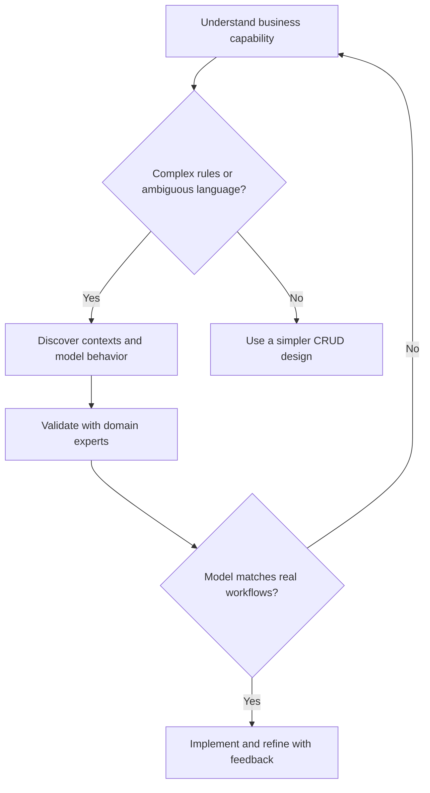

**Follow-up:** Does DDD require microservices? No. A modular monolith can implement DDD very effectively.

**Interview tip:** Begin with business complexity and a specific rule. Naming frameworks is insufficient evidence of DDD.

### 2. What is a bounded context?

**Interview answer:** A bounded context defines where a domain model, its language, and its rules have a consistent meaning. Crossing that boundary requires explicit translation or contracts.

| Context | Meaning of Patient | Owned behavior |
|---|---|---|
| Registration | Demographics and admission identity | Admit and discharge |
| Billing | Party responsible for charges | Issue invoices and record payments |
| Laboratory | Subject of a test order | Collect samples and finalize results |

Do not force every context to use one shared `Patient` entity containing all attributes. That creates coupling between unrelated rules and release cycles. Share stable identifiers or contract data where appropriate, rather than sharing internal domain classes.

A bounded context is a **model boundary**; a microservice is a **deployment boundary**. One context can remain a module or contain multiple deployable components. A service that mixes several incompatible models is a warning sign, although transitional systems may do so deliberately.

**Context mapping** makes relationships explicit:

| Relationship | Meaning |
|---|---|
| Partnership | Teams coordinate changes jointly |
| Customer–Supplier | Downstream needs influence upstream priorities |
| Conformist | Downstream accepts the upstream model |
| Anti-Corruption Layer | Downstream translates and protects its own model |
| Shared Kernel | Small shared model/code with joint governance |
| Open Host Service / Published Language | Stable public interface and documented exchange language |

**Follow-up:** Can contexts use the same database server? Yes, but keep ownership explicit. Independent deployment becomes harder when contexts write each other's tables.

**Interview tip:** Explain what a term means differently in two contexts, then describe the boundary contract. [R1]

### 3. Entity vs value object: what is the difference?

**Interview answer:** An entity is tracked by identity over time. A value object is defined by its values and is generally immutable.

| Aspect | Entity | Value object |
|---|---|---|
| Equality | Stable identity in the relevant scope | Component values |
| Lifecycle | Changes while retaining identity | Replaced with a new value |
| Example | Patient, Invoice | Money, DateRange |
| Typical behavior | Admit, Pay, Cancel | Add, Contains, Overlaps |

```csharp
public sealed record Money
{
    public decimal Amount { get; }
    public string Currency { get; }

    public Money(decimal amount, string currency)
    {
        if (string.IsNullOrWhiteSpace(currency) || currency.Trim().Length != 3)
            throw new ArgumentException("Use a three-letter currency code.");

        Amount = amount;
        Currency = currency.Trim().ToUpperInvariant();
    }

    public Money Add(Money other)
    {
        if (Currency != other.Currency)
            throw new InvalidOperationException("Currencies must match.");
        return new Money(Amount + other.Amount, Currency);
    }
}
```

A C# record provides value-based equality for its members; it does not automatically make all referenced objects deeply immutable. This example uses immutable scalar properties. Production currency validation can use an approved currency catalogue. Whether negative money is valid depends on the business operation; a credit amount may be negative while an invoice charge may forbid it.

Two invoices for the same amount remain different entities. Two `Money(100, "INR")` values are equal. An address may be a value object in checkout but an entity in a property registry: classification depends on the domain.

**Follow-up:** Why immutable? Immutability prevents shared values changing unexpectedly and makes equality easier to reason about.

**Interview tip:** Do not define entity as “a class with an integer primary key.” Explain continuity of identity.

### 4. What are an aggregate, aggregate root, and invariant?

**Interview answer:** An aggregate groups domain objects that must protect a set of business invariants as a consistency boundary. Its root is the public entry point for changes.

An `Invoice` may contain a bounded set of `InvoiceLine` children. Rules include: only draft invoices accept lines; issued invoices contain at least one line; charges must be positive. The root enforces these rules through methods, rather than public setters.

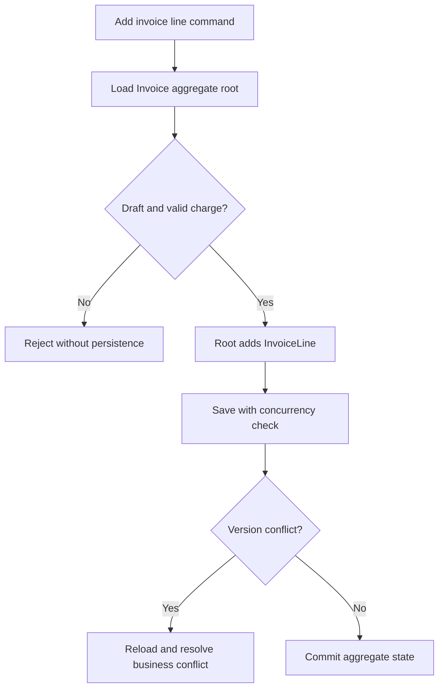

An invariant is a rule that must remain true at the relevant consistency boundary, such as an issued invoice always having lines. UI validation helps users, but the root must protect its invariants regardless of which API calls it.

External code should not mutate child collections directly. Reference other aggregates by identity in the domain model where practical. Loading and modifying a huge connected object graph makes locking, persistence, and concurrency more expensive.

**Follow-up:** Can one aggregate change another? Its methods should not reach into another aggregate's internals. An application service can coordinate roots; events or a process manager can coordinate eventual consistency. A justified local transaction can cover multiple roots, but frequent need for that deserves a boundary review.

**Interview tip:** Give the invariant first, then justify which objects must live together. A database relationship alone does not establish an aggregate.

### 5. Aggregate vs bounded context: how do you choose boundaries?

**Interview answer:** A bounded context is a boundary of meaning and model ownership. An aggregate is a smaller boundary for enforcing consistent changes. One context normally contains multiple aggregates.

For Billing, `Invoice`, `Payment`, and `Refund` may be separate aggregates. Do not put every invoice and payment inside one `Hospital` aggregate merely because they share a hospital ID.

To choose an aggregate, ask:

1. Which rule must hold immediately after this command commits?
2. What state must be read and changed together to enforce it under concurrency?
3. Can remaining updates happen later with visible pending states?
4. Will this boundary grow without limit or become a contention hotspot?

For a payment total rule, a `PaymentAllocation` design might enforce allocations through a payment root with a limited collection, or use a dedicated allocation ledger and atomic database constraints. The right model depends on allocation volume and correction requirements.

**Follow-up:** Should aggregates always be tiny? They should be as small as the required invariants allow. Splitting an aggregate while silently weakening a mandatory rule is also wrong.

**Interview tip:** State both correctness and throughput implications of your chosen boundary.

### 6. What is ubiquitous language?

**Interview answer:** Ubiquitous language is the shared, precise vocabulary used by domain experts and the delivery team within a bounded context. It should appear in discussions, rules, code, events, and tests.

Prefer `AdmitPatient`, `IssueInvoice`, and `FinalizeLabResult` over `UpdateData` or `ProcessRecord`. Model terms change as understanding improves; refactoring names is part of maintaining the model.

A glossary must resolve ambiguity, not just collect words. Does “approved” mean clinical approval, financial authorization, or release permission? These may be distinct concepts in separate contexts.

**Follow-up:** Must every team use identical terminology? No. Maintain consistency within a context and map meanings across contexts.

**Interview tip:** Explain how you resolve a naming disagreement with a concrete workflow and example.

### 7. Domain service vs application service?

**Interview answer:** A domain service implements a business operation that does not naturally belong to one entity or value object. An application service orchestrates a use case.

| Concern | Domain service | Application service |
|---|---|---|
| Responsibility | Domain rule or calculation | Execution of a use case |
| Example | Allocate a discount across eligible charges | Load invoice, invoke rule, save, respond |
| Dependencies | Domain abstractions and values | Repositories, identity, transaction coordination |
| Transport details | None | Usually delegated to API adapters |

An `IssueInvoiceHandler` loads an invoice, gets required policy inputs, calls domain behavior, stages any integration event, and commits. A `TaxPolicy` calculates tax using supplied jurisdiction and tax data. HTTP calls to a tax provider belong behind an adapter; the calculation should not depend on `HttpContext` or an SDK response type.

Domain services can depend on domain-defined abstractions when needed. Prefer explicit inputs where that simplifies reasoning and testing. Avoid relocating every entity behavior into a `SomethingService`.

**Follow-up:** Where do transactions belong? The application use-case boundary coordinates commit; infrastructure implements the transaction mechanism.

**Interview tip:** Distinguish deciding business outcomes from coordinating technical work.

### 8. What are repositories and Unit of Work in DDD?

**Interview answer:** A repository provides collection-like access to aggregate roots. A Unit of Work coordinates persistence of changes within a transaction.

```csharp
public interface IInvoiceRepository
{
    Task<Invoice?> GetAsync(Guid id, CancellationToken ct);
    Task AddAsync(Invoice invoice, CancellationToken ct);
}

public interface IUnitOfWork
{
    Task<int> SaveChangesAsync(CancellationToken ct);
}
```

Create repositories around required aggregate access, not automatically for every table. A repository should load the state necessary for the root's business behavior. Queries for dashboards can use direct DTO projections instead of reconstructing aggregates.

EF Core's `DbContext` already provides change tracking and Unit of Work behavior. An additional interface is a design choice for boundaries and testability, not a universal requirement. Generic CRUD wrappers often add little if they simply duplicate EF APIs.

Avoid leaking `IQueryable` from a domain-facing repository when it makes consumers depend on database query translation or permits arbitrary access to domain internals.

**Follow-up:** Should each repository call `SaveChanges`? Usually no: the application use case owns the commit so related state and outbox writes can succeed atomically.

**Interview tip:** Describe what the abstraction protects and what complexity it adds.

### 9. Domain events vs integration events, and reliable publishing?

**Interview answer:** A domain event records a meaningful business occurrence within a model. An integration event is a public contract communicating committed information across a process or context boundary.

| Aspect | Domain event | Integration event |
|---|---|---|
| Audience | Internal domain/application handlers | Other contexts or external consumers |
| Example | InvoiceIssuedDomainEvent | InvoiceIssuedV1 |
| Shape | Internal model needs | Stable, minimal public contract |
| Timing | Dispatched before or after commit by design | Published for committed business facts |
| Versioning | Coordinated internally | Explicit compatibility strategy |

An aggregate records events in memory. It does not publish directly to Azure Service Bus. Application/infrastructure handlers translate appropriate domain facts into integration contracts.

**Transactional Outbox:** Persist aggregate changes and an outbox row in the same local transaction. A worker publishes pending rows and marks them sent. If it crashes after publishing but before marking sent, a duplicate is possible. Consumers therefore need idempotency.

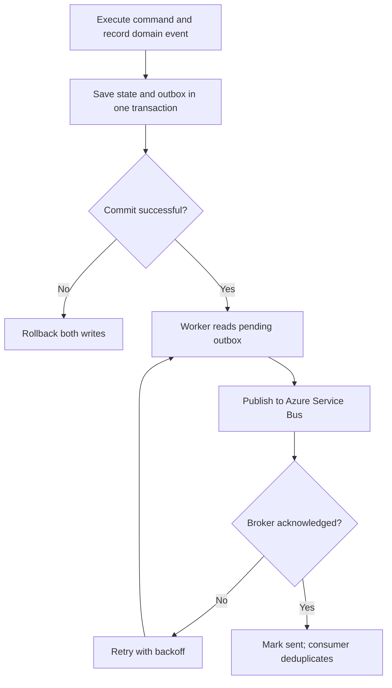

Before-commit internal handlers can participate in the local transaction if deliberately designed. After-commit in-memory dispatch alone leaves a crash gap; durable follow-up work needs an outbox or equivalent guarantee.

**Follow-up:** Does an outbox guarantee exactly-once delivery? No. It closes the database-to-broker loss gap while permitting retries and duplicate deliveries. Retention, monitoring, poison-message handling, and idempotent consumers are still needed.

**Interview tip:** Name the crash window and explain recovery. [R2, R3]

### 10. What is an Anti-Corruption Layer?

**Interview answer:** An ACL translates between external semantics and the local model so that legacy or third-party concepts do not spread through the domain.

Suppose a legacy system exposes `CustNo`, integer status codes, and amounts in minor currency units. The ACL translates them to `BillingAccountId`, explicit domain status, and a validated monetary value. It must also interpret meaning: a legacy “settled” flag might not mean funds were reconciled.

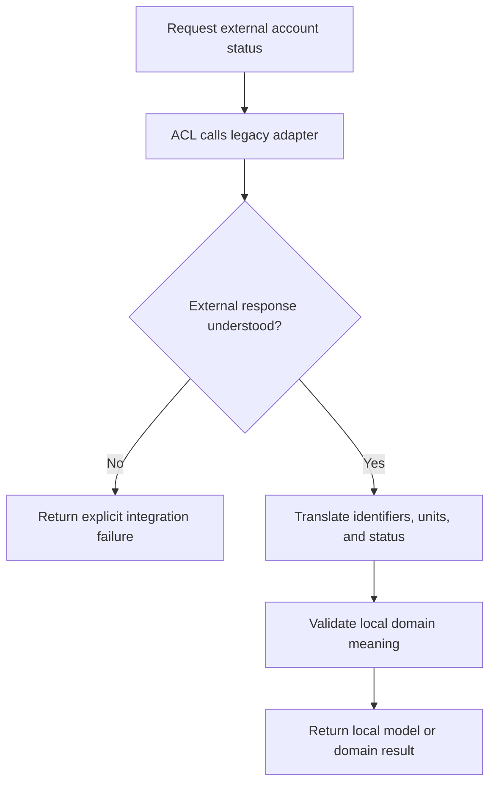

In Clean Architecture, the application/domain owns the port it requires and Infrastructure implements the external adapter and translation. Complex semantic translation can involve local domain types; SDK and transport types stay outside the core.

**Follow-up:** Is an ACL just AutoMapper? No. Field copying may help implementation, but semantic translation and protecting rules are the purpose.

**Interview tip:** Explain a mismatch in meaning, not only a renamed field. [R4]

### 11. DDD vs Clean Architecture?

**Interview answer:** DDD helps discover and express the business model. Clean Architecture organizes dependency direction so business policy is insulated from external mechanisms.

| Approach | Main question |
|---|---|
| DDD | What business concepts, rules, and model boundaries should exist? |
| Clean Architecture | Which parts may depend on which abstractions? |
| CQRS | Should reads and writes use different models or paths? |
| Microservices | Which capabilities need independent deployment and operation? |

You can use DDD in a layered monolith. You can also build a Clean Architecture CRUD application without rich aggregates.

**Follow-up:** Does a Domain project prove DDD? No. The code must reflect domain language and protect relevant rules.

**Interview tip:** Avoid presenting all four approaches as an inseparable package.

### 12. How do you implement DDD in ASP.NET Core?

**Interview answer:** Keep transport handling at the API boundary, use-case coordination in Application, business behavior in Domain, and persistence/integration adapters in Infrastructure.

| Project | Typical contents | Allowed references |
|---|---|---|
| Hospital.Domain | Invoice, Money, domain events, domain ports | No project dependency on Application or Infrastructure |
| Hospital.Application | Commands, queries, handlers, use-case ports | Domain |
| Hospital.Infrastructure | EF mappings, repositories, broker adapters | Application and Domain |
| Hospital.API | Endpoints, authentication, HTTP error mapping, composition | Application; Infrastructure for registration |

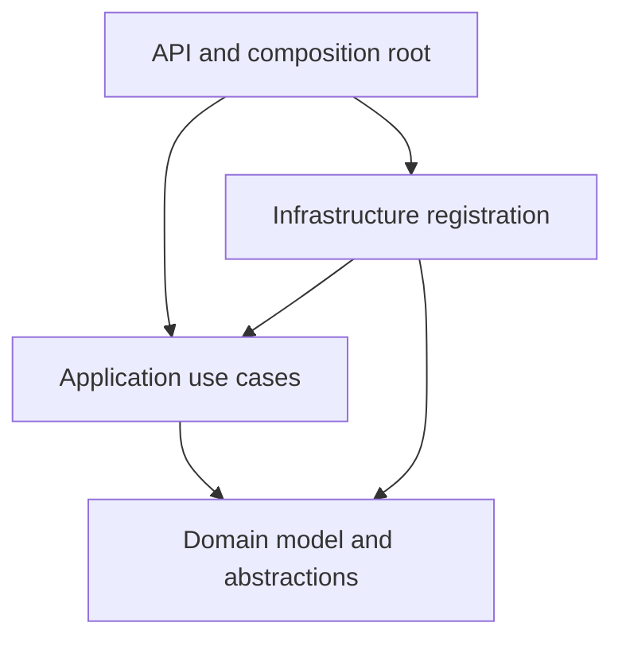

These arrows show **compile-time dependencies**, not runtime call order. At runtime an application handler invokes a repository abstraction whose implementation uses EF Core.

An endpoint authenticates the caller and maps an input DTO. The handler performs resource authorization, loads the root, invokes behavior, stages reliable side effects, and commits. Domain code must not use an HTTP request or EF `DbContext` to enforce core rules.

**Follow-up:** Where are repository interfaces? Domain if they represent aggregate collection concepts, or Application if they serve use-case needs. Be consistent about dependency direction rather than arguing that one folder is mandatory.

**Interview tip:** Explain a full request path and identify where the business rule runs.

### 13. What is CQRS, and how does it fit DDD?

**Interview answer:** CQRS separates the model/path used to change state from the model/path used to read it. Commands express intent; queries return data without business state changes.

An `IssueInvoice` command uses the aggregate to enforce rules. An `InvoiceSummary` query projects selected columns into a DTO and avoids loading all invoice lines.

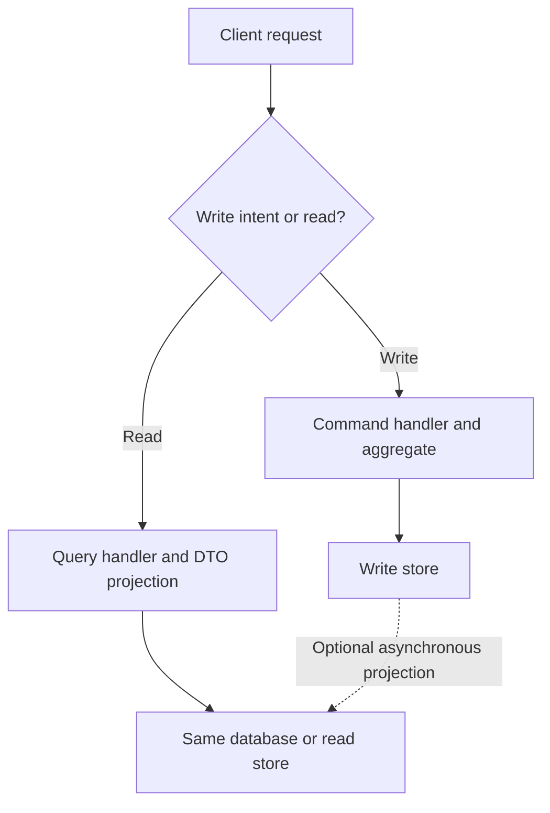

Separate databases, a message broker, MediatR, and event sourcing are optional. Begin with separate code paths over one database if that meets requirements. Separate projections add latency, rebuild logic, and monitoring responsibilities.

**Follow-up:** What if the user cannot see a new invoice immediately? Return its ID and committed status, provide a direct read-after-write path, or expose projection progress. Never hide eventual consistency behind unexplained stale screens.

**Interview tip:** Distinguish CQRS from a library implementing request dispatch. [R5]

### 14. How do you manage transactions across aggregates and services?

**Interview answer:** Use a local ACID transaction for an immediate invariant within one persistence boundary. Use a saga/process manager when a business workflow spans independently committed services.

A saga coordinates local transactions and compensating actions. A compensation is a new business operation, such as a refund, rather than a database rollback of a remote commit.

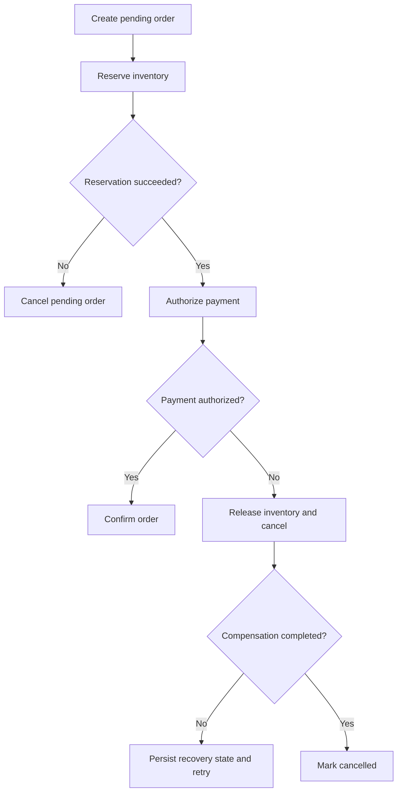

**Orchestration** uses an explicit coordinator, giving visible state and centralized recovery logic. **Choreography** uses reacting participants, reducing central control but making large workflows harder to trace. Neither removes the need for idempotency, correlation IDs, timeouts, and durable state.

If two roots within the same database must change atomically for a valid requirement, a local transaction may be reasonable. If this is the dominant interaction, reconsider whether they are one consistency boundary. Across services, do not imply that an ordinary EF transaction makes remote writes atomic.

**Follow-up:** What if compensation fails? Persist that state, retry transient failures, alert on exhausted recovery, and provide a controlled resolution path.

**Interview tip:** Describe pending and failed states as carefully as success. [R6]

### 15. Anemic vs rich domain model?

**Interview answer:** An anemic model stores data while external procedural services enforce most rules. A rich model combines state and relevant behavior, protecting invariants through its API.

```csharp
// Anemic: callers can create contradictory combinations.
public sealed class InvoiceData
{
    public string Status { get; set; } = "Draft";
    public decimal Total { get; set; }
}

// A rich API expresses business intent:
// invoice.AddLine(description, charge);
// invoice.Issue();
// invoice.Cancel(reason);
```

Rich does not mean entities must send email, run SQL, or perform authorization against an HTTP token. Keep business behavior in the model and technical orchestration outside it.

A data-centric CRUD service can reasonably use a simpler model. The problem is paying for rich-model infrastructure while still allowing rules to be bypassed by public setters.

**Follow-up:** Can domain services coexist with a rich model? Yes, for rules that do not fit naturally on one object.

**Interview tip:** Show a forbidden transition that a method prevents.

### 16. How do you identify bounded contexts in a monolith?

**Interview answer:** Discover business capabilities and language boundaries with domain experts, then compare them with ownership, workflows, and transaction needs.

Event Storming is one useful collaborative technique: identify past-tense business events, commands that cause them, actors, policies, exceptions, and external systems. It is a discovery tool, not a rule that every event becomes a microservice.

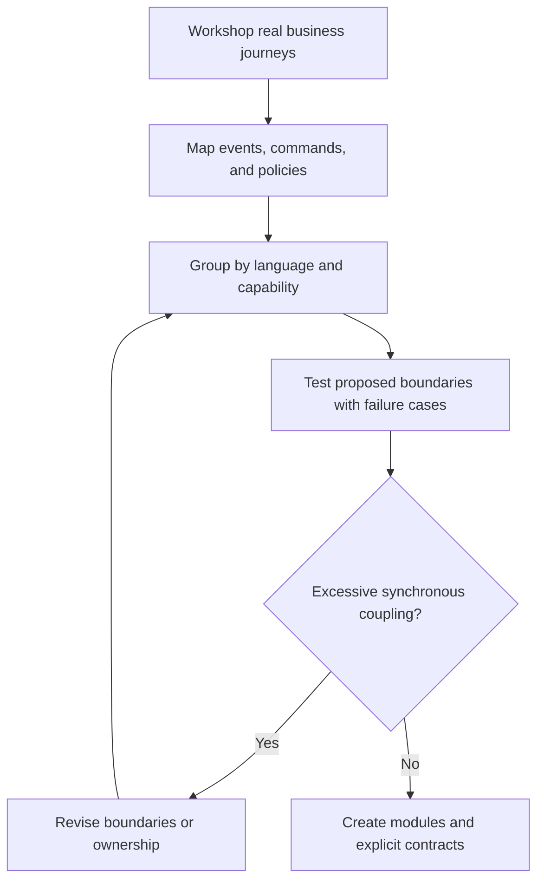

Use a difficult example to test the result. If Registration is unavailable, can Billing still issue an invoice using an owned account snapshot? If not, is that an actual requirement or accidental runtime coupling?

**Follow-up:** Can source-code folders reveal boundaries? They provide evidence, but existing technical organization may hide business boundaries.

**Interview tip:** Mention collaboration and validation, not only database analysis.

### 17. How does DDD work with microservices?

**Interview answer:** DDD informs service boundaries through coherent business models and ownership. Microservices add independent deployment and operational isolation, with distributed-system costs.

A service owns its writes and exposes APIs or events. Another context needing a patient name can use a permitted API or maintain a local projection of approved fields. It should not directly update Registration tables.

Avoid one microservice per entity. A service containing only `InvoiceLine` CRUD but requiring synchronous calls to `Invoice` for every change often breaks a natural consistency boundary.

Start with modular boundaries if independent deployment is unnecessary or operational maturity is limited. Extract a module when scaling, release autonomy, security, or team ownership provides enough benefit.

**Follow-up:** What is a distributed monolith? Separately deployed components that still require coordinated releases or tightly chained calls to perform routine work.

**Interview tip:** Discuss the operational cost: tracing, contract evolution, recovery, and on-call ownership.

### 18. How do you implement optimistic concurrency with EF Core?

**Interview answer:** Configure a concurrency token so updates succeed only when the persisted version matches the version originally read. A conflicting update produces `DbUpdateConcurrencyException`; the application must resolve it.

A SQL Server-specific mapping can use a `byte[]` property with `IsRowVersion()`. Other databases need their own supported version mechanism or an application-managed token.

```csharp
// Portable application-managed token; regeneration is your responsibility.
public Guid Version { get; private set; } = Guid.NewGuid();

// Inside each successful state-changing root operation:
// Version = Guid.NewGuid();

// In Infrastructure / EF entity configuration:
// builder.Property(x => x.Version).IsConcurrencyToken();
```

EF keeps the original token for the update predicate and writes the new token. All meaningful mutation paths must advance it. If only child rows change, ensure the root version is also updated so concurrent aggregate modifications conflict.

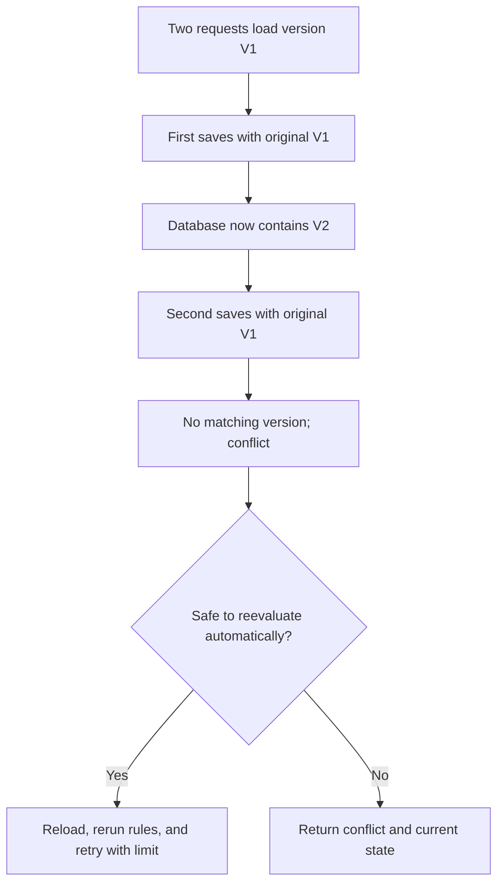

A typical API maps the conflict to HTTP 409. When using `If-Match` preconditions, 412 can be appropriate. To detect stale edits made before the request loaded the entity, compare a client-supplied expected version too; loading the latest row during the request alone does not detect that older user intent.

**Follow-up:** Retry every conflict? No. A second approval or a change to an issued invoice may be invalid after reload. Reapply intent and rules, not stale property assignments.

**Interview tip:** Explain the original-version predicate and business-aware conflict resolution. [R7]

### 19. What is Event Sourcing? Is it required?

**Interview answer:** Event Sourcing persists an ordered event stream as the authoritative state history. Current aggregate state is rebuilt by applying events. It is optional for DDD and CQRS.

An invoice stream might contain `InvoiceOpened`, `LineAdded`, `InvoiceIssued`, and `InvoiceCancelled`. Applying those events reconstructs the invoice. A separate projection supports searches and reports.

| Concern | Required design decision |
|---|---|
| Concurrent appends | Expected stream version |
| Large streams | Snapshots plus replay of later events |
| Event evolution | Compatible contracts or upcasters |
| Projection rebuild | Replay process and checkpointing |
| External side effects | Suppress or isolate them during replay |
| Sensitive historical data | Retention and privacy design |

A snapshot is a performance optimization, not a substitute for the event stream. An audit table added to a state-based application does not automatically make it event sourced.

**Follow-up:** Can old events be edited? Treat them as immutable business history; corrections normally use new events. Schema evolution must preserve their interpretation.

**Interview tip:** Explain why history as the source of truth is worth the added complexity for the chosen domain. [R8]

### 20. How do you migrate a legacy monolith toward DDD-based services?

**Interview answer:** Discover domain boundaries, establish modular ownership, and gradually replace capabilities through a Strangler Fig migration. Protect new models with an ACL.

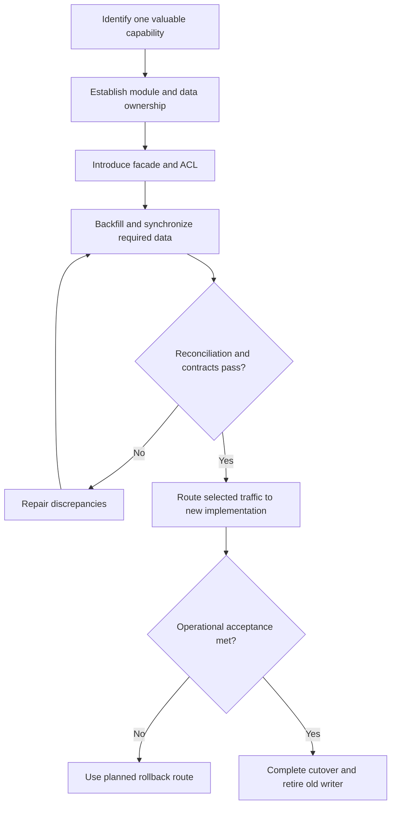

Choose one authoritative writer at every migration stage. Avoid uncoordinated writes to old and new databases: one can succeed while the other fails. Use a deliberate replication mechanism, such as an outbox or change-data capture, and reconcile before ownership changes.

Define measurable acceptance criteria: correctness, latency, failed-message age, recovery time, and release independence. Once the new system accepts writes, rolling back routing may require reverse synchronization; plan this before cutover.

**Follow-up:** Must the destination be microservices? No. A well-structured modular monolith may satisfy the goal with less operational cost.

**Interview tip:** A migration answer needs data ownership and rollback strategy, not only an API gateway.

## Architecture scenarios

### 21. Design hospital billing using DDD

**Proposed model:** Billing contains `Invoice`, `Payment`, and possibly `Refund` roots. `InvoiceLine` is an invoice child; `Money` and `BillingPeriod` are value objects. Registration owns demographics, while Billing owns billing-account facts and permitted snapshots.

**Rules:** A draft invoice can change; an issued invoice needs a correction workflow; a payment cannot be allocated beyond its available balance. If invoices can contain unbounded lines, reconsider that boundary before implementing it.

Issuing an invoice commits its state and an `InvoiceIssuedV1` outbox record. Payment processing remains a separate lifecycle. A projection supplies the patient's balance and outstanding invoices without loading all roots.

**Failure discussion:** Payment-provider timeouts produce an unknown/pending status until reconciled; do not assume failure and charge again. Use provider idempotency keys and payment attempt identities.

**Interview tip:** Explicitly distinguish an invoice from a payment and identify which invariant each root owns.

### 22. Payment succeeds but inventory reservation fails

First clarify whether “succeeds” means authorization or captured funds. If funds are merely authorized, void the authorization; if captured, request a refund. These have different timing and business consequences.

A durable saga records the failed reservation, schedules compensation, and exposes `RefundPending` until confirmation. A timeout is an unknown result: query the provider using the payment identity before repeating a financial operation.

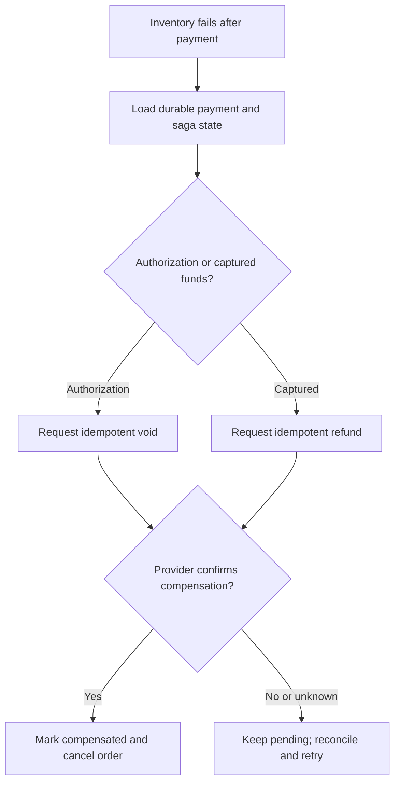

**Interview tip:** Never promise that refunds are instantaneous or that a timeout proves no charge occurred.

### 23. Two services need the same patient information

Define ownership at field level. Registration may own a legal name; Billing may own a billing contact and payer reference. They need not share a mutable entity.

For occasional fresh reads, call the owner's API with a timeout and a defined unavailable response. For high-volume resilient reads, maintain an authorized local projection from integration events. Accept and monitor its staleness, and propagate corrections or deletions according to the data contract.

Use a stable cross-context identifier and an ACL to translate external data. Do not copy more sensitive fields than the receiving capability requires.

**Interview tip:** Explain both ownership and the acceptable age of the copied data.

### 24. An aggregate contains 100,000 children. What do you do?

Do not start by loading all children or adding lazy loading. Ask which invariant requires the entire collection and whether the children actually have independent lifecycles.

Split independent records into roots referenced by ID. Use paginated read models for display. If enforcing a capacity or allocation limit, consider a small reservation/counter aggregate with concurrency protection, backed by suitable constraints, rather than summing all historical children on every command.

If a full-set rule truly requires atomicity, consider a different representation or a database operation that enforces it atomically. Splitting without preserving the rule trades correctness for speed unintentionally.

**Interview tip:** “Use pagination” solves a read issue; it does not fix an incorrectly large write boundary.

### 25. A domain/integration event is delivered twice

For broker-delivered integration events, implement an inbox or processed-message table with a unique key on `(ConsumerName, MessageId)`. Commit the deduplication record and business effect in one local transaction, then acknowledge the broker message.

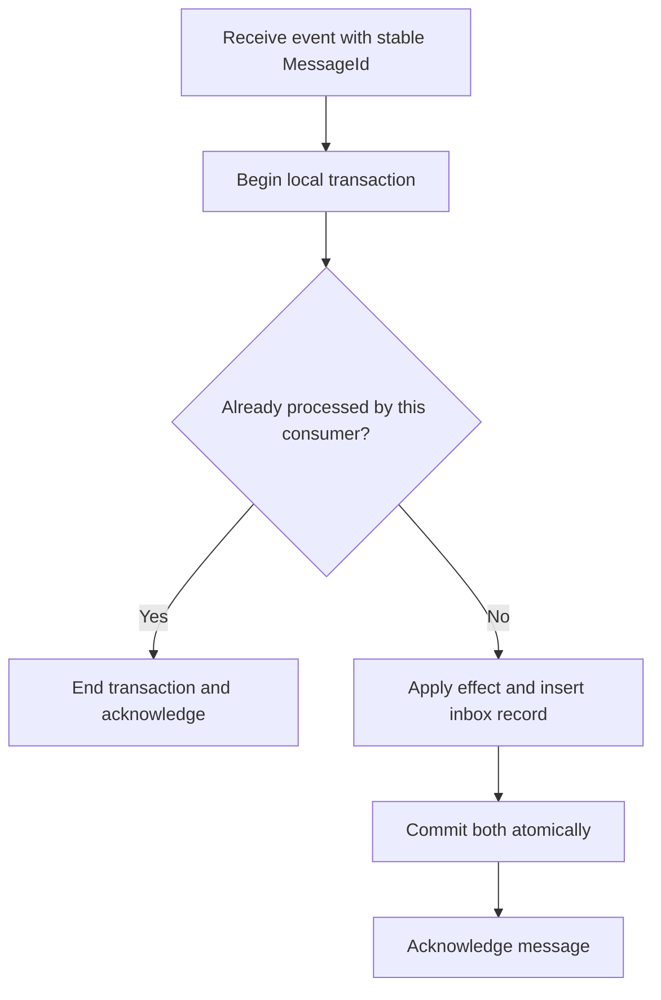

The pre-check alone is insufficient under concurrent delivery. A unique constraint must resolve the race; if inserting fails, roll back that transaction and verify duplicate status safely. A crash after commit but before acknowledgment is harmless on redelivery when deduplication is correct.

For an external effect such as charging a card, a local inbox cannot atomically include the provider. Use a durable outbound operation and a provider idempotency key or reconciliation workflow. In-memory domain handlers can also need protection if use cases are retried.

**Interview tip:** Say “effectively once for this effect under these assumptions,” not universal end-to-end exactly-once delivery.

### 26. Reporting queries are slow with a rich domain model

Keep command behavior rich, and build query-specific DTOs. Project only required columns, use appropriate indexes and bounded pagination, and avoid tracking for read-only EF queries when appropriate.

For expensive cross-context reports, build a reporting projection or warehouse. An event-driven projection needs checkpoints, deduplication, lag metrics, and a rebuild plan. A report requiring strict freshness may instead need an owner-provided query or a clearly defined synchronization point.

**Interview tip:** Do not weaken aggregate encapsulation just to make every report navigate its object graph.

### 27. Business rules differ across countries

Model variation explicitly with policies selected from validated business context. For example, `ITaxPolicy` can have jurisdiction-specific implementations. Give policies effective dates and versions when rules change over time.

Keep one bounded context when language and lifecycle remain coherent. Consider separate contexts when countries differ materially in terminology, ownership, process, and regulation. A `switch` with hundreds of unrelated branches suggests a missing abstraction, but a small stable choice does not require a plugin framework.

Store the applied policy version and inputs where decisions must be explained later. Recalculating an old invoice with today's rules can change its historical meaning.

**Interview tip:** Discuss temporal validity, not just Strategy-pattern class names.

### 28. Teams disagree about domain terminology

Walk through real examples with domain experts. Determine whether the disagreement is ambiguity inside one model or evidence of different models.

If “customer” means the invoice payer in Billing but the patient in Registration, preserve each context's meaning and translate through a context map. If both teams own one context, agree on a definition, update code and documentation, and record the decision.

**Interview tip:** A single global glossary can conceal real differences; do not force identical models merely for naming consistency.

### 29. The database schema does not match domain entities

Use persistence mapping and repositories to reconstruct the model. Legacy names and normalized tables do not need to dictate public domain methods. Map private state, value objects, and relationships in Infrastructure where supported.

When the mismatch becomes substantial, introduce persistence DTOs and explicit mapping, or place an ACL in front of the legacy system. Evaluate the cost: duplicated models require mapping tests and change coordination.

Persistence independence does not mean ignoring query plans, indexes, or transaction limits. Ensure the mapped representation can enforce invariants and concurrency requirements.

**Interview tip:** Demonstrate how one root maps to multiple tables without exposing those tables as public services.

### 30. One service requires data from five contexts

Clarify whether this is a screen, a report, or a command enforcing a rule.

| Need | Suitable starting point | Main trade-off |
|---|---|---|
| Occasional current-data screen | API composition or BFF | Latency and partial failures |
| Frequently accessed dashboard | Local materialized projection | Staleness and rebuild cost |
| Historical analytics | Reporting store or warehouse | ETL and freshness |
| Command needing remote facts | Explicit owner contract, reservation, or workflow | Consistency and availability |

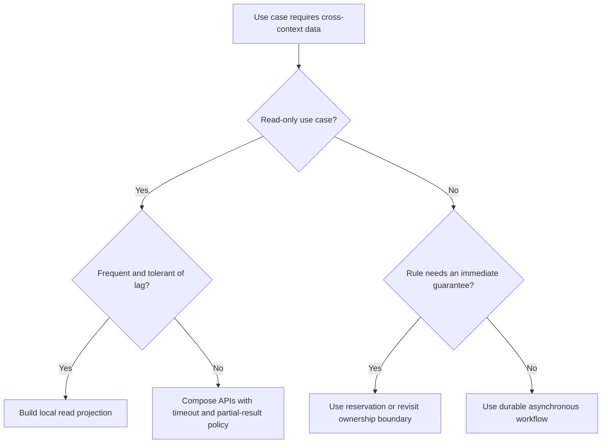

Parallel API calls can reduce latency but do not remove runtime dependency on all five owners. Use deadlines, caching where valid, and explicit partial-result behavior. A stale projection should not enforce a strict current stock or credit limit unless the business explicitly accepts that risk.

**Interview tip:** Read optimization and command correctness require different reasoning.

## End-to-end ASP.NET Core example

This condensed example ties aggregates, domain events, concurrency, and an outbox together. It is illustrative code, not a complete runnable application. Namespaces, EF mappings, API registration, authentication, repository implementations, broker worker, and operational controls are omitted deliberately and described below.

### Domain: protect invoice transitions

```csharp
public enum InvoiceStatus { Draft, Issued }

public interface IDomainEvent { }

public sealed record InvoiceIssuedDomainEvent(
    Guid InvoiceId, decimal Amount, string Currency) : IDomainEvent;

public sealed class InvoiceLine
{
    public Guid Id { get; private set; }
    public string Description { get; private set; } = "";
    public Money Charge { get; private set; } = null!;

    private InvoiceLine() { } // Persistence constructor

    internal InvoiceLine(string description, Money charge)
    {
        Id = Guid.NewGuid();
        Description = description;
        Charge = charge;
    }
}

public sealed class Invoice
{
    private readonly List<InvoiceLine> _lines = new();
    private readonly List<IDomainEvent> _events = new();

    public Guid Id { get; private set; }
    public string Currency { get; private set; } = "";
    public InvoiceStatus Status { get; private set; }
    public Guid Version { get; private set; }
    public IReadOnlyCollection<InvoiceLine> Lines => _lines.AsReadOnly();
    public IReadOnlyCollection<IDomainEvent> Events => _events.AsReadOnly();
    public decimal Total => _lines.Sum(x => x.Charge.Amount);

    private Invoice() { } // Persistence constructor

    public Invoice(Guid id, string currency)
    {
        if (id == Guid.Empty) throw new ArgumentException("Invoice ID required.");
        Id = id;
        Currency = new Money(0, currency).Currency;
        Status = InvoiceStatus.Draft;
        Version = Guid.NewGuid();
    }

    public void AddLine(string description, Money charge)
    {
        if (Status != InvoiceStatus.Draft)
            throw new InvalidOperationException("Only draft invoices accept lines.");
        if (string.IsNullOrWhiteSpace(description))
            throw new ArgumentException("Description required.");
        if (charge.Amount <= 0 || charge.Currency != Currency)
            throw new ArgumentException("Positive charge in invoice currency required.");

        _lines.Add(new InvoiceLine(description.Trim(), charge));
        Version = Guid.NewGuid();
    }

    public void Issue()
    {
        if (Status != InvoiceStatus.Draft)
            throw new InvalidOperationException("Invoice must be draft.");
        if (_lines.Count == 0)
            throw new InvalidOperationException("At least one line required.");

        Status = InvoiceStatus.Issued;
        Version = Guid.NewGuid();
        _events.Add(new InvoiceIssuedDomainEvent(Id, Total, Currency));
    }

    public void ClearEvents() => _events.Clear();
}
```

`Money` is defined in question 3. The root never returns its mutable backing lists, enforces currency consistency, and advances the version when a child is added. This model assumes invoice line counts are bounded to a practical size.

### Application: orchestrate one local commit

```csharp
public sealed record IssueInvoice(Guid InvoiceId, Guid ExpectedVersion);

public sealed record InvoiceIssuedV1(
    Guid InvoiceId, decimal Amount, string Currency);

public sealed record OutboxMessage(
    Guid Id, DateTimeOffset OccurredAt, string Type, string Payload);

public interface IOutbox
{
    void Add(OutboxMessage message);
}

public sealed class IssueInvoiceHandler
{
    private readonly IInvoiceRepository _invoices;
    private readonly IOutbox _outbox;
    private readonly IUnitOfWork _unitOfWork;

    public IssueInvoiceHandler(
        IInvoiceRepository invoices, IOutbox outbox, IUnitOfWork unitOfWork)
    {
        _invoices = invoices;
        _outbox = outbox;
        _unitOfWork = unitOfWork;
    }

    public async Task Handle(IssueInvoice command, CancellationToken ct)
    {
        var invoice = await _invoices.GetAsync(command.InvoiceId, ct)
            ?? throw new KeyNotFoundException("Invoice not found.");

        // Resource-level authorization must run before modification.
        if (invoice.Version != command.ExpectedVersion)
            throw new InvalidOperationException("Stale invoice version.");

        invoice.Issue();

        foreach (var e in invoice.Events.OfType<InvoiceIssuedDomainEvent>())
        {
            var contract = new InvoiceIssuedV1(e.InvoiceId, e.Amount, e.Currency);
            _outbox.Add(new OutboxMessage(
                Guid.NewGuid(), DateTimeOffset.UtcNow, "billing.invoice-issued.v1",
                System.Text.Json.JsonSerializer.Serialize(contract)));
        }

        // Repository, outbox, and Unit of Work MUST share one DbContext.
        // With a transactional relational provider, these changes commit together.
        await _unitOfWork.SaveChangesAsync(ct);
        invoice.ClearEvents();
    }
}
```

**Infrastructure obligations:**

1. Load tracked invoice state, including the lines required by `Issue()`; configure private collections and monetary value mapping explicitly.
2. Mark `Version` as a concurrency token. Exclude `Events` and calculated `Total` from persistence.
3. Stage outbox messages in the same transactional database and `DbContext` as invoice changes. A different context/database does not provide this atomicity automatically.
4. Dispatch with a durable worker. Claim pending rows safely when workers run concurrently; retry failures and preserve each outbox ID as the broker message ID.
5. Map not-found, stale-version, invalid-transition, and EF concurrency errors to explicit API responses. Production code should use distinct error types or typed results rather than mapping every `InvalidOperationException` to one status.
6. After a failed save, discard/reload the unit of work and reexecute safely; do not reuse a partially failed tracked graph blindly. Protect command retries with an idempotency design when required.

The handler shows event-to-contract translation explicitly. A larger system may use dedicated handlers and a carefully defined dispatch lifecycle. Neither approach should publish to the broker before the local transaction commits.

### Meaningful tests to describe in an interview

| Test | Expected behavior |
|---|---|
| Issue an empty invoice | Rejected; no event or committed change |
| Add a negative or wrong-currency charge | Rejected |
| Add a line after issuing | Rejected |
| Issue a valid draft | Status changes; event recorded; version advances |
| Save concurrent updates from the same original version | One succeeds; another conflicts |
| Fail the state/outbox transaction | Neither invoice change nor outbox row commits |
| Crash after broker publish but before marking sent | Retry may duplicate delivery; consumer effect remains idempotent |
| Fail before consumer transaction commits | Business effect and inbox entry both roll back |

Domain tests run without a database. Mapping, transaction, unique-constraint, and concurrency tests need the actual database provider or a faithful integration environment; an in-memory substitute may not reproduce them.

## Interview tips and answer framework

### A reliable two-minute structure

1. **Define:** Give a clear definition in one or two sentences.
2. **Model:** Name the business concept and the invariant.
3. **Boundary:** Identify the context, aggregate, and transaction owner.
4. **Failure:** Explain concurrency, retries, or partial failure.
5. **Trade-off:** Explain the benefit, cost, and simpler alternative.

**Example answer: Aggregate root**

> An aggregate root controls changes inside a consistency boundary. In Billing, Invoice owns its lines and prevents issuing an empty invoice or adding charges after issue. The application loads the root, invokes Issue, and commits with a concurrency token. Payment is a separate lifecycle, coordinated by a durable workflow when necessary. I keep the aggregate small enough to avoid loading payment history on every invoice update, while preserving rules that require immediate consistency.

### Senior interview habits

- Clarify whether consistency must be immediate or whether a pending state is acceptable.
- Separate compile-time dependencies from runtime calls when explaining architecture.
- Discuss both a normal request and a crash at the worst possible point.
- Explain ownership before choosing databases, services, or Azure components.
- Give reasons for adding abstractions; avoid automatic repositories, events, and services everywhere.
- Use a real project example only for work you actually performed. Describe proposed improvements as proposed.
- When challenged, revisit assumptions and invariants rather than defending a pattern name.
- Mention operational signals: outbox age, projection lag, repeated conflicts, dead-letter growth, and stuck saga states.

### Common weak answers and stronger alternatives

| Weak claim | Stronger answer |
|---|---|
| DDD means microservices | DDD models the business; deployment is a separate choice |
| Every table needs a repository | Repositories typically expose aggregate roots; reports use read models |
| All related entities belong in one aggregate | Immediate invariants and lifecycle determine the boundary |
| Domain events must use a broker | Internal events and public integration messages have different contracts |
| Save, then publish, is reliable | Persist an outbox with the state change to close the crash gap |
| Broker deduplication solves everything | Consumer and external side effects also need idempotency |
| Saga rolls back all services | Saga executes compensating business actions that can themselves fail |
| CQRS requires two databases | Separate models/paths can share one database |
| Audit logging means Event Sourcing | Event Sourcing uses events as authoritative state |
| Retry a concurrency conflict unchanged | Reload and reevaluate business intent and rules |
| Rich models should handle HTTP and EF | Keep business behavior independent of transport and persistence |
| Asynchronous always means better | It trades temporal coupling for lag and recovery complexity |

### Project explanations you can adapt

**Live scoring:** A scoring model might distinguish a match's current scoring state from its unbounded historical delivery log. Ask which updates must be atomic, protect concurrent scorers, and broadcast committed score changes. SignalR is a delivery mechanism; it does not itself establish event durability or aggregate correctness.

**Protocol authoring:** Authoring, Review, and Export could be candidate contexts if their language and ownership differ enough. A review decision might reference a specific section revision so later edits can invalidate approval. Avoid placing every section, source chunk, and audit event inside one giant Study aggregate. These are modeling suggestions, not claims about an existing implementation.

### Questions to ask the interviewer

- Which business rules must hold at commit time?
- Who owns each field and is permitted to change it?
- What is the expected volume and contention per aggregate?
- How long may cross-context data be stale?
- What happens after a timeout when the remote result is unknown?
- Who operates recovery when automatic compensation fails?

## Revision checklist

- [ ] Define DDD, core/supporting/generic subdomains, and bounded contexts.
- [ ] Explain entity identity and value-object equality with one example.
- [ ] Design an aggregate from invariants rather than table relationships.
- [ ] Explain application services, domain services, and infrastructure adapters.
- [ ] Describe repository/Unit of Work trade-offs with EF Core.
- [ ] Trace a state change through an outbox and an idempotent consumer.
- [ ] Compare a local transaction, saga, and compensation.
- [ ] Handle concurrent edits without blindly overwriting business decisions.
- [ ] Distinguish DDD, Clean Architecture, CQRS, and Event Sourcing.
- [ ] Explain migration ownership, reconciliation, and rollback.
- [ ] Practice all ten scenarios with assumptions and failure cases.

**Three-session study plan:** Session 1: questions 1–8 and 15–17. Session 2: questions 9–14 and 18–20, drawing the outbox and concurrency flows from memory. Session 3: scenarios 21–30 and a timed explanation of the end-to-end example.

## Static-site publishing notes

This file uses ordinary Markdown, optional YAML front matter, fenced C# blocks, and fenced Mermaid blocks. It has no required external images or site-specific components.

- Enable Mermaid in the site's Markdown pipeline or theme. GitHub's Markdown viewer supports Mermaid, but many static-site generators require explicit configuration.
- Keep the language identifier `mermaid` on diagram fences and `csharp` on C# fences.
- Diagram labels use quoted text, including labels with punctuation, to avoid common Mermaid parser errors.
- If your generator does not accept YAML front matter, remove the opening metadata block.
- The contents links follow common GitHub-style heading slugs. If your theme generates different anchors, adjust links or enable its automatic table of contents.
- Code is for interview explanation. Use your project's supported .NET/EF Core version and database-specific mappings when implementing it.

## References

The supplied **DDD Interview Questions.pdf** defines the question coverage. Answers and examples are expanded for this guide. The references below support specific concepts; the guide's scenarios, code, and study priorities are illustrative synthesis.

- **R1:** Martin Fowler, [Bounded Context](https://martinfowler.com/bliki/BoundedContext.html): model boundaries and language.
- **R2:** Microsoft, [Domain events: design and implementation](https://learn.microsoft.com/en-us/dotnet/architecture/microservices/microservice-ddd-cqrs-patterns/domain-events-design-implementation): internal events and integration-event distinctions.
- **R3:** Microsoft Azure Architecture Center, [Transactional Outbox](https://learn.microsoft.com/en-us/azure/architecture/databases/guide/transactional-out-box-cosmos): atomic business-state/event persistence. The page's implementation uses Cosmos DB; this guide's relational example uses a local database transaction.
- **R4:** Microsoft Azure Architecture Center, [Anti-Corruption Layer](https://learn.microsoft.com/en-us/azure/architecture/patterns/anti-corruption-layer): semantic isolation from external models.
- **R5:** Martin Fowler, [CQRS](https://martinfowler.com/bliki/CQRS.html): separation of command and query models.
- **R6:** Microsoft Azure Architecture Center, [Saga](https://learn.microsoft.com/en-us/azure/architecture/patterns/saga): local transactions and compensation.
- **R7:** Microsoft, [Handling concurrency conflicts in EF Core](https://learn.microsoft.com/en-us/ef/core/modeling/concurrency): tokens, conflict detection, and resolution.
- **R8:** Martin Fowler, [Event Sourcing](https://martinfowler.com/eaaDev/EventSourcing.html): rebuilding state from events.

Reference pages checked on 21 October 2026. Adapt implementation details to the runtime and database used by your project.
